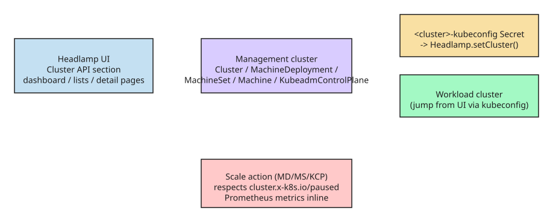

# Managing Cluster API Resources with the Headlamp Plugin

[Headlamp](https://headlamp.dev) is an open-source, extensible Kubernetes SIG UI project for exploring, managing, and debugging cluster resources from a browser. The **Cluster API plugin** (alpha release, June 2026) adds a dedicated Cluster API section to Headlamp, bringing visual clarity to the declarative cluster lifecycle management that [Cluster API](https://cluster-api.sigs.k8s.io/) provides — historically something you could only do with raw `kubectl` commands and deep familiarity with CAPI ownership hierarchies.

## What the plugin adds

| Feature | Description |
| --- | --- |
| Cluster overview | Clusters with live control plane and worker replica status |
| Machine visibility | Inspect MachineDeployments, MachineSets, Machines, and MachinePools with status and conditions |
| CAPI dashboard | Centralized view of resource health, active condition issues, provider info, remediation guidance |
| Control plane monitoring | Track KubeadmControlPlane replicas, versions, and associated Machines |
| Scale from the UI | Scale MachineDeployments and MachineSets directly in Headlamp |
| Owned resource hierarchy | Trace relationships between clusters, deployments, sets, and machines |
| KubeadmConfig inspection | View bootstrap configs, files, kubelet args, join/init settings without opening YAML or secrets |
| Topology awareness | Automatically detect and label ClusterClass-managed resources (warns when manual changes may be overwritten) |
| Map view | Visualize Cluster → control plane → worker relationships in Headlamp's map feature |
| Dynamic API versioning | Supports both `v1beta1` and `v1beta2` CAPI versions |
| Prometheus metrics | Live metrics from the Headlamp Prometheus plugin inline on CAPI resource detail pages |

## Key views

- **Dashboard** — summarizes status of clusters, Machines, MachineDeployments, MachinePools, MachineSets, and control planes; highlights active condition issues, provider information, and configuration template counts. When issues are detected it provides remediation guidance and diagnostic commands.
- **Cluster list / detail** — all Cluster resources in the management cluster with replica status at a glance; the detail page shows resource status, conditions, infrastructure references, control plane references, and related Machines on one page.
- **Machine views** — dedicated pages for MachineDeployments, MachineSets, Machines, MachinePools: replica counts, ownership relationships, provider IDs, versions, conditions. Built-in Scale action adjusts replica counts without terminal commands.
- **KubeadmConfig inspection** — inline files, kubelet arguments, extra volumes, join/init settings.
- **Map view** — visualizes the Cluster / control plane / worker relationship graph; a faster way to understand ownership hierarchies than reading YAML.

## How it works under the hood

From the plugin source (`headlamp-k8s/plugins`, `plugins/cluster-api`):

- A centralized registration helper, `registerClusterApiResource`, creates sidebar entries, list/detail routes, and kind icons for each CAPI resource type consistently.
- `CapiRouteWrapper` detects whether CAPI CRDs exist on the management cluster; if not, it redirects to an empty-state dashboard — so the plugin is safe to install in clusters without CAPI.
- `useCapiApiVersion` / `getStoredVersionFromCrd` inspect the CRD's `spec.versions` and `status.storedVersions` to pick the active API version (`v1beta1` vs `v1beta2`) dynamically; resource classes use a `withApiVersion` static method, and printer columns are fetched from the CRD so UI tables match `kubectl` output for that environment.
- **Workload-cluster connection**: the plugin locates the generated `<cluster>-kubeconfig` Secret created by CAPI, base64-decodes it (using `TextDecoder` to handle binary certificate data), and calls `Headlamp.setCluster({ kubeconfig })` — so you can jump from the management cluster straight into a managed workload cluster.
- **Scaling**: a unified `ClusterScaleAction` dialog adjusts replica counts across worker groups and control plane simultaneously; it respects the `cluster.x-k8s.io/paused` annotation to halt reconciliation.
- **Owned-resource tracking**: sections filter the global machine list by `ownerReferences` and CAPI labels (e.g., `cluster.x-k8s.io/deployment-name`) to show which Machines belong to a given Cluster, MachineDeployment, or MachineSet.



## Installation and usage

- **Install**: open Headlamp → Plugin Catalog → search *Cluster API* → Install. (Published on Artifact Hub as `headlamp_cluster-api`; alpha/beta releases since April 2026.)
- **For developers**: clone the plugin repo and run it locally:

```bash
git clone https://github.com/headlamp-k8s/plugins.git
cd plugins/cluster-api
npm install
npm run start
```

- **Troubleshooting**: permission issues → check the Headlamp ServiceAccount; build errors → `rm -rf node_modules package-lock.json && npm install`.
- The plugin is provider-agnostic (Docker/CAPD, AWS, Azure, GCP, vSphere) and API-version-agnostic (`v1beta1`/`v1beta2`).

This is an **alpha release** — community feedback shapes what comes next. See `plugins/cluster-api/README.md` in the [headlamp-k8s/plugins](https://github.com/headlamp-k8s/plugins) repo for full installation and usage instructions.

## References

- [Introducing the Cluster API plugin for Headlamp](https://kubernetes.io/blog/2026-06-25/headlamp-cluster-api-plugin/) (Kubernetes blog, Chayan Das)
- [headlamp_cluster-api on Artifact Hub](https://artifacthub.io/packages/headlamp/headlamp-plugins/headlamp_cluster-api)
- [Cluster API plugin source and docs](https://github.com/headlamp-k8s/plugins/tree/main/plugins/cluster-api)
- [Headlamp plugin development docs](https://headlamp.dev/docs/latest/tutorials/plugin-development/)
