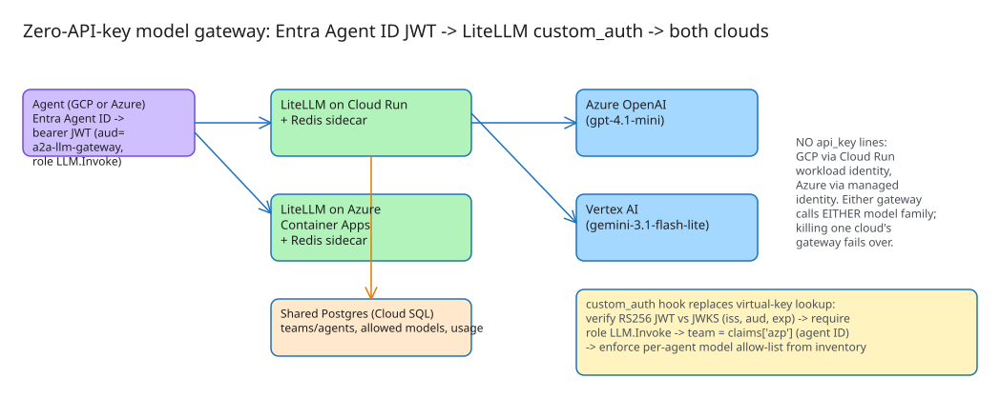

# Zero-API-Key Cross-Cloud LiteLLM Gateway: Entra Agent ID JWTs + Workload Identity Federation

Goal: agents on **GCP and Azure** reach models on **both clouds** through a LiteLLM Proxy deployed once per cloud, with **no API keys anywhere** on the agent→model path — inbound auth uses each agent's workload identity (Microsoft Entra Agent ID JWTs), outbound auth uses workload identity federation. One shared Postgres makes either gateway serve any agent.



## 1. Model catalogue — no key fields

```yaml
model_list:
  - model_name: gpt-4.1-mini
    litellm_params:
      model: azure/gpt-4.1-mini
      api_base: https://<your-resource>.openai.azure.com/
      api_version: "2024-10-21"
      azure_ad_token: oidc/google/api://AzureADTokenExchange   # GCP->Azure federation
  - model_name: gemini-3.1-flash-lite
    litellm_params:
      model: gemini/gemini-3.1-flash-lite
      # no api_key: workload identity (or external_account credential file)
litellm_settings:
  master_key: os.environ/LITELLM_MASTER_KEY   # admin only, never on agent path
  turn_off_message_logging: true               # keep usage, never prompts
```

Outbound trust per edge:
- **GCP → Gemini**: Cloud Run service account with Vertex AI role. Nothing to configure.
- **GCP → Azure OpenAI**: LiteLLM asks Google for an OIDC token; an Entra **federated credential** on the app registration accepts it (`azure_ad_token: oidc/google/api://AzureADTokenExchange`).
- **Azure → Azure OpenAI**: the Container App's managed identity.
- **Azure → Gemini**: reverse federation — managed-identity token exchanged at a **Google workload identity pool** via an `external_account` credential file (`credential_source.file: /var/run/fed/azure-token`, `service_account_impersonation_url` to the shared `litellm-runtime@…` service account); a sidecar keeps the Azure token file fresh; the pool accepts only that one managed identity as subject.
- **Both → Postgres**: `cloud-sql-proxy --auto-iam-authn --port=5432 <project>:<region>:<instance>` sidecar; database user *is* the service account, no password in the DSN.

## 2. Inbound: replace LiteLLM's key system with a JWT check

Agents authenticate via Entra Agent ID (`azure-identity`'s `ManagedIdentityCredential.get_token`, scope `api://a2a-llm-gateway/.default`) and send the JWT as a bearer token. LiteLLM's `custom_auth` hook validates it (registered via `litellm.proxy.proxy_server.custom_auth = custom_auth`):

```python
JWKS_URL = "https://login.microsoftonline.com/<TENANT_ID>/discovery/v2.0/keys"
AUDIENCE = "api://a2a-llm-gateway"

async def custom_auth(user_api_key, params, user_api_key_dict, **kwargs):
    claims = await verify_bearer(params)  # PyJWT: decode(token, key=jwks.get_signing_key, algorithms=["RS256"],
                                          #   audience=AUDIENCE, issuer=..., leeway=30)
    if claims.get("roles") != ["LLM.Invoke"]:
        raise HTTPException(status_code=403, detail="agent does not have LLM.Invoke")
    team = await lookup_team(claims["azp"])          # azp == the agent ID
    if model not in allowed_models(team):
        raise HTTPException(status_code=403, detail=f"{model} is not in {team}'s allow-list")
    return UserAPIKeyAuth(api_key=None, user_id=claims["azp"],
                          team_id=team["team_id"], team_alias=team["alias"],
                          metadata={"entra_object_id": claims["sub"]})
```

Per-agent allow-lists come from the onboarding inventory (`agents: [{name: gcp-agent, llm: {gateway: gcp, models: [gemini-3.1-flash-lite]}}]`); the pipeline assigns `LLM.Invoke` in Entra and creates the LiteLLM team. Requests outside the list are refused **before any provider is called**.

## 3. Cross-cloud failover

Same audience, role, and database on both gateways ⇒ the same token works on either; either gateway reaches both model families ⇒ provider-down and gateway-down are independent failures. Test: switch off the Azure gateway — the Azure agent's next answer arrives via the GCP gateway unchanged. Hard rule: **a refusal is not an outage** — never fail over on 401/403/429, that would route around policy.

## 4. Operations gotchas (from the authors)

- **One side owns the schema**: two LiteLLM instances migrating the same DB at startup is a race — run migrations on one, start the other with `DISABLE_SCHEMA_UPDATE=true`.
- **custom_auth failures all surface as 401** (LiteLLM maps hook exceptions), even logical 403s — clients must read the message, not just the code.
- **Pin the LiteLLM image version** — the hook imports proxy internals; an unpinned upgrade can break every agent's sign-in at once.
- **Per-minute rate limits are per cloud** (Redis counters are per-site): 60 req/min means 60 on each side.
- The shared Cloud SQL instance lives in one cloud — both gateways depend on it (top production hardening target).
- The admin master key stays in each cloud's secret manager, read by the gateway's identity; agents never see it.

## References

- [One Model Gateway Across Clouds: LiteLLM on Cloud Run and Azure with Zero API Keys — DEV.to (Google Developer Experts)](https://dev.to/gde/one-model-gateway-across-clouds-litellm-on-cloud-run-and-azure-with-zero-api-keys-3ma7)
- [LiteLLM proxy settings (turn_off_message_logging)](https://docs.litellm.ai/docs/proxy/settings)
- [Azure AD application properties (custom claims in tokens)](https://learn.microsoft.com/en-us/azure/active-directory/develop/reference-app-manifest)
- [Google workload identity federation](https://cloud.google.com/iam/docs/workload-identity-federation)

Related: [[explanation-office-party-libreoffice-ld-preload-skill-chain]]
