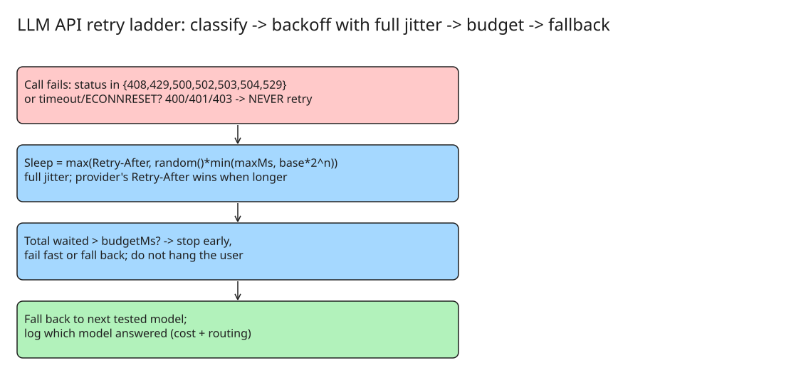

# How to Retry LLM API Calls: Exponential Backoff with Full Jitter, Retry-After, Budgets and Model Fallbacks

LLM APIs fail in predictable ways under load — **429** (rate limit), **5xx** (provider trouble), **529** (Anthropic's "overloaded" capacity response), timeouts. A production client retries *only those*, spreads retries so fleets don't stampede in lockstep, obeys the provider's `Retry-After`, gives up on a **time budget**, and only then **falls back to another model**. This note reproduces the tested pattern.



## Step 1 — Classify: which errors are retryable

| Response | Retry? | Why |
| --- | --- | --- |
| 429 Too Many Requests | Yes | Rate limit; wait as long as `Retry-After` says |
| 500, 502, 503, 504 | Yes | Provider/network trouble, usually brief |
| 529 (overloaded) | Yes | Capacity; often clears in seconds |
| 408, timeouts, `ECONNRESET` | Yes | The request may never have arrived |
| 400, 422 | **No** | Your request is wrong (too long, bad schema) — fails identically on every retry and every model |
| 401, 403 | **No** | Bad key or no permission |

A 400 from an over-long prompt is a context-window problem — fixed by trimming the conversation, never by waiting.

## Step 2 — Backoff with full jitter

Plain exponential backoff (0.5s, 1s, 2s, 4s) synchronises every client hit by the same outage into aligned waves. **Full jitter** picks a random delay in `[0, min(maxMs, base·2^n)]` — in AWS's published comparison of backoff strategies it was one of the two best performers and the simplest.

```js
const RETRYABLE = new Set([408, 429, 500, 502, 503, 504, 529]);

export class HttpError extends Error {
  constructor(status, retryAfter) {
    super(`HTTP ${status}`);
    this.status = status;
    this.retryAfter = retryAfter; // seconds, from the Retry-After header
  }
}

const isRetryable = (error) =>
  error instanceof HttpError
    ? RETRYABLE.has(error.status)
    : error.name === "TimeoutError" || error.code === "ECONNRESET";

/** Full-jitter exponential backoff honouring Retry-After, with a total-wait budget. */
export async function withRetry(call, {
  attempts = 4, baseMs = 500, maxMs = 20_000, budgetMs = 30_000,
  sleep, random = Math.random,
} = {}) {
  let waited = 0;
  for (let attempt = 1; ; attempt++) {
    try {
      return await call(attempt);
    } catch (error) {
      if (attempt >= attempts || !isRetryable(error)) throw error;
      const backoff = random() * Math.min(maxMs, baseMs * 2 ** (attempt - 1));
      const delay = error.retryAfter
        ? Math.max(error.retryAfter * 1000, backoff)
        : backoff;
      if (waited + delay > budgetMs) throw error;   // fail fast, don't hang the user
      waited += delay;
      await sleep(delay);
    }
  }
}
```

Three details that matter:

- **`Retry-After` wins** when longer than the computed backoff — the provider knows when capacity returns; retrying sooner earns another 429.
- **The budget** (`budgetMs`) stops a request hanging for minutes: if `Retry-After: 120` and a user waits on a chat reply, failing fast or falling back beats a two-minute spinner.
- **`attempts` counts the first call** — 4 means one call plus up to three retries.
- Injecting `sleep` and `random` as parameters makes the logic testable without real waiting.

## Step 3 — Model fallback only after a model's own retries are exhausted

```js
/** Try each model in order; move on only when a model's retries are exhausted on a retryable error. */
export async function withFallback(models, request, options) {
  let last;
  for (const model of models) {
    try {
      return await withRetry(() => request(model), options);
    } catch (error) {
      if (!isRetryable(error)) throw error; // a 400 will fail on every model too
      last = error;
    }
  }
  throw last;
}
```

Fallbacks change behaviour, so treat them deliberately: the fallback model must be **tested with your prompts**, handle your tool schemas, and fit the same context window. **Log which model answered each request** and include it in cost reporting — comparing by model name alone hides which deployment did the work.

## Step 4 — Verify with deterministic tests

The article's passing tests (Node.js 24) encode the contract:

- 503, 503, success → waits of exactly `[500, 1000]` ms (with `random: () => 1`).
- 429 with `Retry-After: 7` → waits 7000 ms, not 0.5 s.
- 400 → thrown immediately, `n === 1` (never retried).
- `Retry-After: 120` beyond budget → gives up without sleeping.
- Fallback: primary returns 529 on every attempt, secondary answers.

## Step 5 — Don't double-retry

Most provider SDKs already retry 429/5xx with backoff. Check their defaults before adding your own layer — three SDK retries inside four of yours is up to **16 calls** per request. **Own retry logic in exactly one place**; if several services share providers, that place is often an **LLM gateway** (e.g. LiteLLM) centralising retries, fallbacks and budgets.

## Related

- [[../../ai-machine-learning/rag/howto-hybrid-search-bm25-rrf]] — sibling reliability note for the retrieval side of an LLM stack.
- [[howto-litellm-zero-api-key-cross-cloud-gateway-entra-jwt]] — gateway pattern; centralising retries/fallbacks in an LLM gateway.

## References

- [Retrying LLM API calls: exponential backoff, jitter, Retry-After and model fallbacks — dev.to (Ali Ahmed)](https://dev.to/quantumbreakz/retrying-llm-api-calls-exponential-backoff-jitter-retry-after-and-model-fallbacks-1800)
- [Original article — aliahmed.si](https://aliahmed.si/blog/llm-api-retries-backoff-fallbacks/)
- [AWS Architecture Blog: Exponential Backoff and Jitter](https://aws.amazon.com/blogs/architecture/exponential-backoff-and-jitter/)
