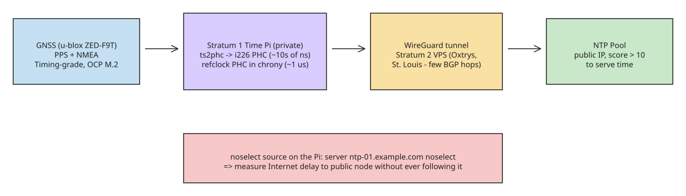

# Running a Public NTP Pool Node: Chrony, PHC Hardware Timestamping, and the Two-Tier Time Architecture

Jeff Geerling documents joining the NTP Pool with a public **Stratum 2** server (`ntp-01.jeffgeerling.com`) fed by his private **Stratum 1** Raspberry Pi "Time Pi" (`time.jeffgeerling.com`) — deliberately *not* exposing the Stratum 1 hardware directly. The post is a practical operator's guide to what hosting pool time actually requires.

## Requirements to join the NTP Pool

You do **not** need GNSS hardware. The pool's real requirements:

1. **Uptime** — servers are only made active after being online and serving good time consistently for a long period.
2. **Good time** — Stratum 1 (GNSS) works, but pulling from a few reliable upstreams and running Stratum 2 or 3 is fine.
3. **Stable IP** (IPv4 and/or IPv6) and a **long-term commitment** — "testing the waters" wastes pool resources; a new server takes hours just to spin up the pool's verification tests.

Two operational caveats before you sign up:

- Your server's **IP address becomes public** (Geerling was previously DDoSed for a month after exposing his home IP self-hosting on Pis).
- **NTP traffic decays slowly** — misconfigured clients can keep hitting your IP for months or *years* after you stop serving.

## The two-tier architecture (why not expose the GPS Pi)

```
GNSS antenna (u-blox ZED-F9T timing-grade, M.2 OCP spec)
      │  PPS + NMEA
TimeHAT v6 (Intel i226 NIC, hardware timestamping)
      │
Stratum 1 Time Pi (studio, private)  ──WireGuard──▶  Stratum 2 VPS (Oxtrys, St. Louis)
  chrony + linuxptp ts2phc                                public NTP Pool node
```

Rationale for each layer:

- **WireGuard tunnel** between Stratum 1 and Stratum 2 keeps the private GNSS host off the public internet and gives a stable path.
- **Cloud VPS close to you** (St. Louis was chosen for low latency / fewer BGP hops — fewer hops means better NTP accuracy).
- On the Stratum 1 Pi, the public node is added as a `noselect` source so it can be *measured but never followed*:

```
server ntp-01.jeffgeerling.com noselect
```

This yields a continuous Internet-delay comparison graph (against WWV Ft. Collins, NIST Boulder, Cloudflare). Note: singling out servers like this is for **measurement only** — production clients should use pool addresses, and Geerling polls these only every 1024 s. BGP rerouting shows up as step changes in Cloudflare's latency line.

## Precision timing on the Pi (Stratum 1 side)

- `linuxptp`'s **`ts2phc`** disciplines the i226 NIC's **PHC (PTP Hardware Clock)** directly from the GNSS module's **PPS pin** — accuracy within **tens of nanoseconds** of UTC.
- The PHC feeds the system clock via **`refclock PHC` inside chrony** instead of `phc2sys` — this fixed intermittent **~200 ms clock jumps**. System-clock accuracy bottoms out around **1 µs** because the pulse crosses the PCIe bus (unmeasurable latency; the BCM2712 lacks PCIe PTM, and `rp1-ptp-pps` work targets the deterministic GPIO/PPS path).

### Configuration traps hit in practice

1. **Debian's default `sourcedir /run/chrony-dhcp`** silently injected a DHCP-provided NTP server, which stampededed the GNSS-derived time with a much less accurate public source — another reason to steer clocks in chrony rather than `phc2sys`.
2. **`unattended-upgrades` rebooted the VPS** mid-post: a new Debian kernel took the server offline; the NTP Pool score had to recover past **10** before it served again, taking **6–12 hours**. Mitigation: keep automatic package upgrades, **disable automatic reboots**.
3. Some provider firewalls auto-block public NTP servers because pure-UDP traffic *looks* like abuse — vet the hoster (Cloudflare cannot proxy NTP; UDP proxying needs paid Spectrum and would hurt accuracy anyway).

## NTS status

Network Time Security (NTS) is **not yet supported by the NTP Pool** (only community experiments). Geerling's stance: run basic NTP, and don't rely *only* on NTP for critical timing.

## Operational checklist

- [ ] Stable IPv4/IPv6, provider aware you're running a public UDP/123 service.
- [ ] chrony steering only (no `phc2sys` double-steering); remove `sourcedir /run/chrony-dhcp` on Debian.
- [ ] Upstream = GNSS Stratum 1 over a private tunnel, or several trustworthy pool upstreams.
- [ ] Automatic reboots disabled; maintenance windows planned — score recovery costs 6–12 h.
- [ ] `chronyc tracking` exported to monitoring (e.g. chrony_exporter → Prometheus; alert on offset > 50 ms or stratum > 3).
- [ ] Commit: don't vanish months after joining — orphaned client traffic is the pool's tax.



## Related notes

- `cloud-infrastructure/incident-response/explanation-telstra-ntp-timing-loop-outage.md` — what happens when timing infrastructure fails at scale.

## Corroboration (KB Zookeeper, 2026-11-23)

Checked against the official NTP Pool participation page:

- **Static IP is mandatory** ("once a year or less" change tolerance) plus a permanent connection — matches the note's stable-IP requirement.
- **Bandwidth bar is low**: ~5–15 NTP packets/s steady, spikes of 60–120 pkt/s a few times a day (~10–15 Kbit/s, spikes to ~120 Kbit/s); the page suggests at least 384–512 Kbit/s.
- **Stratum 3 (even 4) is explicitly acceptable** — the pool is load distribution, not a hardware club; only Stratum 1/2 upstreams being "nice" is folklore.
- **Upstream rule**: joining servers *should not* use pool.ntp.org as their configured upstream — pick good static upstreams (which may themselves be pool members). This complements the note's "several trustworthy pool upstreams" checklist item with the anti-pattern to avoid.
- **Decay warning is official wording too**: after leaving, client traffic "will take weeks, months or even YEARS before the traffic completely goes away."
- Servers are continuously monitored for availability and precision after joining; scores are visible on the public scores page (the note's score>10 recovery detail is the operational consequence).

## References

- **Jeff Geerling — I joined the NTP Pool, but not with my Stratum 1 Pi**: https://www.jeffgeerling.com/blog/2026/i-joined-the-ntp-pool/
- **NTP Pool — official "Join the pool" requirements page**: https://www.ntppool.org/en/join.html
- **NTP Pool — public server scores/monitoring**: https://www.ntppool.org/scores/
- **time-pi project (Ansible-managed config for both tiers)**: https://github.com/geerlingguy/time-pi
- **NTP Pool participation guide**: https://www.ntppool.org/en/
- **TimeHAT v6**: https://github.com/Time-Appliances-Project/TimeHAT
- **u-blox ZED-F9T timing module**: https://www.u-blox.com/en/product/zed-f9t-module
