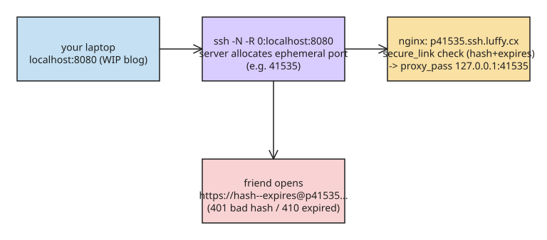

# How to Build a Self-Hosted HTTP Tunnel with Only OpenSSH and nginx

Commercial tunnels (ngrok, Cloudflare Quick Tunnels) or client-based ones (frp, localtunnel, sish) all add moving parts. Vincent Bernat's approach exposes `localhost` over the internet using **only OpenSSH + nginx** — both already running on a typical server — plus Let's Encrypt for TLS. The result: one short command gives you a shareable HTTPS URL with expiring, signed links instead of relying on the port number alone as a secret.

## Step 1: Forward localhost to an ephemeral remote port

```bash
ssh -N -R 0:localhost:8080 web02.luffy.cx
# Allocated port 41535 for remote forward to localhost:8080
```

`-R 0:...` asks the server to pick a free port (here 41535). The tunnel is now `https://p41535.ssh.luffy.cx/` → `http://127.0.0.1:41535`.

## Step 2: nginx proxies the wildcard subdomain to the allocated port

```nginx
server {
    listen 0.0.0.0:443 ssl;
    listen [::0]:443 ssl;
    server_name ~^p(?<port>\d{5})\.ssh\.luffy\.cx$;
    location / {
        proxy_pass http://127.0.0.1:$port;
    }
}
```

DNS + TLS prerequisites: a `*.ssh.luffy.cx` CNAME record and a **wildcard certificate** via Let's Encrypt (ACME DNS-01 challenge, hosted on Route 53 in the author's setup; NixOS fetches certs automatically).

## Step 3: Stop relying on the port as the only secret

The allocated port is the only thing keeping content private — and it's enumerable. The fix uses nginx's `ngx_http_secure_link_module`: a hash over `(expires, port, secret)` travels in the URL **as the basic-auth username**, so it never touches the case-insensitive domain name:

```
https://6J3jK1WmB15c6WmjW_X-Wg--1789928654@p41535.ssh.luffy.cx/en/blog
        └──────────┬───────────┘  └────┬────┘  └─┬─┘
                   hash               expires   port
```

The client sends the username via HTTP basic auth; nginx exposes it in `$remote_user`. A `map` directive splits `hash--expires`, and `secure_link_md5` recomputes the digest:

```nginx
map $remote_user $httpssh_link {
    "~^([-_A-Za-z0-9]{22})--([0-9]+)$" "$1,$2";
}
server {
    # ...
    location / {
        secure_link $httpssh_link;
        secure_link_md5 "$secure_link_expires $port ZuPerS3cr3!";

        if ($secure_link = "") {   # hash missing or wrong
            add_header WWW-Authenticate 'Basic realm="tunnel"' always;
            return 401;
        }
        if ($secure_link = "0") {  # valid but expired
            return 410;
        }

        proxy_pass http://127.0.0.1:$port;
        proxy_set_header Host $host;
        proxy_set_header X-Forwarded-For $proxy_add_x_forwarded_for;
        proxy_set_header Authorization "";   # strip before forwarding
        proxy_http_version 1.1;
        proxy_set_header Upgrade $http_upgrade;      # WebSocket support
        proxy_set_header Connection "upgrade";
        proxy_buffering off;
        proxy_read_timeout 30m;
    }
}
```

`$secure_link` is empty on hash mismatch, `"0"` when expired, `"1"` otherwise. Note the `Authorization` header is removed before proxying so your local app never sees the tunnel credentials.

## Step 4: Generate signed URLs

```bash
expires=$(( $(date +%s) + 86400 ))
port=41535
secret='ZuPerS3cr3!'
printf '%s %s %s' "$expires" "$port" "$secret" \
  | openssl md5 -binary \
  | openssl base64 \
  | tr +/ -_ | tr -d =
# 6J3jK1WmB15c6WmjW_X-Wg
```

## Step 5: Wrap it in a helper script (the port is not in any env var)

OpenSSH does not expose the allocated ephemeral port, so the helper walks up the process tree to find ancestor `sshd-session` processes and reads their listening ports with `ss`:

```bash
pids=$(
  pid=$$
  while [ "$pid" -gt 1 ]; do
    line=$(ps -o comm=,pid=,ppid= -p "$pid")
    echo "$line"
    pid=${line##* }
  done | awk '$1 == "sshd-session" { printf "pid=%s,\n", $2 }'
)

ports=$(sudo -n ss --listening --numeric --tcp --processes --no-header \
  | grep -F "$pids" \
  | awk '{ print $4 }' | awk -F: '{ print $NF }' \
  | sort -un)

lifetime=86400
secret='ZuPerS3cr3!'
expires=$(( $(date +%s) + lifetime ))
for port in $ports; do
  token=$(printf '%s %s %s' "$expires" "$port" "$secret" \
            | openssl md5 -binary \
            | openssl base64 \
            | tr +/ -_ | tr -d =)
  echo "https://$token--$expires@p$port.ssh.luffy.cx/"
done
sleep infinity   # keep the ssh session (and tunnel) alive
```

Install it as `http-over-ssh` on the server and add to `~/.ssh/config`:

```
Host http-over-ssh
    Hostname web02.luffy.cx
    RemoteCommand http-over-ssh
    ControlPath none
```

Now `ssh http-over-ssh` prints ready-to-share signed URLs. The complete script (with minor improvements) and a NixOS variant (`http-over-ssh.nix`) are in the author's nixops-take1 repo.



## Security notes

- The hash is MD5 over `(expires, port, secret)` — fine here because it authenticates *you* to nginx, not cryptographic security against an active attacker on the wire (TLS covers that).
- Expiration timestamps make links revocable by time; rotate `secret` to invalidate all outstanding URLs.
- WebSocket proxying requires the `Upgrade`/`Connection` headers plus `proxy_buffering off`.
- **Ephemeral-port entropy is low.** The kernel-chosen port carries only ~14.8 bits of entropy, which is why the signed-link layer exists at all — and why you should not rely on the port alone even after adding secure links (the hash binds the port to your secret).
- **The pre-hardening config exposes every localhost port.** The first nginx block proxies *any* `p{port}.ssh.luffy.cx` to that local port; before the secure_link check is in place, an attacker can direct traffic to any listening port on 127.0.0.1/0.0.0.0 (a simple curl loop over ports enumerates them), bypassing firewall rules. The author's mitigation: limit the `server_name` regex to the ephemeral port range and keep the secure_link gate in front of every request.
- **OpenSSH version detail:** since OpenSSH 9.8, the session helper is named `sshd-session`; on older versions the helper is just `sshd`, so adjust the process-tree walk accordingly. The `sudo` requirement for `ss --processes` exists because `sshd-session` drops privileges and its `/proc/PID/fd` becomes root-owned (not dumpable).
- **Community discussion** ([HN thread](https://news.ycombinator.com/item?id=49958569)): alternatives raised include [sish](https://github.com/anderspitman/sish) (dedicated SSH tunnel server with automatic TLS and a request console), Tailscale serve, and mTLS client certificates; concerns raised about tunnel enumeration and abandoned sessions.

## References

- [Self-hosted HTTP tunnels with SSH and nginx — Vincent Bernat](https://vincent.bernat.ch/en/blog/2026-http-over-ssh)
- [Complete helper script (nixops-take1)](https://github.com/vincentbernat/nixops-take1/blob/master/tags/http-over-ssh.sh)
- [nginx ngx_http_secure_link_module](https://nginx.org/en/docs/http/ngx_http_secure_link_module.html)
- [Let's Encrypt DNS-01 challenge types](https://letsencrypt.org/docs/challenge-types/#dns-01-challenge)
