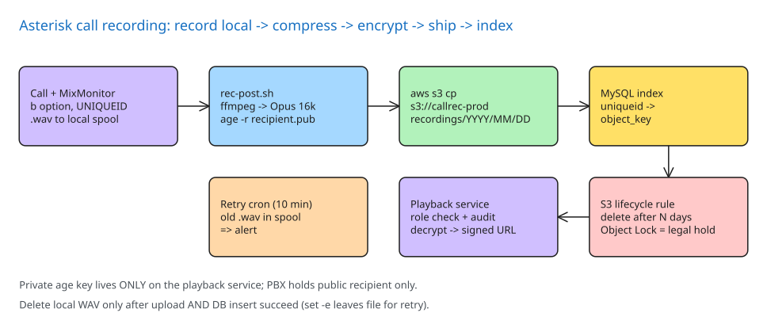

# Asterisk Call Recording Storage: Compression, Encryption, Retention and Object Storage

Asterisk call recording storage is a design problem, not a checkbox. The default FreePBX setup
(`MixMonitor` writing uncompressed WAV into `/var/spool/asterisk/monitor/YYYY/MM/DD/`) breaks at
contact-center volume for four reasons: uncompressed size (~0.96 MB/min at 8 kHz 16-bit PCM),
one shared PBX disk, no retention policy, and flat access (anyone with shell can hear every call).

The working pattern: **record local → compress → encrypt → upload to object storage → index by
`uniqueid` → delete by lifecycle rule** — with alerting when the local spool grows.

## Why not record straight to network storage?

A slow NFS mount stalls the audio write path *during the call*. MixMonitor cannot write natively
to S3, and mounting S3 as a filesystem for live writes adds latency and failure modes to the call
path. Record to local disk, then move the finished file after the call.

## Storage math (worked example)

20 agents × 300 recorded min/day = 6,000 min/day, 22 working days/month:

| Format | Bitrate (mono) | Per minute | Per day | Per month |
| --- | --- | --- | --- | --- |
| WAV, 8 kHz 16-bit PCM | 128 kbit/s | ~0.96 MB | ~5.8 GB | ~127 GB |
| MP3 | 32 kbit/s | ~0.24 MB | ~1.4 GB | ~32 GB |
| Opus | 16 kbit/s | ~0.12 MB | ~0.7 GB | ~16 GB |

For phone-quality audio (8 kHz source), Opus/MP3 at 16–32 kbit/s is clear enough for QA and
disputes — 4–8× storage savings. Test real calls with the QA team before committing to a bitrate.

## Step 1 — Record only the useful part

The `b` option starts writing only when the call is bridged (no ringing/hold music). Name files by
`UNIQUEID` (already a key in the CDR, no odd characters in paths):

```asterisk
exten => _X.,1,Set(REC=${STRFTIME(${EPOCH},,%Y/%m/%d)}/${UNIQUEID})
 same => n,Set(MIXMONITOR_FILENAME=/var/spool/asterisk/monitor/${REC}.wav)
 same => n,MixMonitor(${MIXMONITOR_FILENAME},b,/usr/local/bin/rec-post.sh ${UNIQUEID} ${MIXMONITOR_FILENAME})
 same => n,Dial(PJSIP/${EXTEN},30)
```

The third `MixMonitor` argument runs after the recording file is closed (on FreePBX, use the
"Post Call Recording Script" field in Advanced Settings instead of editing generated dialplan).

## Step 2 — Compress, encrypt, upload, index

```bash
#!/usr/bin/env bash
# /usr/local/bin/rec-post.sh <uniqueid> <wav_path>
set -euo pipefail
UID_="$1"; WAV="$2"
OUT="${WAV%.wav}.opus"
ffmpeg -nostdin -loglevel error -i "$WAV" -ac 1 -c:a libopus -b:a 16k "$OUT"
# client-side encryption with age; the private key never lives on the PBX
age -r "$(cat /etc/rec/recipient.pub)" -o "$OUT.age" "$OUT"
KEY="recordings/$(date -u +%Y/%m/%d)/$UID_.opus.age"
aws s3 cp "$OUT.age" "s3://callrec-prod/$KEY" --only-show-errors
mysql callrec -e "INSERT INTO recordings (uniqueid, object_key, created_at) VALUES ('$UID_', '$KEY', UTC_TIMESTAMP())"
rm -f "$WAV" "$OUT" "$OUT.age"
```

Order matters: delete the local WAV only after upload **and** DB insert both succeed; `set -e`
stops on first failure and leaves the file for a retry job. Run as the `asterisk` user with
minimal permissions; keep credentials in an instance role, never in the dialplan.

## Step 3 — Retry and alert

A cron job every 10 minutes re-runs the post script for `.wav` files older than 15 minutes in the
spool. Anything still there after an hour pages someone — uploads are failing.

## Where recordings live

| Option | Retention control | Access control | Good for |
| --- | --- | --- | --- |
| Local PBX disk | Manual cron | Shell/web admin users | Small offices, short retention |
| NAS / NFS | Snapshot policies | Share permissions | On-site teams |
| S3-compatible object storage | Lifecycle rules, Object Lock | Per-bucket IAM, signed URLs | Contact centers, compliance, multi-site |

Object storage wins because retention and access become **configuration** instead of scripts.

## Retention, deletion, encryption

- **Lifecycle expiration** on the `recordings/` prefix deletes after N days — the number comes
  from your recording policy agreed with legal (rules differ by country/industry).
- **Legal holds**: S3 Object Lock blocks deletion of recordings under dispute even when lifecycle
  rules would remove them.
- **Delete (DSR) requests**: index by `uniqueid` → find all calls for a customer via CDR →
  delete objects → mark rows deleted.
- **Card payments**: never record card numbers — mute via the AMI `MixMonitorMute` action while a
  payment screen is open, or route payments to a separate unrecorded IVR.
- **Two layers of encryption**: server-side encryption on the bucket (lost disks at the provider)
  plus client-side `age`/GPG (bucket readers still cannot play files — the private key lives only
  on the playback service).
- **Playback** only through a small service that checks role, logs access, decrypts, and returns a
  short-lived signed URL.

## Failure modes to watch

- **Spool growth** — first sign uploads stopped; alert on size/age of `/var/spool/asterisk/monitor`.
- **Silent no-record** — a dialplan change drops MixMonitor from a queue; reconcile daily CDR
  answered calls against indexed recordings.
- **Clock/path drift** — use UTC in object keys so DST changes don't duplicate folders.
- **Key loss** — back up the decryption key separately and test a restore; encrypted recordings
  with no key are deleted recordings.
- **Transcoding load** — ffmpeg competes with calls for CPU on a busy PBX; at high volume, ship
  the WAV to a worker queue and transcode there.

## Pipeline overview



## Related

- [Multitenant Private Buckets with Database Metadata](../../../explanations/cloudinfrastructure/objectstorage/explanation-multitenant-private-bucket-database-metadata.md) — same signed-URL + DB-index pattern.

## References

- Original article: [Asterisk Call Recording Storage: Retention & Encryption](https://dev.to/muhammadalimughal/asterisk-call-recording-storage-retention-encryption-1f1m) (DEV.to)
- [AWS S3 Object Lock documentation](https://docs.aws.amazon.com/AmazonS3/latest/userguide/object-lock.html)
- [age encryption tool](https://github.com/FiloSottile/age)
