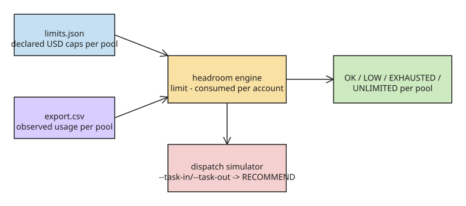

# Check Per-Account AI Quota Headroom Before Dispatching an Agent Task (blackbox-bill v0.3.0)

**blackbox-bill** v0.3.0 turns a billing post-mortem tool into a **pre-flight** tool: before dispatching the next agent task, show per-account quota headroom and tell you which account can survive the task. It reads files you already have — no network calls, no API keys, zero dependencies (Python 3.9+ stdlib only).

## Step 1 — Install

```bash
pip install blackbox-bill
```

Source: [github.com/hahahahahahahahah6/blackbox-bill](https://github.com/hahahahahahahahah6/blackbox-bill) (MIT).

## Step 2 — Declare your limits once

Vendor billing exports **never carry quota limits** (no vendor puts remaining quota in a CSV), so you declare caps once in a JSON file. Caps are in USD; `null` means unlimited; an optional `match` spec partitions bill rows across accounts by a CSV column value:

```json
{
  "accounts": [
    {"name": "cursor-pro", "plan": "cursor:pro",
     "limits": {"cursor-models": 500.0, "other-models": 125.0, "api-key": null}},
    {"name": "shared-api-key", "plan": "api-only",
     "limits": {"api-key": 200.0},
     "match": {"column": "account", "value": "shared-api-key"}}
  ]
}
```

## Step 3 — Run the headroom dashboard

```bash
blackbox-bill headroom --csv export.csv --limits-file limits.json
```

```
account 'cursor-pro' (plan cursor:pro, 3 bill row(s))
  pool             consumed      limit  remaining   remaining               status
  api-key             $0.00  unlimited  unlimited   [????????????????????]    n/a  UNLIMITED
  cursor-models      $30.00    $500.00    $470.00   [###################-]  94.0%  OK
  other-models      $120.00    $125.00      $5.00   [#-------------------]   4.0%  LOW
```

Pools are flagged `OK` / `LOW` (&lt;25% left) / `EXHAUSTED` / `UNLIMITED`. No CSV this cycle? Run limits-only and re-run with the export later.

## Step 4 — Simulate the dispatch

Planning a long run? Re-price the task under each account's plan rate card and get a recommendation:

```bash
blackbox-bill headroom --csv export.csv --limits-file limits.json \
    --task-in 1000000 --task-out 250000 --task-pool other-models
```

```
  'cursor-pro'         est $10.00  DOES NOT FIT (remaining $-5.00)
  'shared-api-key'     cannot price: no declared limit for pool 'other-models'

WARNING: no account has headroom for this task under the declared limits.
Top up, switch plan, or shrink the task before you dispatch — not after you're stuck mid task.
```

When an account fits: `RECOMMEND: dispatch on 'acct-b' — it has headroom for this task.` Bring your own numbers with `--rates-file`.

## Honest limitations (from the author)

- **Limits are self-declared.** The dashboard is exactly as right as your `limits.json`; if a plan cap changes and the file doesn't, the dashboard is wrong in the expected way — keep numbers conservative.
- **The simulator prices, it doesn't predict.** Flat per-token rates; real overage behavior and request-based floors are not modeled. "Fits" means "has budget for this size", not a guarantee.
- **Rate cards are illustrative** unless you pass `--rates-file` with your own.

**Positioning:** still a read-only billing-attribution ledger — no enforcement, no budget lines, no blocking. Use a statusline to watch the burn; use blackbox-bill to audit it, now also *before* you light the fuse.

## Diagram



## References

- [Stop finding out you're rate-limited mid-task — DEV.to](https://dev.to/haoli/stop-finding-out-youre-rate-limited-mid-task-check-the-headroom-first-10ak) (primary source)
- [blackbox-bill on GitHub](https://github.com/hahahahahahahahah6/blackbox-bill) (MIT)
