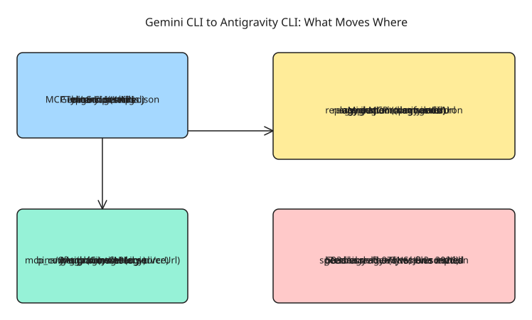

# Migrating from Gemini CLI to Antigravity CLI

Google decommissioned the open-source **Gemini CLI** (TypeScript, `gemini` binary, 100k+ GitHub stars) in favor of **Antigravity CLI** — a closed-source Go binary invoked as `agy`. As of **June 18, 2026**, Gemini CLI stopped serving requests for free, AI Pro, and Ultra personal accounts with no grace period. Enterprise (Code Assist Standard/Enterprise, Google Cloud, paid API keys) access is unchanged. This note is the migration procedure, verified against a hands-on test of `gemini 0.47.0` vs `agy 1.0.9` on shutdown day.

## Step 1 — Install Antigravity CLI

Install the `agy` binary (curl install script; fix your `PATH` manually if needed), then run the diagnostics:

```bash
agy doctor
```

Complete the **browser OAuth** flow on first run. Settings land at `~/.gemini/antigravity-cli/settings.json`. Note the inversion vs Gemini: `gemini` authenticated headless via an API-key-style env var (CI-friendly); `agy` requires a browser login first, which is a real obstacle on headless servers.

First launch in an environment with legacy Gemini config triggers **auto-onboarding**: `agy` detects your existing profiles and presents an interactive checklist for which assets to convert — which extensions and global configs to convert, session tokens migrated into the OS native keyring storage, and default visual/rendering parameters mapped automatically to the new settings profile. So the first run does part of the migration for you; the steps below cover what onboarding does not.

## Step 2 — Migrate extensions

```bash
agy plugin import gemini
```

**Gotcha:** the importer looks for *extensions* — full folders with a manifest — not loose single-file custom commands. A bare command file produces a correct-looking "No gemini extensions found" and migrates nothing. Build a proper extension (folder with `gemini-extension.json` manifest + context file + bundled command), confirm with `gemini extensions list`, then re-run the import. On success, `agy plugin list` shows the plugin with source marked `gemini-cli`, and the converted skill fires via `agy -p "..."` (it cites the `SKILL.md`).

## Step 3 — Move skills

Workspace skills move from `.gemini/skills/` to `.agents/skills/`; global skills from `~/.gemini/skills/` to `~/.gemini/antigravity-cli/skills/`.

## Step 4 — Fix the MCP config (where migrations silently fail)

Antigravity moves MCP server configuration out of inline `settings.json` entries into a dedicated **`mcp_config.json`** — global servers at `~/.gemini/config/mcp_config.json`, workspace servers at `.agents/mcp_config.json`. The trap: **remote MCP servers use `serverUrl`, not `url`**. If you keep `url`, the server appears to load at startup, passes initial checks, and only fails hours later when you actually invoke a tool — no startup error, silent session failure.

Verify everything:

```bash
agy inspect
```

## Step 5 — Replace `gemini` with `agy` in CI and automation

The migration tooling does **not** touch your scripts. Find and replace every direct `gemini` invocation:

- GitHub Actions workflows, GitLab CI/CD, Jenkins, cron jobs
- Shell aliases in dotfiles
- Docker entrypoints, Makefile targets

**Known gap (resolved — see update below):** ACP (agent client protocol) stdio mode had no drop-in replacement (tracked in the antigravity-cli repo, issue #31). The `agy acp` subcommand now ships this — details in the update section.

## Verified behavioral differences (shutdown-day test)

| Dimension | Gemini CLI 0.47.0 | Antigravity CLI 1.0.9 |
| --- | --- | --- |
| Install | one-line npm | curl script, manual PATH fix |
| Auth | env var / headless | browser OAuth on first run |
| Trivial-prompt speed | ~3.2s median (jittery 2.9-5.5s) | ~3.97s median (tight 3.5-4.2s) |
| Startup noise | every run ("Ripgrep not available", `[STARTUP]` warnings) | none |
| 503 handling | auto-retries **burn free quota** (20 req/day flash-lite cap), forced enable-billing | zero 503s observed |
| Headless file writes | **not available** (`write_file` missing) | completed the task |
| Headless shell | **not available** (`run_shell_command` missing) | ran pytest, mypy, git, venv |
| Extension migration | (source tool) | `agy plugin import gemini` worked |
| Failure mode | raw Node.js stack traces | plain-language step narration + summary |

Headless automation is the decisive delta: in scripted mode, Gemini CLI could read and think but could not write files or run commands, while Antigravity ran a full engineering workflow (venv, `pytest`, `mypy`, `git`, AST analysis) with `--dangerously-skip-permissions`.

**Caveats from the test:** the comparison was shutdown-day behavior against a tool actively being switched off, on a free-then-barely-paid account under server load; skills, subagents, MCP servers, and hooks were not migration-tested; and whether `agy` offers any non-browser login path for true CI use remains an open question to confirm before trusting it in production automation.

## Update (2026-11-13): CI auth and ACP gaps — both resolved

The two open questions above are now answered by the official Antigravity CLI docs.

**Non-browser auth exists.** Two paths work headless:

1. **Gemini API-key mode** — point `modelProvider` at `gemini` in `~/.gemini/antigravity-cli/settings.json` and supply your own Gemini API key (create one in Google AI Studio). Model requests go directly to the Gemini API and **no account session is ever established** — the CI-friendly equivalent of the old `gemini` env-var auth.
2. **Cached OAuth credentials** — headless mode (`agy -p`, "print mode") reuses cached credentials: authenticate once in an interactive `agy` session and scripted runs inherit the login. In a terminal-less environment (CI), an unauthenticated run fails fast with an `authentication required` error instead of hanging. On Linux servers/containers without D-Bus, the CLI falls back cleanly when no Secret Service keyring is available.

**ACP stdio mode shipped.** `agy acp` starts an Agent Client Protocol server (JSON-RPC over stdin/stdout) for ACP-capable editors — Zed, JetBrains IDEs, Android Studio, Xcode. Register `agy` with argument `acp` as a custom agent (e.g. Zed `settings.json` → `agent_servers` → `{"command": "agy", "args": ["acp"]}`). Sign in once interactively or via `agy acp --login`; cached credentials are reused. (GitHub issue #31, open since 2026-05-20, tracked the original gap.)

**Headless/CI integration details** worth knowing for step 5 rewrites:

- Response goes to `stdout`, diagnostics/auth prompts to `stderr` — safe to capture the answer directly (`answer=$(agy -p "...")`).
- `--output-format text|json|stream-json`: `json` returns one envelope with `status`, `response`, `conversation_id`, `duration_seconds`, `num_turns`, and `usage` token counts; `stream-json` emits NDJSON `init` / `step_update` / `result` events for live progress and per-step tool visibility.
- `--json-schema '<schema|file|primitive>'` enforces structured output; read the parsed object from `structured_output`.
- `--print-timeout 10m` bounds the run; terminal `status` values are `SUCCESS`, `ERROR`, `CANCELED`, `INTERRUPTED`, `INVALID`, `WAITING`, `RUNNING`, with exit code 1 on error — fail CI jobs by checking `.status != "SUCCESS"` with `jq`.
- Conversation resume: `--continue`/`-c` or `--conversation <id>`; `--sandbox` enables terminal sandbox restrictions; `--model`/`--effort`/`--agent` override per run.

## Diagram

&lt;!-- Gemini CLI to Antigravity CLI migration -->
## References

- [Gemini CLI vs. Antigravity: What works, not the spec sheet — The New Stack](https://thenewstack.io/gemini-cli-antigravity-replacement/)
- [An important update: Transitioning Gemini CLI to Antigravity CLI — Google Developers Blog](https://developers.googleblog.com/en/an-important-update-transitioning-gemini-cli-to-antigravity-cli/)
- [Introducing Google Antigravity CLI — Google Antigravity Blog](https://antigravity.google/blog/introducing-google-antigravity-cli)
- [Gemini CLI to Antigravity CLI migration discussion — GitHub](https://github.com/google-gemini/gemini-cli/discussions/27274)
- [Migrating from Gemini CLI — Google Antigravity docs (official migration guide)](https://antigravity.google/docs/cli/gcli-migration/)
- [Headless mode — Antigravity CLI docs](https://antigravity.google/docs/cli/headless/)
- [Agent Client Protocol (ACP) — Antigravity CLI docs](https://antigravity.google/docs/cli/acp/)
- [Authenticate (API-key mode) — Google Antigravity docs](https://antigravity.google/docs/install/)
- [antigravity-cli issue #31 — ACP stdio JSON-RPC mode feature request](https://github.com/google-antigravity/antigravity-cli/issues/31)
