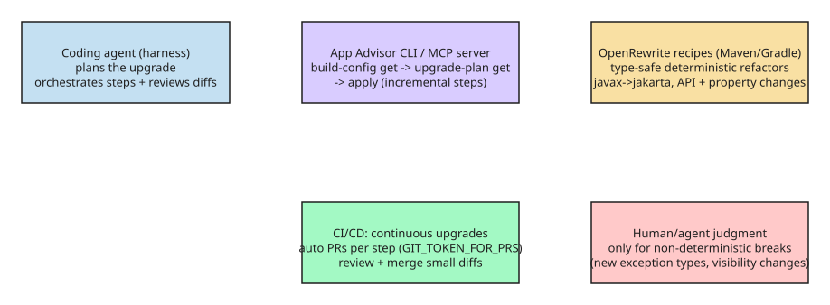

# Upgrading Spring Boot with AI Agents Plus Deterministic OpenRewrite Refactors

Naively asking a coding agent to "upgrade this application to Spring Boot 4" is slow and unreliable on real codebases. This note captures the pattern from Raquel Pau's (Broadcom) article: **enrich the agent with deterministic, type-safe refactoring tools** so the agent plans and orchestrates while OpenRewrite recipes apply the mechanical changes.

## Why pure-agent upgrades fail at scale

- A natural-language upgrade request on a large legacy app takes 20+ minutes for initial results, then several more iteration rounds to fix compilation errors and tests — typically **1–2 days** of wall-clock time even without internal shared-library dependencies, with no guarantee the result merges.
- Token cost compounds across every iteration (initial run + each fix round).
- Agents make unrequested changes: in a Spring Petclinic 3.5.x → Boot 4 test, the agent consumed **~1.39M tokens** (478k planning + 909k code changes) and *still failed* — it renamed starters/imports that weren't requested and left deprecated-method warnings plus a compilation error.
- Agents don't perform semantic analysis of the codebase the way humans do; they pattern-match on text. Framework upgrades need **type-awareness** (resolving every expression's type, like IDE autocompletion) to be safe.

The motivation is often security: Broadcom estimates ~50% of Spring Boot apps were still on 2.7 or earlier in 2025, and vulnerability discovery has spiked — upgrading is part of security preparedness. A **continuous upgrade culture** (keep all dependencies within supported ranges, use latest patch releases) shrinks the CVE exposure window and standardizes versions across applications so internal Spring components can be shared.

## The pattern: agent + deterministic recipes

The most flexible open-source technology for type-safe, deterministic code changes in Java is **[OpenRewrite](https://openrewrite.org)**, run as a Maven or Gradle plugin. Recipes resolve the type of every expression and apply refactors mechanically — no LLM guessing.

VMware Tanzu Spring packages this for agents:

- **Tanzu Platform / Tanzu Spring CLI commands** based on OpenRewrite guide coding agents through planning and executing *incremental* Spring upgrades at scale — handling deprecations, API changes, property changes, and even internal frameworks or third-party OSS libraries that depend on Spring (and must be upgraded first).
- **Tanzu Spring Essentials** includes the **App Advisor CLI**, which can also run as a **local MCP server** ([docs](https://techdocs.broadcom.com/us/en/vmware-tanzu/spring/application-advisor/1-5/app-advisor/model-context-protocol-server.html)) — so any agent with MCP support gets upgrade planning and execution as tools.

### App Advisor workflow (from Broadcom docs)

```bash
# 1. Produce build configuration: dependency tree (SBOM), Java version, build tool info
advisor build-config get

# 2. Generate the step-by-step upgrade plan (which Spring projects move to which versions, in what order)
advisor upgrade-plan get

# 3. Apply a step locally; review changes before committing
advisor upgrade-plan apply

# Preserve coding style when using spring-javaformat or similar:
advisor upgrade-plan apply --after-upgrade-cmd=${MAVEN_OR_GRADLE_FORMATTER_TASK}

# 4. Continuous/incremental upgrades with automatic PRs from CI/CD:
advisor upgrade-plan apply --push --from-yml   # needs GIT_TOKEN_FOR_PRS + .spring-app-advisor.yml in repo root
```

The plan resolves *all* Spring projects that must move together (e.g., Spring Web 5.3.x alongside Spring Security 5.8 → both to 6.0.x), so generated PRs build without extra manual changes. For individual recipes, the OpenRewrite Maven plugin works directly:

```bash
./mvnw -B org.openrewrite.maven:rewrite-maven-plugin:6.22.1:runNoFork \
  -Drewrite.recipeArtifactCoordinates=com.vmware.tanzu.spring.recipes:spring-boot-3-upgrade-recipes:1.7.0 \
  -Drewrite.activeRecipes=<TANZU_SPRING_RECIPE_ID>
```

Commercial recipes are embedded in the CLI binary since Application Advisor 1.6 (works air-gapped); custom or version-pinned recipes need access to the Spring Commercial Maven repository.

## Decision rule for incompatibilities

The Tanzu Spring team's principle: **if the solution for an incompatibility is deterministic, encode it as a recipe** and configure common migration patterns (e.g., Spock → JUnit) with the CLI tools — don't leave them to the agent. Only genuinely context-dependent changes (a new exception type, changing a public method to protected) need human/agent judgment; each organization should centralize how those are resolved.



## Checklist for a safe agent-driven Spring upgrade

1. Keep the estate in a **continuous upgrade culture** first — small patch-level moves make major upgrades cheaper and more deterministic.
2. Generate build config + upgrade plan (`advisor build-config get`, `advisor upgrade-plan get`); let the tool order steps (Java version, javax→jakarta, framework, security, data).
3. Apply **one step at a time**, review diffs, commit per step — small PRs are reviewable and revertible.
4. Encode every deterministic incompatibility as an OpenRewrite recipe; reserve agent judgment for genuinely context-dependent breaks.
5. Wire CI/CD to push automatic upgrade PRs (`--push --from-yml`, `GIT_TOKEN_FOR_PRS`), so CVE-driven upgrades land fast without a 1–2 day manual cycle.

## References

- [Transform your AI coding agent into a deterministic Java Spring expert](https://thenewstack.io/deterministic-ai-spring-upgrades/) (The New Stack, Raquel Pau / Broadcom)
- [What is Application Advisor?](https://techdocs.broadcom.com/us/en/vmware-tanzu/spring/application-advisor/1-5/app-advisor/what-is-app-advisor.html)
- [Upgrade Spring applications (App Advisor CLI workflow)](https://techdocs.broadcom.com/us/en/vmware-tanzu/spring/application-advisor/1-6/app-advisor/upgrade-spring-app.html)
- [Running commercial recipes with OpenRewrite tools](https://techdocs.broadcom.com/us/en/vmware-tanzu/spring/application-advisor/1-6/app-advisor/recipes.html)
- [How to upgrade Spring Boot from 2.7 to 4.0 (guide)](https://techdocs.broadcom.com/us/en/vmware-tanzu/spring/application-advisor/1-5/app-advisor/how-to-guides-upgrade-boot.html)
