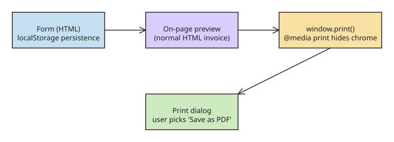

# Generate PDFs With window.print() and a Print Stylesheet Instead of a PDF Library

Every browser already ships a PDF renderer. Before adding a server-side PDF library (fonts, a render route, rate limits, and customer data flowing through your backend), try the lazy option: `window.print()` plus a print stylesheet.

## Step 1 — Build the document as normal HTML

The on-page preview is the document itself: a plain-HTML invoice (or time card, rate table, …). Nothing special is needed to make it printable.

## Step 2 — Add a print stylesheet

Hide everything except the document when printing:

```css
@media print {
  @page { margin: 14mm; }
  header, footer, form, .buttons { display: none !important; }
  .invoice { box-shadow: none; padding: 0; }
}
```

## Step 3 — Wire the button to window.print()

```js
document.querySelector("#download-pdf")
  .addEventListener("click", () => window.print());
```

The user clicks *Download PDF*, the print dialog opens, they pick **Save as PDF** — done. The browser handles font rendering, page breaks, and the file format. On phones the same path goes through the share sheet.

## Step 4 — Persist client-side only

If the tool should remember user details, save the form to `localStorage` — nothing leaves the browser.

## What this buys you

1. **Nothing to store means nothing to worry about.** No server route, no font management, no rate limiting, no customer names/addresses/amounts flowing through a backend.
2. **A promise you can keep.** "Your data stays in this browser" is true *by design*, not by policy — there is nowhere else for it to go.
3. **Cheap reuse.** The same pattern (plain HTML + a bit of JS + localStorage + print CSS) powered three tools (invoice generator, time-card calculator, hourly-rate calculator); each took an afternoon.

## Trade-offs to accept

- **You cannot control the browser's own page header/footer** (date and URL in the margins). Most browsers have a checkbox to hide them; acceptable for an invoice, not for pixel-exact brand output.
- The user must click through the print dialog once per download — no silent server-side file delivery.
- Complex layout (tables across pages, custom fonts with fallbacks) needs testing per browser.

## Decision rule

If the document is *already* HTML and the audience can click "Save as PDF", skip the PDF library. Add a real renderer (server-side or canvas-based) only when you need unattended generation, exact typography control, or non-HTML sources.

## Diagram



## References

- [I almost added a PDF library. A print stylesheet was enough. — DEV.to](https://dev.to/sheaf/i-almost-added-a-pdf-library-a-print-stylesheet-was-enough-5eha) (primary source)
- [Free invoice generator demo (Sheaf)](https://sheaf.guestleaf.app/tools/invoice-generator)
