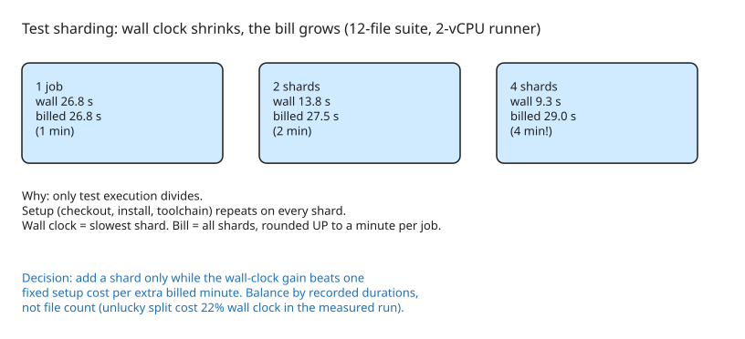

# How to Decide How Many CI Test Shards Actually Pay Off

Sharding a test suite across parallel CI runners trades **money for wall clock**: only test execution divides, while queue wait, checkout, toolchain setup and dependency install repeat **in full on every shard**. Wall clock is set by the *slowest* shard; the bill is set by *all* shards added together. There is a crossover point where one more shard buys almost nothing and costs a whole job — and it can be computed from two numbers you already have.

## The measured cost model

A 12-file synthetic suite (8 files × 1 s, plus 2/3/5/6 s files) on a 2-vCPU runner, one pass per shard, `--no-file-parallelism`:

| Split | Slowest shard | Wall clock | Billed (all shards) |
| --- | --- | --- | --- |
| One job | 26.77 s | 26.77 s | 26.77 s |
| Two shards | 13.77 s | 13.77 s | 27.54 s |
| Four shards | 9.25 s | 9.25 s | 28.98 s |

Two shards nearly halved wall clock for +0.8 s billed; four took another 4.5 s off for +2.2 s billed — roughly 3× the extra cost for ⅓ the extra gain. **Diminishing returns are steep.**

## The billing rounding trap

GitHub rounds **each job up to the nearest minute**. The four-shard split that cost 2.2 extra seconds of machine time is billed as **4 minutes against 1**. For a small suite, sharding is a pure invoice loss buying seconds. It flips as the suite grows: the rounding is a fixed per-shard penalty while the saving scales with work (a 20-minute suite in four ~6-minute shards = 24 billed minutes to buy back ~14 wall-clock minutes).

## Shard by timing, not by file count

Most runners split by file enumeration order, so the split is only as balanced as your file sizes. In the measurements, a lucky two-way split (heaviest files in different halves) came out within 11 ms; an unlucky one (both heavy files in one shard) lost **22 % of wall clock** to nothing but assignment order (16.76 s vs 13.77 s), with the other shard idling at 10.75 s. Balancing by **recorded durations** (longest-first assignment from a timing report) put the halves within 20 ms.

## Runner flags (index/total shape)

Use `strategy.job-total` so the total cannot drift from the matrix width:

```bash
# vitest
npx vitest run --shard=${{ matrix.shard }}/${{ strategy.job-total }}
# playwright (more even with fullyParallel on — splits at individual tests, not files)
npx playwright test --shard=${{ matrix.shard }}/4
# jest
npx jest --shard=${{ matrix.shard }}/4
# pytest — split by recorded durations (pytest-split plugin)
pytest --splits 4 --group ${{ matrix.group }}
```

Differences: Vitest and Jest assign whole files; Playwright splits per-test when `fullyParallel` is on; pytest's usual answer is a duration-based plugin.

## Workflow skeleton that keeps results usable

`fail-fast: false` keeps sibling shards running after one fails, and each shard needs a **unique report artifact name** or the upload overwrites itself. Merge in an aggregator job that `needs:` all shards (Playwright `merge-reports` with blob reports; elsewhere junit-per-shard + merge step).

```yaml
jobs:
  test:
    runs-on: ubuntu-latest
    strategy:
      fail-fast: false
      matrix:
        shard: [1, 2, 3, 4]
    steps:
      - uses: actions/checkout@v7
      - uses: actions/setup-node@v7
        with:
          node-version: 22
          cache: npm
      - run: npm ci
      - run: npx vitest run --shard=${{ matrix.shard }}/4
      - uses: actions/upload-artifact@v7
        if: always()
        with:
          name: results-${{ matrix.shard }}
          path: junit-*.xml
```

## Cut fixed cost before you add a shard

Every shard repeats setup, so a second spent in setup is a second spent × shard count. Measured setup items on the same runner: system package index refresh **23.85 s**, a toolchain the image lacks **2.16 s** to unpack, warm-cache install 0.85 s + ~0.9 s runner startup. Also check in-job parallelism first — on this runner, file-parallelism on vs off measured 25.16 s vs 25.18 s (no gain): **parallelism inside a job you already pay for is free, a shard never is.**



## Decision procedure

1. Measure whole-suite wall clock and billed time.
2. Model: `wall(n) ≈ max_shard_test_time + fixed_setup`, `billed(n) = ceil(sum / 60 s) × 60 s per job`.
3. Add shards only while `wall(n) − wall(n+1)` is worth ≥ one fixed setup cost per invoice minute.
4. Balance by recorded durations before adding more shards.
5. Re-measure in-job parallelism on your own runner before step 3.

## References

- Original article: [GitHub Actions test sharding: how many shards actually pay](https://dev.to/kalemi/github-actions-test-sharding-how-many-shards-actually-pay-4e0c)
- [GitHub Docs: running variations of jobs in a workflow](https://docs.github.com/en/actions/how-tos/write-workflows/choose-what-workflows-do/run-job-variations)
- [GitHub Docs: Actions limits and concurrency](https://docs.github.com/en/actions/reference/limits)
