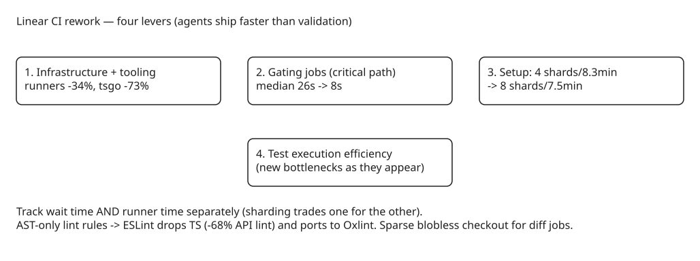

# Keeping CI Fast When AI Agents Ship Code Faster Than Validation — Linear's Rework

Agents made it exponentially faster to ship code at Linear, but validating those changes didn't keep up: every PR still has to pass through CI, so as development accelerates, CI becomes the bottleneck — driving infrastructure costs up and leaving developers *and agents* waiting for feedback. Their rework (Sept 2026) targets two metrics: **how long a PR waits on CI** and **how much runner time it consumes**. Result with test suites nearly quadrupled since January: PR wait time down from >6 min to just over 5, and runner time per test roughly halved. Without the rework, today's suite would take ~11 minutes — close to double what developers actually wait.

The four levers, in order of application:

## 1. Upgrade infrastructure and tooling (free gains first)

- **Faster runners**: moving workloads off GitHub Actions to third-party runners with faster CPUs, higher-performance storage, and better cache infrastructure made the *same pipeline* run **34% faster on average**, with some workloads like `tsc` dropping 52%.
- **Native toolchain**: switching to `tsgo`, the native TypeScript compiler, cut the weekly median of the `tsc` check by **73%** — large enough to move the bottleneck off typechecking entirely.

### Lint without the type checker

A handful of custom ESLint rules depended on TypeScript type information (to enforce a restriction or apply an autofix), so every lint run built the full type graph first — making lint one of the most memory-intensive CI jobs. The fix: rewrite those rules to use **static analysis over the AST** (identifying function-like constructs and guard patterns without type information). That let ESLint drop TypeScript entirely:

- API lint time **-68%**, full-repo lint time **-55%**, memory usage down substantially.
- Bonus: syntax-only rules port cleanly to **Oxlint**, which further reduced CI runner-minutes spent on linting.

## 2. Optimize the jobs that gate other work (critical path)

Every run starts with small change-detection jobs (which paths did the PR touch, have these tests already passed for the same inputs). They're gated at job level so skipped work never reserves a runner — but they sit directly on the critical path: none of the eight API test shards can start until they finish. Small delays there are disproportionately expensive.

- **Fetch only what each job needs**: change-detection jobs were checking out the full working tree when they needed a small subset. Capping fetch depth took the slowest gate from **94 s → 20 s**; removing checkout entirely from jobs that never need a working tree cut their time from **27 s → 7 s**. For commit-push and merge-queue events, a **sparse, blobless checkout with limited history** was enough to diff paths — saving another ~11 s.
- Net effect on the change-detection job: median **26 s → 8 s**, p90 **31 s → 12 s**, slowest run **138 s → 37 s**.

### Make checkout resilient

After swapping runner infrastructure, `actions/checkout` times grew and sometimes hung — the third-party runners sit outside GitHub's network and rely on a direct IP link whose intermittent degradation stalled fetches. Since several workflows begin with a checkout, one stalled fetch delayed the entire run; the fix was making checkout retry/tolerant of that link (the article details the resilience work around the provider's degraded link).

## 3. Reduce repeated setup

Test sharding is the headline: before setup optimizations, the test job used **4 shards with 8.3 min of setup**; after, it runs **8 shards with 7.5 min of setup** — more parallelism at *lower* total setup cost. (Sharding shortens wait time but costs more machine time per run; Linear tracks both metrics separately.)

## 4. Make test execution more efficient

The remaining work targets the tests themselves, using what was learned from the earlier passes on new bottlenecks as they appear. The codebase is primarily TypeScript, but the levers (faster machines, native toolchains, AST-only linting, minimal checkouts, sharding) apply across languages and toolchains.

## Why this matters for agent-driven teams

1. **CI wait time is now an agent metric too** — agents block on CI feedback just like humans; a 6-minute gate taxes every agentic loop iteration.
2. **Watch the two metrics separately**: sharding and parallelization trade machine time for wall-clock time. Optimizing only one (e.g., cutting runner minutes while wait time grows) hides regressions.
3. **The cheap wins compound first**: infrastructure + toolchain upgrades alone delivered most of the headline numbers before any pipeline logic changed — audit your `tsc`/lint/checkout costs before redesigning pipelines.
4. **Gating jobs are the hidden critical path**: change-detection and scheduling jobs look trivial but serialize everything behind them; give them minimal checkouts and measure their p90, not just median.

## Practical takeaways

1. Before redesigning pipelines, audit the three cheapest levers: runner hardware/cache, native compiler (`tsgo` for TS), and AST-only lint rules.
2. Give change-detection/gating jobs minimal checkouts (capped depth; sparse blobless when only diffing paths) — they serialize everything behind them.
3. Make checkout resilient to network degradation between your runner provider and the git host, or one stalled fetch delays the whole run.
4. When agents are in the loop, treat CI wait time as a first-class product metric alongside cost.

## References

- [Linear: AI coding has made CI a bottleneck, so we reworked ours to keep up](https://linear.app/now/ci-bottleneck-reworked)
- [tsgo — native TypeScript compiler](https://github.com/microsoft/typescript-go)
- [Oxlint documentation](https://oxc.rs/docs/guide/usage/linter)
