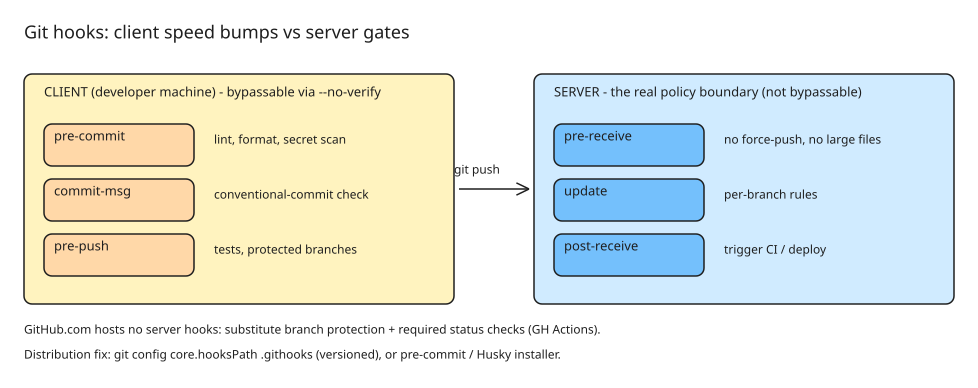

# Configuring Git Hooks That Actually Protect You

The motivating incident: an AWS access key reaches a public repo; GitHub secret-scanning alerts arrive **in 47 seconds**, but the team's pre-commit hook never fired on the offender's laptop — because hooks live in `.git/hooks/` and **don't sync with the repo**. Hours of key rotation, history scrubbing, and downstream-fork notifications were preventable with ~30 lines of YAML and a one-line install.



## The mental model first: speed bumps vs gates

| Hook | Side | Trigger | Use case |
| --- | --- | --- | --- |
| `pre-commit` | Client | `git commit` | Lint, format, secret scan |
| `pre-push` | Client | `git push` | Run tests, block push to protected branches |
| `commit-msg` | Client | After editor closes | Validate commit message format |
| `prepare-commit-msg` | Client | Before editor opens | Pre-fill message (branch name, ticket) |
| `post-commit` | Client | After commit | Notify, log |
| `pre-receive` | Server | Before refs update | Enforce policy (no force-push, no large files) |
| `update` | Server | Per-ref | Per-branch policy |
| `post-receive` | Server | After refs update | Trigger CI, deploy, notify |

Two rules fall out of this table:

1. **Client hooks are bypassable** (`git commit --no-verify`); server hooks are not. Client hooks = UX/convenience (fail fast locally in ~200 ms instead of 5 min in CI); server hooks = policy. Use both — never treat a pre-commit hook as a security control.
2. **GitHub.com supports no server-side hooks.** Server hooks need self-hosted git (Gitea, Forgejo, plain `git daemon`) or GitHub Enterprise / GitLab self-hosted. On GitHub.com, the substitute is branch protection rules + required status checks via Actions.

## Step 1 — Make hooks version-controlled with `core.hooksPath`

The raw mechanism (`cp .git/hooks/pre-commit.sample .git/hooks/pre-commit && chmod +x ...`) has the fatal flaw that `.git/` is not versioned. The modern answer:

```bash
git config core.hooksPath .githooks   # git runs hooks from the versioned .githooks/ dir
```

Requires Git 2.36+. The remaining problem — getting every developer to run that one command — is what the frameworks solve.

## Step 2 — Python/polyglot projects: the `pre-commit` framework

```bash
pip install pre-commit   # Python 3.8+
cd my-repo && pre-commit install
```

A battle-tested `.pre-commit-config.yaml`:

```yaml
repos:
  # Standard hygiene
  - repo: https://github.com/pre-commit/pre-commit-hooks
    rev: v4.6.0
    hooks:
      - id: trailing-whitespace
      - id: end-of-file-fixer
      - id: check-yaml
      - id: check-added-large-files
        args: ['--maxkb=500']
      - id: check-merge-conflict
      - id: detect-private-key
  # Ruff: fast Python linter + formatter (replaces flake8 + black + isort)
  - repo: https://github.com/astral-sh/ruff-pre-commit
    rev: v0.5.0
    hooks:
      - id: ruff
        args: [--fix, --exit-non-zero-on-fix]
      - id: ruff-format
  # Type checking (only on changed files)
  - repo: https://github.com/pre-commit/mirrors-mypy
    rev: v1.10.0
    hooks:
      - id: mypy
        additional_dependencies: [types-requests, pydantic]
        args: [--strict, --ignore-missing-imports]
  # Secret scanning
  - repo: https://github.com/Yelp/detect-secrets
    rev: v1.5.0
    hooks:
      - id: detect-secrets
        args: ['--baseline', '.secrets.baseline']
  # Conventional commit validation
  - repo: https://github.com/compilerla/conventional-pre-commit
    rev: v3.2.0
    hooks:
      - id: conventional-pre-commit
        stages: [commit-msg]
        args: [feat, fix, docs, style, refactor, perf, test, chore]
```

Install and bootstrap:

```bash
pre-commit install
pre-commit install --hook-type commit-msg
pre-commit run --all-files          # first-time setup across the whole tree
detect-secrets scan > .secrets.baseline
detect-secrets audit .secrets.baseline   # review each finding once
```

Three details that make or break adoption:

1. **Pin every `rev:`.** Unpinned hooks update unpredictably and break CI.
2. **Generate the `detect-secrets` baseline first.** Without `.secrets.baseline`, every test token and example password in the repo flags and developers disable the hook. (Alternative scanner: `gitleaks`.)
3. **Commit-message validation must run at `stages: [commit-msg]`**, not the default commit stage — the message file doesn't exist at pre-commit time.

A failing hook is fast, specific, and actionable:

```
detect-secrets..............................................................Failed
- hook id: detect-secrets
- exit code: 1
.env: AWS_SECRET_ACCESS_KEY=wJalrXUt...
```

## Step 3 — JS/TS projects: Husky

Husky (Node 18+) is the equivalent of `pre-commit install` for JS — it uses `core.hooksPath` under the hood and wires into `package.json`:

```bash
npm install --save-dev husky
npx husky init        # creates .husky/pre-commit, adds "prepare": "husky" to package.json
```

`"prepare": "husky"` in `package.json` is the distribution trick: `npm install` itself installs the hooks, so no developer has to remember anything. Hook files are plain scripts:

```bash
# .husky/pre-commit
npm run lint
npm run format:check
npx tsc --noEmit

# .husky/commit-msg  -> conventional-commit validation
```

## Anti-patterns checklist

- Relying on `pre-commit` secret scanning as your **security boundary** — `--no-verify` defeats it; enforce server-side (or branch protection + Actions on GitHub.com) for real.
- Hooks that take minutes: anything over ~1s per commit gets bypassed; heavy checks belong in CI, fast ones in hooks.
- No baseline for the secret scanner → alert fatigue → hook disabled.
- Unpinned hook revisions.
- Forgetting `pre-commit install --hook-type commit-msg` (the commit-msg hook silently never runs).

## References

- [How to Configure Git Hooks: Stop Pushing Secrets and Broken Commits (DEV.to / Mango Developer)](https://dev.to/mango7777/how-to-configure-git-hooks-stop-pushing-secrets-and-broken-commits-2a0g)
- Related in KB: Audit browser storage for secret leaks, Treat VCS/CI-CD as attack surface, [Frontend secrets audit before shipping](../../securityprivacy/websecurity/howto-frontend-secrets-audit-before-shipping.md)
