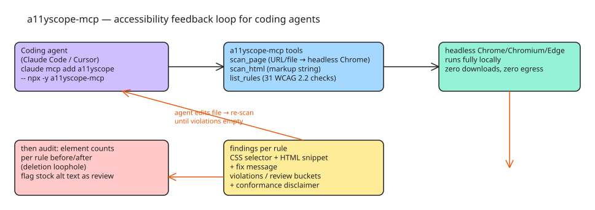

# How to Give a Coding Agent an Accessibility Feedback Loop — a11yscope as an MCP Server

Coding agents (Claude Code, Cursor, …) now generate a large share of new HTML and ship `` without `alt`, grey-on-white placeholders, and `outline: none` at high volume. A checker that a human clicks does nothing for them — the fix is exposing the checker as an MCP server so the agent that writes the markup can also validate and repair it. `a11yscope-mcp` (npm: [a11yscope-mcp](https://www.npmjs.com/package/a11yscope-mcp)) is a complete working example: a WCAG 2.2 rule engine (31 checks) packaged as three MCP tools that run fully locally against the Chrome/Chromium/Edge/Brave you already have — no downloads at install, nothing sent anywhere.

## The three tools

| Tool | Input | Output |
| --- | --- | --- |
| `scan_page` | URL or local HTML file, loaded in headless Chrome | violations grouped by rule; each finding carries a CSS selector, an HTML snippet, and a fix message |
| `scan_html` | a string of markup | same shape — the one agents actually need: "you just wrote this component, check it before you save it" |
| `list_rules` | — | the 31 checks mapped to WCAG 2.2 success criteria |

Check coverage: text alternatives (images, labels, buttons, links, frames, SVG), colour contrast with large-text/bold exemptions and translucent-background compositing, document structure (language, title, heading order, main landmark, skip link, tables, lists), and keyboard/pointer/ARIA (zoom lock, positive tabindex, aria-hidden focusables, nested controls, 24×24 target size, autoplay, captions, invalid roles, required ARIA states, autocomplete, removed focus outlines).

## Setup

Claude Code:

```bash
claude mcp add a11yscope -- npx -y a11yscope-mcp
```

Cursor, Claude Desktop, or any other MCP client (`mcpServers` config):

```json
{
  "mcpServers": {
    "a11yscope": { "command": "npx", "args": ["-y", "a11yscope-mcp"] }
  }
}
```

## The closed loop

The prompt that closes the loop:

> scan http://localhost:3000 with a11yscope and fix every violation, then scan again

The agent reads each finding's selector + message, edits the file, re-scans until the list is empty. A result looks like:

```json
{
  "summary": { "violations": 2, "review": 1, "rulesRun": 31, "rulesFailed": 2, "rulesPassed": 28 },
  "rules": [
    {
      "id": "img-alt", "wcag": ["1.1.1"], "level": "A", "impact": "critical",
      "help": "Add alt text describing what the image conveys. If purely decorative, use alt=\"\" ...",
      "violations": [{ "selector": "html > body > main > img",
                       "message": " has no alt attribute (src: a.png)",
                       "snippet": "" }]
    },
    {
      "id": "link-name", "wcag": ["2.4.4", "4.1.2"], "level": "A", "impact": "critical",
      "violations": [{ "selector": "html > body > main > a",
                       "message": "Link has no discernible text",
                       "snippet": "<a href=\"/x\">" }]
    }
  ],
  "disclaimer": "Automated checks find roughly a third of accessibility barriers. A clean result is a good sign, not a conformance claim; items marked review need a human decision."
}
```

## Design decisions worth copying

1. **Machine-checkable vs human-review split.** Only ~⅓ of accessibility barriers are machine-checkable. Anything the engine cannot decide comes back as `review`, not as pass — an agent will happily claim "WCAG compliant" if every finding is framed as pass/fail. The disclaimer is injected into every response on purpose.
2. **Findings carry fix instructions, not just verdicts.** Selector + snippet + what-to-change is the minimum that lets an agent act without re-deriving the problem.
3. **Calibrate against zero-violation reference sites.** gov.uk, webaim.org, deque.com, a11yproject.com, and w3.org/WAI all return zero violations from the engine; anything reported on those sites is treated as a checker bug until proven otherwise. (The author's initial run against gov.uk found 72 "violations" — all of them bugs in the checker.)
4. **Local-only execution.** Headless Chrome on the user's machine; no install-time downloads, no network egress. That makes it safe to point at internal pages.

## Failure modes the closed loop does not see

From the comment section — the cheapest way to make `img-alt` or `link-name` hit zero is to delete the element or write `alt="image"`; a re-scan reports a clean page either way. Mitigations: return element counts per rule before/after ("3 images checked, 0 now" should read differently from "3 images, all with alt"), flag alt text equal to a filename or stock word as `review`, and keep a `notApplicable` bucket so `scan_html` on a fragment does not let the agent read "28 passed" as evidence about the whole page (contrast, heading order, landmarks, and skip-link checks depend on the surrounding page). Also open: how `scan_page` handles shadow DOM and same-origin iframes — the usual hiding places for unnamed controls.

## Checklist

- [ ] Wrap your checker's engine as MCP tools, not just a CLI — the agent needs structured output (selector, snippet, fix message)
- [ ] Split findings into `violations` / `review` / (ideally `notApplicable`)
- [ ] Inject a conformance disclaimer into every response
- [ ] Calibrate the rule engine on known-clean reference sites and treat reported findings there as engine bugs
- [ ] Run the checker locally against the user's existing browser; keep egress at zero
- [ ] Prompt the agent with "scan → fix → rescan until empty", then audit the element counts before accepting the clean result

## Diagram



## References

- [I turned my accessibility checker into an MCP server, so the agent that writes the HTML can also fix it — DEV.to](https://dev.to/perceivable/i-turned-my-accessibility-checker-into-an-mcp-server-so-the-agent-that-writes-the-html-can-also-1n7i)
- [a11yscope issues — false-positive calibration tracker](https://github.com/perceivable/a11yscope/issues)
