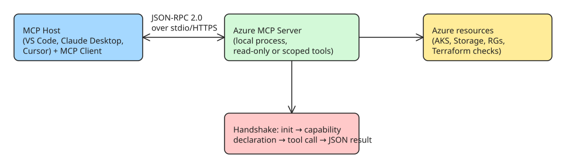

# How to Give Your AI Agent Scoped Azure Access with the Azure MCP Server

LLMs have two systemic gaps when operating on cloud infrastructure: a **fixed knowledge cutoff** (blind to real-time state) and an **"air-gap" limitation** (no secure way to touch external systems). The ad-hoc answer — letting agents run raw CLI commands in a terminal — is fragile. The [Azure MCP Server](https://github.com/Azure/azure-mcp) closes the gap with a structured, governable interface: it exposes **40+ Azure services and 170+ tools** (Container Apps, AKS, Storage, Resource Groups, Terraform best-practices checks) through the Model Context Protocol.

This howto covers the MCP architecture in one page, then walks through three local configuration modes and the VS Code integration.

## Why an MCP server beats raw CLI execution

| Raw terminal access | Azure MCP Server |
|---|---|
| Agent parses messy unstructured stdout | Returns rich semantic JSON data blocks to the LLM |
| Full account permissions by default | Read-only mode or a selected subset of tools |
| No confirmation gate | Protocol requires explicit user confirmation before mutative/sensitive tool calls |

The governance point is the load-bearing one: you can configure the server so an agent *cannot* delete production infrastructure, and every sensitive action still asks for human sign-off.

## MCP architecture in 60 seconds



The handshake is structured rather than free-form: (1) the client connects and queries capabilities; (2) the server returns a schema of its tools; (3) when the LLM needs external data, the host requests a specific tool execution; (4) the server runs locally and returns semantic JSON.

## Step 1 — Pick your configuration mode

All three modes run the server locally over `stdio` transport. Choose by ecosystem:

**NuGet / .NET teams** (`dnx` fetches and starts the server dynamically):

```json
{
  "mcpServers": {
    "Azure MCP Server": {
      "command": "dnx",
      "args": [
        "Azure.Mcp",
        "--source",
        "https://api.nuget.org/v3/index.json",
        "--yes",
        "--",
        "azmcp",
        "server",
        "start"
      ],
      "type": "stdio"
    }
  }
}
```

**Node.js / TypeScript teams** (`npx` with the npm package):

```json
{
  "mcpServers": {
    "azure-mcp-server": {
      "command": "npx",
      "args": ["-y", "@azure/mcp@latest", "server", "start"]
    }
  }
}
```

**Docker / isolated environments** (requires a local `.env` with Azure Service Principal credentials):

```json
{
  "mcpServers": {
    "Azure MCP Server": {
      "command": "docker",
      "args": [
        "run", "-i", "--rm",
        "--env-file", "/full/path/to/.env",
        "mcr.microsoft.com/azure-sdk/azure-mcp:latest"
      ]
    }
  }
}
```

## Step 2 — Install the VS Code extension and verify

1. Search for and install the **Azure MCP Server** extension from the VS Code marketplace.
2. Open the Command Palette (`Cmd+Shift+P` / `Ctrl+Shift+P`) and run the extension's commands to confirm the server is active.

## Step 3 — Scope tool access (the governance step)

Open the integrated AI chat window, select the **Tools** icon, and toggle individual tools on/off. Typical posture: keep read operations enabled, disable write/mutative operations for day-to-day work. This is where "scoped access" becomes real — the agent literally cannot call a tool you have switched off.

## Step 4 — Use it

With the server connected, natural-language requests map to Azure tool calls:
- *"Are there any inactive containers running in my resource group?"* → AKS/Container Apps inspection tools.
- *"Upload our local config file to blob storage."* → Storage upload tool (with confirmation).

Two production patterns worth copying:
1. **AKS incident triage** — ask the agent to investigate crash-looping pods; it calls the relevant AKS tools, inspects logs, identifies the misconfiguration, and proposes a fix in seconds instead of dozens of manual diagnostic commands.
2. **Terraform/compliance audit** — point the agent at your IaC directory; because the server incorporates Azure Terraform best practices, it cross-references configs against live Resource Groups and flags compliance violations or drift before deployment.

## Pitfalls

- **Credentials scope = blast radius.** The server inherits whatever identity you authenticate with (Service Principal in `.env`, `az login` context). Use a least-privilege SP for agent workloads — the MCP layer scopes *tools*, but not Azure RBAC underneath them.
- **Read-only mode is a configuration, not a guarantee** — verify which tools are actually enabled after each config change (Step 3), especially when switching between environments.
- **Mutative actions still prompt.** The confirmation gate protects you from accidental deletes, but it also means fully unattended automation of write operations is out of scope for this setup.

## References

- [DZone — Supercharging AI Agents with Azure Context Using MCP](https://dzone.com/articles/supercharging-ai-agents-with-mcp) (original source)
- [Azure/azure-mcp on GitHub](https://github.com/Azure/azure-mcp) (server repository)
- [What is the Azure MCP Server? — Microsoft Learn overview](https://learn.microsoft.com/en-us/azure/developer/azure-mcp-server/overview)
- [Quickstart: Integrate Azure MCP Server with GitHub Copilot CLI](https://learn.microsoft.com/en-us/azure/developer/azure-mcp-server/how-to/github-copilot-cli) (alternative client integration)
- Related KB notes: [[Tool Descriptions Are the Contract]] and [[How to Map HTTP API Parameters into MCP Tool Schemas]] — tool design principles that apply when you extend beyond Azure's built-in tools.
