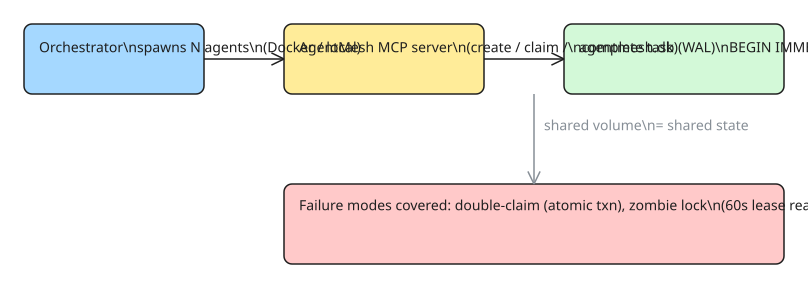

# How to Coordinate Multi-Agent AI Swarms Without Cloud Deadlocks — a Distributed Task Board MCP Server (AgentMesh)

Running 20 AI coding agents on a shared repo fails in predictable ways: two agents claim the same issue, a crashed agent leaves a task locked forever, and adding a cloud queue (Redis, Postgres, a workflow service) for coordination adds more infrastructure than the work itself justifies. [AgentMesh](https://github.com/johannschiffer/agentmesh-mcp) solves the coordination problem with **one MCP server and a single SQLite file in WAL mode** — no cloud dependency, no message broker, no distributed lock service.

The core idea: the coordination state is just a small SQLite database, and SQLite's WAL + immediate transactions give you atomic task claiming for free.

## The four failure modes and their fixes

| Failure mode | Fix in AgentMesh |
|---|---|
| Two agents claim the same task | `BEGIN IMMEDIATE` + conditional update in one atomic transaction — exactly one writer wins |
| Crashed agent leaves zombie lock | Leased claims with heartbeat; `lease_timeout_sec` (default 60s) lets a reaper reclaim stuck tasks |
| Task depends on unfinished work | `depends_on` JSON array; task stays `blocked` until all deps are `done`, then auto-promotes to `pending` |
| Agents poll forever / busy-wait | Claim is atomic; agents that lose the race move on to the next task instead of waiting |

## Step 1 — Wire the MCP server into the agent

Claude Code (and any MCP host) configuration:

```json
{
  "mcpServers": {
    "agentmesh": {
      "command": "agentmesh",
      "args": ["--db", "/shared/agentmesh.db"]
    }
  }
}
```

All agents point at the **same database file** (shared volume for Docker agents, shared FS for local processes). That file is the entire coordination state.

## Step 2 — The atomic claim (the part that matters)

The whole concurrency story is this transaction:

```python
def claim_task(conn, task_id, agent_id):
    """Atomic claim: BEGIN IMMEDIATE + conditional update.
    Only one agent can win; losers see rowcount == 0 and move on."""
    with conn:  # WAL mode + BEGIN IMMEDIATE
        cur = conn.execute(
            """UPDATE tasks
               SET status = 'claimed', claimant = ?, claimed_at = now(),
                   lease_expires = now() + ?
               WHERE id = ? AND status IN ('pending', 'zombie')""",
            (agent_id, LEASE_TIMEOUT_SEC, task_id),
        )
        return cur.rowcount == 1  # False → someone else got it
```

Two properties make this correct without any external lock:

1. **`BEGIN IMMEDIATE`** takes the write lock up front, so two concurrent claims serialize instead of both seeing `pending`.
2. **The conditional `WHERE`** makes the claim idempotent and race-free: the second writer's update matches zero rows and learns it lost.

## Step 3 — DAG dependencies without a workflow engine

Tasks carry a `depends_on` JSON array of task IDs. On every state change the server checks the DAG:

```python
def promote_blocked(conn):
    """Promote blocked tasks whose deps are all done."""
    for row in conn.execute("SELECT id, depends_on FROM tasks WHERE status = 'blocked'"):
        deps = json.loads(row["depends_on"])
        open_deps = conn.execute(
            """SELECT count(*) FROM tasks
               WHERE id IN (?) AND status NOT IN ('done')""", deps,
        ).fetchone()[0]
        if open_deps == 0:
            conn.execute("UPDATE tasks SET status = 'pending' WHERE id = ?", (row["id"],))
```

This gives you parallelizable fan-out: the board only exposes `pending` tasks, so agents naturally work on the frontier of the DAG.

## Step 4 — Zombie reclamation

A claim is a **lease**, not a lock. Agents heartbeat while working; the server (or any agent, on claim attempt) runs a reaper:

```python
def reap_zombies(conn):
    """Claims older than the lease timeout become claimable again."""
    conn.execute(
        """UPDATE tasks SET status = 'pending', claimant = NULL
           WHERE status = 'claimed' AND lease_expires < now()"""
    )
```

A crashed agent can never wedge the swarm: worst case, its tasks become claimable after 60 seconds.

## Step 5 — The agent-side loop

Each agent runs the same loop until the board is empty:

```python
while True:
    task = mcp.claim_task(agent_id)   # atomic; None when board is empty
    if task is None:
        break
    result = do_work(task)            # edit code, run tests, whatever
    mcp.complete_task(task.id, result)
```

Because claiming is atomic and the board is the single source of truth, you can run agents as local processes, Docker containers, or on different machines with a shared volume — no orchestration service in the middle.



## When this pattern works (and when it doesn't)

**Works well:**
- Dozens of agents, same repo, one machine or a shared volume — the SQLite file *is* the coordination plane.
- Crash-tolerant by construction: restart an agent and it just keeps claiming; state survives in the file.
- Debuggable: `sqlite3 agentmesh.db "select * from tasks"` is the entire observability story.

**Breaks down:**
- **Many writers on a network filesystem** — SQLite over NFS/SMB is not safe; use a real queue (Redis Streams, Postgres `FOR UPDATE SKIP LOCKED`) once the board outgrows one machine.
- **Long-running tasks with coarse heartbeats** — a 60s lease is tight for tasks that take 10 minutes; scale `lease_timeout_sec` to your work or rely on heartbeats.
- **Cross-machine agents with no shared volume** — the design assumes the DB file is reachable by every agent; that's the one place "distributed" is doing heavy lifting.

## References

- [How to Coordinate Multi-Agent AI Swarms Without Cloud Deadlocks — a Distributed Task Board MCP Server (DEV.to, original source)](https://dev.to/johann_schiffer/how-to-coordinate-multi-agent-ai-swarms-without-cloud-deadlocks-a-distributed-task-board-mcp-server-djb)
- [johannschiffer/agentmesh-mcp on GitHub](https://github.com/johannschiffer/agentmesh-mcp)
- Related KB notes: [[MCP Protocol Era Downgrades — Why Your Server Silently Serves the Old Spec (2026-07-28)]] (protocol behavior when scaling MCP servers), [[How to Soak-Test Your MCP Server Before AI Agents Do It for You (mcpload)]] (load-testing the server side)
