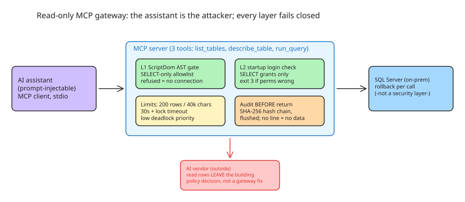

# How to Let an AI Assistant Read SQL Server Without Letting It Write (Defense-in-Depth MCP Gateway)

The request looks simple: let an AI assistant answer questions from an on-premises SQL Server. The hard part is what the assistant must **not** be able to do. The correct threat model treats **the assistant itself as the attacker** — it can be prompt-injected (e.g., by text stored in a table it just read) or simply make a mistake. Three properties must still hold: it cannot change the database, it cannot read outside the connected database, and it cannot get data back from a call before that call is recorded.

## The threat no gateway fixes: exfiltration by design

Before any hardening: **the rows the assistant reads leave the building**, to the AI vendor that runs the model. Read-only does not change that. What may be sent, under which personal-data rules (GDPR, KVKK, etc.), is a policy decision the firm must make explicitly. A read-only gate controls *damage to* the database, not *disclosure from* it.

## Architecture: mssql-readonly-mcp as the reference pattern

[`mssql-readonly-mcp`](https://github.com/oguzhanpisgin/mssql-readonly-mcp) (MIT, C# on .NET 10) is a concrete implementation of the pattern. The MCP client starts it as a **local stdio process** and it exposes exactly three tools: `list_tables`, `describe_table`, `run_query` — only `run_query` takes SQL. The design generalizes to any database + any MCP server:

### Layer 1 — SELECT-only gate built on the parser, not a keyword filter

The SQL text is parsed with **ScriptDom** (the T-SQL parser library). It must be exactly one plain `SELECT`, and **every node in the syntax tree must be on a hand-written allowlist** of node types and function names. A refused call opens **no connection at all**.

Why an allowlist and not a regex/keyword filter: the publicly reported bypass classes are *shapes, not words* — stacked statements, `GO` batches, `EXEC` of a string, DML inside or after a CTE, nested comments. A regression suite replays them (71 allowed / 247 refused rows), and a generated test ensures a node type added by a later ScriptDom version cannot pass silently.

Subtle parser-vs-engine divergence to watch: a `GO` on its own line is a **batch separator to the parser**, but SQL Server reads it as a column alias and runs both statements. The project resolves this by replaying 335 lexer cases against a real SQL Server and asserting the exact split (269 refused by the gate, 61 allowed and read identically by the server, 5 allowed by the gate and refused by the server — defense still holds).

**Principle: gate on the AST the database will execute, never on the text you received.**

### Layer 2 — the login, verified at startup (not assumed)

The gate is not trusted alone. At startup the server **asks SQL Server what its login may do** and refuses to start (exit code 3, no override) if the permission check fails. A setup script (`scripts/create-readonly-login.sql`) grants `SELECT` only on listed tables/views — a table without a grant is not even listed. Belt and braces: the database enforces what the gate promises.

### Layer 0.5 — transaction rollback, honestly labeled

Every `run_query` runs in a transaction that is always rolled back — but this is explicitly **not counted as a security layer**: a read can still leave an auto-created statistics object behind. Layers that claim more than they deliver are worse than no layers.

### Per-call limits (availability)

- Rows capped (200 default), characters capped (40,000), time capped (30 s/call)
- Session lock timeout (5,000 ms) and **low deadlock priority**, so the assistant's query loses deadlocks against real workloads
- A call not finished 0.5 s past its limit is answered `Timeout` with no data; cleanup continues server-side

### Tamper-evident, write-before-return audit log

No call returns data before its **hash-chained audit line** is written: one JSON line with a SHA-256 hash plus the hash of the previous line, flushed to disk before the result goes back. If the line cannot be written, the call returns an error and **no data** (the query may still have run). `verify-audit` exits 0 on an intact file, 1 on a tampered copy.

Known audit limits: the chain does not detect removal of the newest lines or a full rewrite unless the last hash is copied somewhere the writer cannot write (the hash is unkeyed); on Windows a second server process on the same path writes a sibling file — verify **every** file.

## Setup procedure (five-minute start)

1. Download the release build (Windows x64 / Linux x64 / macOS arm64) and **check it against `SHA256SUMS`**
2. List your tables in `scripts/create-readonly-login.sql`, run it as admin (`sqlcmd -S <host> -E -b -i create-readonly-login.sql`), then `check-login`
3. Connect the MCP client (stdio config with the connection string in an environment variable, password never in a file or command line)
4. Ask questions; run `verify-audit` afterwards

## Validation evidence (what "tested" should mean)

The project reports gate 416 + audit 90 unit tests and 259/259 integration tests on SQL Server 2019/2022/2025 images, plus **five red-team attack runs** speaking JSON-RPC over stdio against containerized SQL Server. Findings were LOW/MEDIUM only (unaudited malformed tool calls, timeouts overshooting by ~5 s, a frozen-connection lock leak U-1 fixed in v0.1.1). An Extended Events trace shows no batch/RPC/login event for refused statements. Scans: gitleaks, semgrep, CodeQL, NuGet advisories. Honest caveats stated by the author: **not a third-party audit**, and some platforms (Linux/macOS builds) were not yet exercised — read such claims as self-assessment, not certification.

## Design checklist for any read-only database MCP gateway

- [ ] Parser-level allowlist on the AST (not keyword blocklists); refused call = no connection opened
- [ ] Startup verification of the DB login's actual permissions; refuse to start otherwise
- [ ] Per-table GRANTs, and the tool surface only *lists* what is granted
- [ ] Row/char/time caps + lock timeout + low deadlock priority
- [ ] Hash-chained audit written and flushed **before** data is returned; fail closed
- [ ] Explicit threat-model statement about what leaves the building to the model vendor
- [ ] Regression corpus of known parser-bypass shapes, replayed on every release

## References

- [Original article: Letting an AI assistant read SQL Server without letting it write](https://dev.to/oguzhanpisgin/letting-an-ai-assistant-read-sql-server-without-letting-it-write-208m)
- [mssql-readonly-mcp on GitHub (v0.1.1)](https://github.com/oguzhanpisgin/mssql-readonly-mcp)
- [mssql-readonly-mcp release v0.1.1](https://github.com/oguzhanpisgin/mssql-readonly-mcp/releases/tag/v0.1.1)
- Related in KB: `howto-azure-mcp-server-scoped-agent-access.md`, `explanation-mcp-servers-writing-public-content.md`, `explanation-tool-descriptions-are-the-contract.md`
