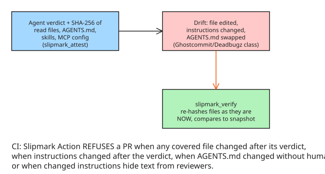

# How to Bind Agent Verdicts to Their Instructions: Slipmark MCP Server for Codex

Codex reads `AGENTS.md` from the repo it works in — and every other coding agent now does too. That makes `AGENTS.md` **part of the input to every review**, and the 2026 attacks on coding agents went for exactly that: **Ghostcommit, Deadbugz, poisoned skills**. The attack class: change the instructions an agent (or a human reviewing its work) trusts, and the downstream verdicts inherit the change silently.

Slipmark 0.6 adds an MCP server that binds every agent verdict to a SHA-256 snapshot of the instructions and files it was given, so drift is detectable.

## Setup: three lines in `~/.codex/config.toml`

```toml
[mcp_servers.slipmark]
command = "npx"
args = ["-y", "slipmark@0.6.1", "mcp"]
```

## The two tools

| Tool | What it does |
| --- | --- |
| `slipmark_attest` | Records the agent's verdict together with the **SHA-256 of each file it read**, and of `AGENTS.md`, skills, and MCP config |
| `slipmark_verify` | Checks every recorded verdict against the files **as they are now** |



## CI enforcement

The Slipmark CI Action refuses a pull request when any of these hold:

- a **file changed after the verdict** that covered it
- the **agent's instructions changed after the verdict**
- `AGENTS.md` changed **without a person approving it**
- changed instructions **hide text from reviewers**

## Deliberate narrowness

The MCP server is intentionally a weak surface — an agent that can only *record and check*, not act:

- **cannot** record a human approval (only a human can)
- **cannot** run commands
- **cannot** overwrite another verdict

That asymmetry is the security property: the attestation channel is one-way into the ledger, and the approval channel is human-only.

## Demo

Each attack modeled as an open pull request, plus one verdict recorded through the MCP server: [github.com/founder-ship-it/slipmark-context-demo](https://github.com/founder-ship-it/slipmark-context-demo). Main repo: [github.com/founder-ship-it/Slipmark](https://github.com/founder-ship-it/Slipmark).

## Practical implications

| If you... | Then... |
| --- | --- |
| Let coding agents review/attest code in CI | Add the three-line MCP config so verdicts carry instruction + file hashes |
| Worry about `AGENTS.md`-poisoning attacks (Ghostcommit/Deadbugz/poisoned skills) | The CI Action's four refusal conditions are the exact attack shapes to block |
| Need human-in-the-loop on instruction changes | Approval is deliberately NOT reachable from the agent — wire your approval flow around `slipmark_verify` |

## Related notes

- [How to Maintain Maintainability Sensors for Coding Agents](../aicodingagents/howto-maintainability-sensors-for-coding-agents.md) — another layer of post-hoc checks on agent work
- [How to Require a Job Receipt for Remote Model Proposals](../aicodingagents/howto-require-a-job-receipt-for-remote-model-proposals.md) — schema-validated proposals as a pattern; attestation is the same idea applied to the *instructions* side

## References

- [Slipmark for Codex: bind every verdict to the instructions it was given (DEV.to)](https://dev.to/paulredman/slipmark-for-codex-bind-every-verdict-to-the-instructions-it-was-given-2mc6)
- [Slipmark repository (GitHub)](https://github.com/founder-ship-it/Slipmark)
- [Slipmark context demo — attacks as open PRs (GitHub)](https://github.com/founder-ship-it/slipmark-context-demo)
- [AI coding agents hijacked using AGENTS.md file in Downloads folder (BleepingComputer)](https://www.bleepingcomputer.com/news/security/ai-coding-agents-hijacked-using-agentsmd-file-in-downloads-folder/) — a real-world instance of the exact instruction-poisoning attack class this note defends against (an `AGENTS.md` dropped into a watched folder flips an agent's behavior).
- [Mitigating Indirect AGENTS.md Injection Attacks in Agentic Environments (NVIDIA Developer Blog)](https://developer.nvidia.com/blog/mitigating-indirect-agents-md-injection-attacks-in-agentic-environments/) — how NVIDIA's AI Red Team surfaced indirect `AGENTS.md` injection in OpenAI Codex, and the mitigation patterns (sandboxing, allow-listing, provenance checks) that attestation sits alongside.
- [OpenAI Codex — MCP servers](https://developers.openai.com/codex/mcp) — how Codex wires up MCP servers, the surface this note's verdict-attestation pattern plugs into.
