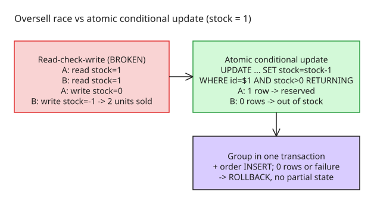

# How to Prevent Inventory Oversell with Atomic Conditional Updates

Two customers order the last item at the same time. Both requests read `stock = 1`, both conclude stock is available, both orders are accepted — and you have sold two units of one. The root cause is not a slow database: it is that **checking stock and reserving it are separate operations without sufficient concurrency control**.

## Step 1: recognize the read-check-write race

The naive application logic:

```js
if (product.stock > 0) {
  await createOrder(product.id);
  await updateStock(product.id, product.stock - 1);
}
```

Another request can execute between the check and the update. **Wrapping this in a transaction is not automatically enough** — the operations must be *designed* so conflicting requests cannot both reserve the same unit.

## Step 2: use an atomic conditional update

Fold the check and the decrement into a single statement (PostgreSQL example):

```sql
UPDATE products
SET stock = stock - 1
WHERE id = $1
  AND stock > 0
RETURNING id, stock;
```

- **A row is returned** → one unit was successfully reserved
- **No row is returned** → the product doesn't exist or has no stock left

Under PostgreSQL's normal transactional behavior, concurrent updates to the same row are coordinated: a later update rechecks the condition after waiting for the conflicting update. This is stronger than reading stock into application memory and updating it later.

## Step 3: keep the order workflow transactional

Reserving stock is usually one step of a larger workflow (order record + order items). Group the operations so a failed later step can't leave decremented inventory without an order:

```sql
BEGIN;

UPDATE products
SET stock = stock - 1
WHERE id = $1
  AND stock > 0
RETURNING id;
-- Application must verify exactly one row was returned.
-- If not: ROLLBACK. Otherwise: INSERT the order record.

COMMIT;
```

The application must **inspect the returned rows** and issue `ROLLBACK` when stock is unavailable or a required operation fails; production code also handles exceptions and transaction cleanup.

## Step 4: ORMs don't change the rules

An ORM (e.g. Prisma) makes access more convenient, but the same concurrency principles apply: use a **conditional update** supported by the database/ORM, or a parameterized SQL statement, then create the order inside a transaction and roll back on failure. Do **not** assume a read-then-write is safe merely because it sits inside a transaction.

## Step 5: production considerations

- **Idempotency** — retrying the same order/payment must not create duplicates
- **Payment failures** — reservations may need to expire or be released if payment doesn't complete
- **Deadlocks** — transactions locking multiple rows should acquire locks in a consistent order
- **Monitoring** — track failed reservations, transaction errors, unusual order patterns

## Step 6: test the fix

Create a product with **one unit** of stock and fire two concurrent order requests. Expected:

- Only one request reserves the last unit; the other gets out-of-stock
- Stock never goes negative
- A failed order leaves no partial database changes

Repeat with larger stock values and more concurrent requests. **Automated integration tests against the actual database** are preferable to mocked responses.

**Key lesson:** enforce critical business rules at the database-operation level, not with application-code checks.



## References

- [Preventing Race Conditions in Inventory Management Using Database Transactions (DEV.to)](https://dev.to/sachin_rajput_1361bca0230/preventing-race-conditions-in-inventory-management-using-database-transactions-b4g)
