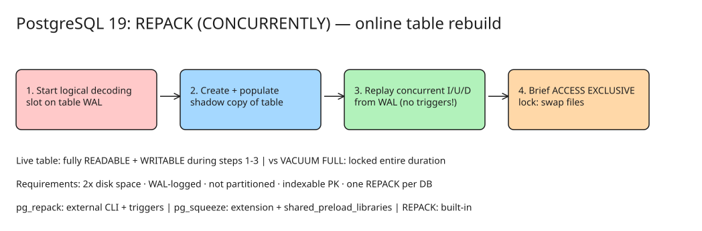

# How to Reclaim Table Bloat Online with REPACK (PostgreSQL 19)

PostgreSQL 19 promotes online table rebuilds from third-party extensions (`pg_repack`, `pg_squeeze`) to a first-class `REPACK` SQL command. This note is the production runbook: detect bloat, choose the right mode, run it, and know the preconditions before you touch a busy table.



## Why bloat exists (30 seconds)

Postgres MVCC keeps old row versions after `UPDATE`/`DELETE`. Autovacuum marks that space reusable *inside the file* but never shrinks the table or returns space to the OS. On large, update-heavy tables vacuum falls behind and the dead-tuple pile becomes permanent disk waste plus extra page reads. Reclaiming the space requires a **table rebuild** — historically `VACUUM FULL` (read/write lock for the whole duration = downtime), dump/restore, `pg_repack` (external CLI + trigger overhead), or `pg_squeeze` (extension, needs `wal_level=logical`, a replication slot, and `shared_preload_libraries`).

## Step 1 — Detect and quantify bloat

```sql
SELECT
    schemaname,
    relname,
    pg_size_pretty(pg_relation_size(schemaname || '.' || relname)) AS size,
    n_live_tup,
    n_dead_tup,
    CASE WHEN n_live_tup > 0
         THEN round((n_dead_tup::float / n_live_tup::float)::numeric, 4)
    END AS dead_tup_ratio,
    last_autovacuum,
    last_autoanalyze
FROM pg_stat_user_tables
ORDER BY dead_tup_ratio DESC NULLS LAST;
```

Rule of thumb from the source: **&lt;50% dead-tuple ratio** → monitor, check autovacuum settings; **>50%** → investigate and consider a rebuild, especially with slow queries or growing files. There is no single magic threshold — weigh wasted bytes, workload, and whether a rewrite is worth it.

## Step 2 — Pick the REPACK mode

```sql
-- Like VACUUM FULL: ACCESS EXCLUSIVE lock for the whole operation
REPACK my_table;

-- Online: table stays fully readable AND writable; brief exclusive lock only
-- at the very end for the file swap
REPACK (CONCURRENTLY) my_table;

-- Online + physically reorder rows to match an index (successor to CLUSTER,
-- which took a lock)
REPACK (CONCURRENTLY) my_table USING INDEX my_index;
```

Options: `CONCURRENTLY` (online rebuild via WAL logical decoding — the `pg_squeeze` technique, now built in, no extension, no `shared_preload_libraries`), `VERBOSE` (progress at INFO level), `ANALYZE` (refresh planner statistics after the repack).

```sql
REPACK (CONCURRENTLY, VERBOSE, ANALYZE) repack_test;
-- INFO:  repacking "public.repack_test" in physical order
-- INFO:  "public.repack_test": found 0 removable, 1000000 nonremovable
--        row versions in 38452 pages
-- Time: 9406.788 ms          → Before: 493 MB, After: 228 MB (54% reduction)
```

`USING INDEX` is also a performance feature on its own: `REPACK orders USING INDEX idx_orders_created_at` stores rows sequentially by date, turning scattered range scans (`WHERE created_at BETWEEN ...`) into sequential I/O. Caveat: later updates are **not** automatically clustered — locality decays.

## Step 3 — Check the CONCURRENTLY preconditions

Before running on production, verify all of these (violations fail the command):

- [ ] **2× free disk space** for the table + indexes (two copies exist during the rebuild)
- [ ] Table is WAL-logged (not `UNLOGGED`)
- [ ] Table is **not partitioned**
- [ ] Table has an **indexable primary key**
- [ ] Not a system catalog or TOAST table
- [ ] Not a non-heap access method
- [ ] No other REPACK is running in the same database (one per database at a time)

## Step 4 — Budget the time cost

Measured on the source's test (493 MB table, 1M live rows after deleting 1M of 2M):

| Method | Time | Result | Table accessible? |
| --- | --- | --- | --- |
| `VACUUM FULL` | 2.7 s | 228 MB | No (locked throughout) |
| `REPACK` | 5.9 s | 228 MB | No (locked throughout) |
| `REPACK (CONCURRENTLY)` | 9.4 s | 228 MB | **Yes** (brief lock at end only) |

`CONCURRENTLY` is ~3.5× slower in wall clock because it does logical decoding + WAL replay on top of the rebuild. The tradeoff is deliberate: **more time in exchange for staying online.**

## How CONCURRENTLY works internally

1. Start a logical decoding slot on the table's WAL.
2. Create and fully populate a shadow copy of the table.
3. Replay concurrent `INSERT`/`UPDATE`/`DELETE` captured from WAL into the shadow copy (no triggers on the live table — the key improvement over `pg_repack`).
4. Take `ACCESS EXCLUSIVE` briefly, swap the files, release.

## Pitfalls

- **WAL volume**: the rebuild is fully logged; plan headroom in `max_wal_size` / replication lag windows.
- **Replication slot pinning**: if the repack stalls, WAL retention grows — monitor `pg_replication_slots`.
- **Old extension cleanup**: if you previously ran `pg_repack`, drop leftover log tables/triggers after migrating to built-in REPACK.
- Bloat ratios from `pg_stat_user_tables` are **estimates**; corroborate with actual file size vs. estimated live tuple bytes before a rewrite.

## References

- [Snowflake Engineering: Postgres 19 REPACK — Faster, Built-In Table Bloat Cleanup](https://www.snowflake.com/en/blog/engineering/postgres-19-repack-table-bloat/)
- [PostgreSQL 19 REPACK command reference](https://www.postgresql.org/docs/19/sql-repack.html)
- [Crunchy Data: Checking for PostgreSQL Bloat](https://www.crunchydata.com/blog/checking-for-postgresql-bloat)
- [pg_repack project site](https://reorg.github.io/pg_repack/)
- [pg_squeeze (CYBERTEC)](https://github.com/cybertec-postgresql/pg_squeeze)
