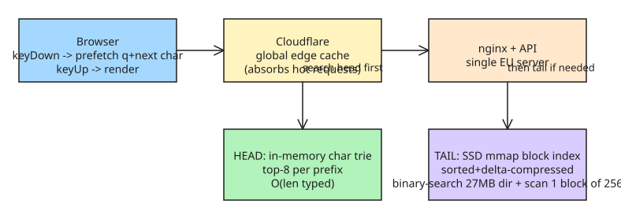

# p99 ~0 ms Autocomplete for 240M Domain Names (Wirewiki)

A case study in making a web autocomplete feel *instant* across 240 million domain names. The trick is to make the API response land **before the user releases the second key**, so perceived latency is zero at p99.

## Defining the latency budget

Latency is measured as `keyUp -> results ready for rendering`. On a 60 Hz display (16.7 ms/frame) you have roughly two key-press durations plus the gap between presses. Measured by typing 100 domain names fast: **p99 budget ~121 ms**.

The client-side trick that buys time:
- On `keyDown` (user starts pressing a key), **prefetch** suggestions for the typed char + any likely next char.
- On `keyUp`, **render** — by then the response is already in hand.

```jsonc
// GET /autocomplete?q=wi  -> returns current results AND precomputed next-char buckets
{
  "results": ["wikipedia.org", "windowsupdate.com", "..."],
  "next": {
    "-": ["wi-fi.ru", "wi-fi.org", ...],
    ".": ["wi.gov", "wi.us", ...],
    "a": ["wiadomosci.wp.pl", ...]
  }
}
```

## The two-tier data structure (head + tail)

Data sources: **Tranco** top-1M popular domains (the head, suggested first) and **CZDS** full gTLD domain lists (the tail). Results returned in rank order.


- **Head — in-memory character trie:** stores the precomputed top-8 suggestions for *every* prefix; a lookup is a walk of a few pointers. Worst case `O(len typed)`.
- **Tail — SSD-backed memory-mapped block index:** CZDS domains sorted and delta-compressed into fixed-size blocks with a tiny in-memory directory (~27 MB). A lookup binary-searches the directory, then linearly scans one 256-name block. ~240M names take ~2.5 GB on disk; hot pages stay cached by the OS. Worst case `O(len typed * log N)`.

Both query length and domain count are bounded, so both structures are effectively **O(1)** in practice — keeping p99 latency low.

## Measured results (LLM stress test: 720k keystroke queries from 60k simulated domains, open-loop replay)

- API alone answers most requests within **2 ms**.
- Through nginx at 1.6k req/s: **15 ms** at p99.
- End-to-end (browser -> Cloudflare -> server + ~10 ms) stays within the 121 ms budget even with 1000 concurrent typers — *for European traffic*. US traffic adds 100-200 ms and would exceed the budget; geo load-balancing across regions is what would close that gap (deliberately not built for a niche tool).

## Reusable lessons

1. **Prefetch on keyDown, render on keyUp** — hide network latency inside the human typing interval rather than fighting it.
2. **Precompute next-char buckets server-side** so one request covers multiple future keystrokes.
3. **Tier your data:** a small hot in-memory structure (trie) for the head + a compact mmap index for the long tail; both bounded -> effectively constant time.
4. **Let the CDN absorb hot paths** and measure end-to-end, not just API latency — network dominates once you're past ~10 ms of compute.

## References

- [p99 0 ms* autocomplete for 240M domain names (ruurtjan.com)](https://ruurtjan.com/articles/p99-0ms-autocomplete-for-240-million-domain-names)

## Further Reading (added 2026-10-19 by KB Zookeeper audit)

- [🤯 P99 0ms Autocomplete: How Tries Power 240M Domain Names Instantly, Explained!, Видео, Смотреть онлайн](https://salda.ws/video.php?id=U8loO-2F84c) — #Tries #Autocomplete #DataStructures #P99 #TechExplained #Edumation # Видео 🤯 P99 0ms Autocomplete: How Tries Power 240M Domain Names Instantly 
- [P99 0 ms* autocomplete for 240M domain names | Hacker News](https://news.ycombinator.com/item?id=49505219) — That is not how any autocomplete works that I know of, vasco 4 hours ago What you said might be true and yet what OPs AI agent did wasn't measure latency of…
