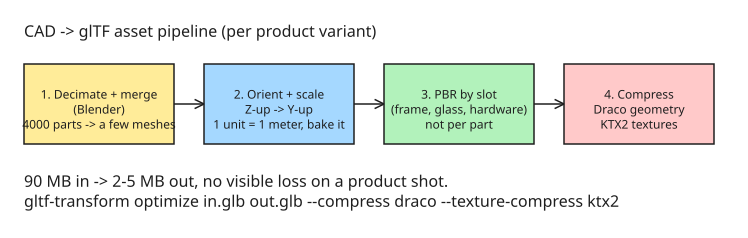

# How to Turn Manufacturer CAD Files into Browser-Loadable glTF

The demo looks easy: load a glTF, orbit around it, swap a material. Then a real manufacturer sends their actual product file, and you learn the hard part was never the Three.js — it was getting their CAD into something a browser can load in under three seconds.

## What actually arrives

Manufacturers model in SolidWorks, Inventor, Rhino, or hand you a STEP file. Exported to glTF, a single product variant lands at **40–120 MB** and is usually:

- **Z-up** — the CAD convention. Three.js is Y-up, so the model is lying on its back.
- **Scaled in millimeters or inches** — either microscopic or the size of a building.
- **Stripped of materials**, or carrying CAD materials that mean nothing to a PBR renderer.
- **Thousands of separate parts** — every bolt its own mesh = thousands of draw calls.

None of that is the manufacturer doing anything wrong: CAD and realtime web rendering want opposite things.

## The four-stage pipeline

Run every incoming model through these stages before it goes near the configurator:



1. **Decimate and merge in Blender.** Collapse the part tree, remove internal geometry the customer never sees, weld bolts and screws into the parent. A 4000-part assembly becomes a handful of meshes.
2. **Fix orientation and scale on import.** Rotate Z-up to Y-up, set **1 unit = 1 meter**. Do it once, bake it, never think about it again in the app.
3. **Reassign PBR materials by slot, not per part.** Group surfaces into material slots (frame, glass, hardware) so a color picker touches *one* material instead of two hundred.
4. **Compress.** `gltf-transform` or `gltf-pipeline`, with **Draco** for geometry and **KTX2** for textures (so the GPU stores them compressed, not just the file):

```bash
gltf-transform optimize in.glb out.glb --compress draco --texture-compress ktx2
```

**90 MB in, 2–5 MB out**, with no visible loss on a product shot.

**Trade-offs worth knowing before you ship.** Draco compression is **lossy** — re-compressing an already-compressed model loses precision, so compress last in the art workflow and keep an uncompressed original. Decompression happens on the client *before* upload to the GPU: it adds parse latency and does not improve frame rate — if you need fewer vertices, simplify the geometry, not just compress it. For small geometries (under ~1 MB) the WASM decoder's own size can outweigh the savings. Encoder options: `edgebreaker` (default) compresses best but reorders vertices; use `sequential` to preserve index order. Details: [KHR_draco_mesh_compression documentation](https://gltf-transform.dev/modules/extensions/classes/KHRDracoMeshCompression).

## The part the quote forgets

This pipeline is **per product line, and it is ongoing**: new product → new file → run it again; new variant → new export; manufacturer updates a model → someone reprocesses it.

When scoping a configurator, treat the asset pipeline as **its own line item** — sometimes a small Blender script or a Laravel queue job so reprocessing is one command, not a day of clicking. The author's studio runs several of these in production, one per manufacturer, each fed by the same pipeline.

## Practical implications

| Symptom | Stage that fixes it |
| --- | --- |
| Model lying on its back | Stage 2 (Z-up → Y-up, bake on import) |
| Microscopic / building-sized model | Stage 2 (1 unit = 1 meter) |
| Thousands of draw calls | Stage 1 (decimate + merge, weld fasteners) |
| Color picker edits 200 materials | Stage 3 (material slots) |
| 40–120 MB glb, slow first load | Stage 4 (Draco + KTX2 → 2–5 MB) |
| Every new variant takes a day | Automate: script/queue job so reprocessing is one command |

## Related notes

- [How to Optimize SVG Icons for Web Performance](howto-svg-icon-optimization.md) — the 2D counterpart: an asset pipeline that strips weight before the browser sees it.
- [Browser-Only PDF Processing with CSP Enforcement](../../../examples/programming/frontendjavascript/example-browser-only-pdf-processing-with-csp-enforcement.md) — heavy binary assets (PDFs vs 3D scenes) processed client-side without a server round-trip.

## References

- [CAD to glTF — the manufacturer file pipeline nobody warns you about (DEV.to)](https://dev.to/gronskideveloper/cad-to-gltf-the-manufacturer-file-pipeline-nobody-warns-you-about-3ch9)
- [gltf-transform (Khronos)](https://gltf-transform.dev/)
- [KHR_draco_mesh_compression — glTF Transform docs](https://gltf-transform.dev/modules/extensions/classes/KHRDracoMeshCompression) — lossy-compression caveats, encoder options, and the WASM-decoder-size caveat.
- [trimesh (Python)](https://trimesh.org/) — server-side CAD/mesh loading and simplification for batch pipelines (reads some native CAD formats via plugins).
- [Three.js](https://threejs.org/)
