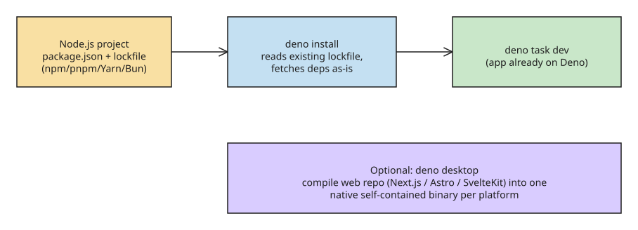

# Deno 2.9: Native Desktop Apps and Easier Node.js Migration

Deno 2.9 (released June 2026) is a major update to the JavaScript/TypeScript/WebAssembly runtime built on V8 and Rust. Two of its changes matter most for working JavaScript developers: a new **`deno desktop`** tool that turns existing web projects into native desktop apps, and a migration path to Deno that now fits in a couple of commands.

## Feature highlights

- **`deno desktop`** (experimental in 2.9) — compiles your existing web repository (Next.js, Astro, Remix, SvelteKit, or a plain script) into a **single self-contained native binary per platform**. The UI runs in a web view; application logic runs on Deno itself. No Electron or Tauri, no IPC layers — and full Node/npm compatibility from the start.
- **Lockfile-aware installs** — `deno install` now reads **npm, pnpm, Yarn, and Bun lockfiles** directly, so migrating a Node project does not require converting dependency metadata.
- **Node.js 26 compatibility target** aligned with the latest Node release.
- **CSS module imports via import attributes**, per the web standard for CSS module scripts (e.g. `import "./style.css" type(text/css)`).
- **Web Crypto API extended** with modern and **post-quantum algorithms** based on the NIST proposals.
- **Performance vs 2.8** (Deno.serve benchmarks, concurrency 100, dedicated Linux x86_64 machine): hello-world cold start halved from **34 ms to ~17 ms**. Sources of the gain: lazy loading of Node globals from the snapshot, limiting early Node bootstrap to Node workers, a V8 code cache for deferred ESM modules, minified snapshots, and on macOS a chain of pre-main fixes.
- **Tooling polish**: `deno compile`, `deno bundle`, `deno fmt`, `deno task` improved; supply-chain security hardening, refined test/coverage tools, and more granular **OpenTelemetry tracing** parameters.

## `deno desktop` in detail

- **Experimental in 2.9** — the surface is stabilizing; some platform features are still landing.
- **Native APIs under `Deno.*`** — `Deno.BrowserWindow` (window size, position, menus, DevTools), `Deno.Tray` (system-tray icon plus an attached panel), `Deno.Dock` on macOS, `Deno.autoUpdate()` (polling auto-updater that applies binary patches in the background). `prompt()`/`alert()`/`confirm()` render as native dialogs.
- **Bindings instead of IPC** — bind a function in the entrypoint with `window.bind()` and call it from page JavaScript via the `bindings` namespace; in-process channels with no cross-process round-trip.
- **Two rendering backends** — `--backend webview` (default) uses the OS engine (WebView2 on Windows, WebKit on macOS/Linux) for small, fast binaries; `--backend cef` bundles Chromium (CEF) for identical rendering on every platform at the cost of tens of megabytes.
- **Distribution** — same machinery as `deno compile`: `.app`/`.dmg` (macOS), `.exe`/`.msi` (Windows), `.AppImage`/`.deb`/`.rpm` (Linux). `--target` cross-compiles from one machine, `--all-targets` builds everything in one command, `--compress` ships a self-extracting bundle. `Deno.serve()` inside a desktop entrypoint automatically binds to the port the webview opens — no port wiring.
- **`deno watch main.ts`** — new alias for `deno run --watch-hmr`: re-runs on file changes with hot module replacement, restarting if hot replacement fails.

## How to migrate an existing Node.js project



1. **Install dependencies** — in the existing project root, run:
   ```bash
   deno install
   ```
   Deno 2.9 reads `package.json`, the existing lockfile, and workspace structure. No dependency rewrite.
2. **Run the app** —
   ```bash
   deno task dev
   ```
   In most projects that is the entire migration: nothing to port, nothing to rewrite.
3. **Verify the edge cases** — 2.9 specifically fixes the last remaining gaps: **pnpm workspaces** and tools that **invoke Node via the shell** now work without intervention.
4. **Optional desktop packaging** — point `deno desktop` at the web repository; it compiles code + Deno runtime + web rendering engine into one redistributable binary per platform.

## Notes and caveats

- The runtime is MIT-licensed, single-executable (runtime + package manager in one binary), and event-driven like Node (non-blocking I/O with blocking variants).
- Performance gains are measured on a dedicated Linux x86_64 machine; expect relative, not absolute, improvements elsewhere.
- The CSS import-attributes feature and Web Crypto extensions track evolving web standards — check current spec status before building critical features on them.

## References

- [Deno 2.9 est disponible — Developpez (javascript section)](https://javascript.developpez.com/actu/384649/Le-moteur-d-execution-pour-JavaScript-TypeScript-et-WebAssembly-Deno-2-9-est-disponible-integrant-un-generateur-d-applications-de-bureau-natives-et-facilite-la-migration-des-projets-Node-js/)
- [Deno Desktop: convert web apps into native binaries (Developpez)](https://javascript.developpez.com/actu/384396/Deno-Desktop-convertit-les-applications-web-en-binaires-natifs-en-ciblant-votre-referentiel-web-existant-tel-que-Next-js-Astro-ou-SvelteKit-pour-le-compiler-en-un-executable-natif-leger-et-autonome/)
- [Deno 2.9 release post — Deno blog](https://deno.com/blog/v2.9)
- [Desktop apps — Deno docs](https://docs.deno.com/runtime/desktop/)
