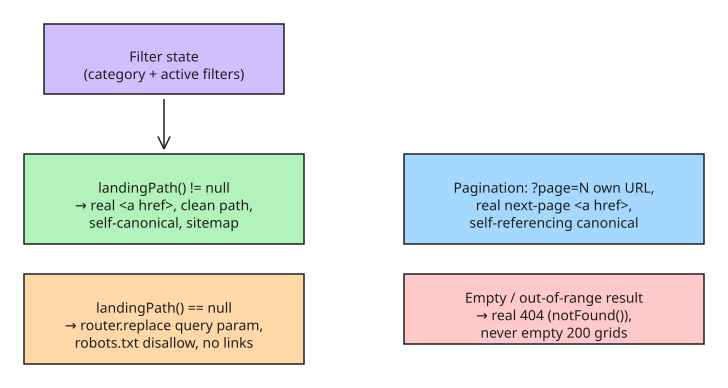

# Faceted Navigation and Infinite Scroll in Next.js: Crawlable URLs Without Combinatorial Explosion

Five optional filters with ten values each = 11⁵ = **161,051 valid URLs** before sorting and pagination — and crawlers will try to fetch them all. Google's guidance is blunt: there is usually no good reason to let crawlers fetch filtered pages. The fix is an architectural decision encoded in one module, not a meta tag.

## 1. Classify every filter state into one of three groups

| Kind | Example | Treatment |
| --- | --- | --- |
| **Landing facets** | category + one searched filter (brand, type) | clean path, self-referencing canonical, sitemap entry, real `<a href>` |
| **User-only state** | color, size, price, sort, "in stock" | query params only; never in crawlable links |
| **Pagination** | page N | its own rules (below) — it multiplies everything else |

Encode the decision once so the filter UI, sitemap, and canonical tag all agree:

```ts
// lib/facets.ts
export type Filters = Record<string, string[]>;

const LANDING_FACETS = new Set(["brand", "type"]);

export function landingPath(category: string, filters: Filters): string | null {
  const active = Object.entries(filters).filter(([, values]) => values.length > 0);
  if (active.length === 0) return `/${category}`;
  if (active.length > 1) return null;

  const [key, values] = active[0];
  if (!LANDING_FACETS.has(key) || values.length !== 1) return null;
  return `/${category}/${key}/${encodeURIComponent(values[0])}`;
}

export function filterQuery(filters: Filters): string {
  const params = new URLSearchParams();
  for (const key of Object.keys(filters).sort()) {
    for (const value of [...filters[key]].sort()) params.append(key, value);
  }
  return params.toString();
}
```

`landingPath` answers "does this state deserve its own page?"; `filterQuery` gives a **stable parameter order** — `?size=42&color=red` and `?color=red&size=42` are two different URLs to a crawler.

## 2. Render links vs controls accordingly

- `landingPath` returns a path → render `next/link` (a real anchor).
- It returns `null` → checkbox/button updating the query string with `router.replace`. Shareable URLs still work, but the HTML contains no thousands of crawlable links into parameter space.

Add a robots.txt rule for user-only parameters (`app/robots.ts`):

```ts
export default function robots(): MetadataRoute.Robots {
  return {
    rules: {
      userAgent: "*",
      disallow: ["/*?*color=", "/*?*size=", "/*?*price=", "/*?*sort="],
    },
    sitemap: "https://shop.example/sitemap.xml",
  };
}
```

⚠️ **One mechanism per URL pattern**: a URL blocked in robots.txt is *never fetched*, so any `noindex` or canonical on that page is never seen. Third option from Google's faceted-nav guide: put filters in the **fragment** (`#color=red`) — fragments have no effect on crawling at all.

**Empty result sets must 404**, not an empty grid with 200 — otherwise empty combinations look like real pages.

## 3. Infinite scroll that crawlers can follow

Crawlers don't scroll or click "load more". Google's three rules for incremental loading:

1. every chunk has its own URL (`?page=3`);
2. each page links to the next with a normal `<a href>`;
3. each page is its own canonical (not page 1). `rel="next"`/`rel="prev"` are dead at Google.

Keep infinite scroll for users by treating the server-rendered "next page" link as the source of truth and *enhancing* it:

```tsx
"use client";
import Link from "next/link";
import { useEffect, useRef, useState } from "react";

type Product = { id: string; name: string; href: string };
type Chunk = { items: Product[]; nextPage: number | null };

export function ProductList({ category, first }: { category: string; first: Chunk }) {
  const [items, setItems] = useState(first.items);
  const [next, setNext] = useState(first.nextPage);
  const sentinel = useRef<HTMLAnchorElement>(null);

  useEffect(() => {
    if (!sentinel.current || next === null) return;
    const observer = new IntersectionObserver(async ([entry]) => {
      if (!entry.isIntersecting) return;
      observer.disconnect();
      const chunk: Chunk = await fetch(`/api/${category}?page=${next}`).then((r) => r.json());
      setItems((prev) => [...prev, ...chunk.items]);
      setNext(chunk.nextPage);
      window.history.replaceState(null, "", `?page=${next}`);
    });
    observer.observe(sentinel.current);
    return () => observer.disconnect();
  }, [category, next]);

  return (
    <>
      <ul>
        {items.map((p) => (
          <li key={p.id}><Link href={p.href}>{p.name}</Link></li>
        ))}
      </ul>
      {next !== null && (
        <Link ref={sentinel} href={`/${category}?page=${next}`}>Next page</Link>
      )}
    </>
  );
}
```

Without JS: one chunk plus a working next-page link. With JS: the same anchor becomes the scroll trigger, and `window.history.replaceState` keeps the address bar in sync without a navigation. On the server, call `notFound()` for out-of-range page numbers **before any Suspense boundary** so it returns a real 404.



## 4. Verify what a crawler actually finds

Crawl a staging build within a defined scope and **group URLs by pattern**: if parameter URLs outnumber product URLs, the filter UI is still leaking links. Check status, metadata, and indexability of every crawled URL with any site-audit tool.

## References

- [Faceted navigation and infinite scroll in Next.js: URLs crawlers can actually use (DEV.to)](https://dev.to/liaxim/faceted-navigation-and-infinite-scroll-in-nextjs-urls-crawlers-can-actually-use-36ac)
- Related in KB: [Eradicate slow TTFB with streaming SSR in Next.js](howto-eradicate-slow-ttfb-with-streaming-ssr-nextjs.md)
