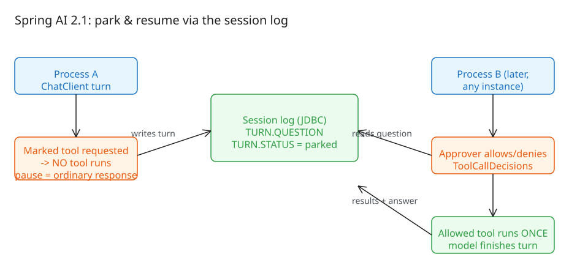

# Human-in-the-Loop Tool Calls That Survive a Restart with Spring AI 2.1

How-to: make a Spring AI agent **pause** when the model wants to run a dangerous tool (e.g. one that
moves money), let a human approve or deny minutes or hours later — possibly **in another process or
after a restart** — and then resume the turn. This is Spring AI 2.1's *tool call confirmation* plus
the community *Session Extensions* project (turn status / park & resume).



The key design property: **the loop keeps nothing while it waits**. A pause is an ordinary model
response, and the resumption is an ordinary request — the prompt and the paused reply hold everything
needed to continue, so the pause can outlive the process. This is the same "durable execution" idea
as WAL-based agent runtimes (see [Durable Agent Execution with SQLite WAL](../../../examples/aimachinelearning/agentarchitecture/example-agent-durable-execution-sqlite-wal.md)),
specialized for the human-approval case.

## 1. Mark the tool

Confirmation is declared per tool. Reading tools run freely; writing tools wait:

```java
@Tool(description = "Returns the customer's mortgage payments for one month ...")
public String mortgagePaymentStatus(@ToolParam(description = "The month, as YYYY-MM") String month,
        ToolContext toolContext) { ... }

// This call moves money, so a person approves it first
@Tool(description = "Collects the planned retry of a failed mortgage payment today ...",
        requiresConfirmation = true)
public String retryMortgagePaymentNow(@ToolParam(description = "The month of the payment, as YYYY-MM") String month,
        ToolContext toolContext) { ... }
```

Three ways to mark a call for confirmation — Spring Boot combines them (a call pauses if **any** rule
says so):

| Mechanism | Use case |
| --- | --- |
| `@Tool(requiresConfirmation = true)` | Tools you own |
| `spring.ai.tools.confirmation.tools=deleteFile,transferMoney` | Tools you do not own (e.g. MCP tools), named by property |
| `ToolCallConfirmationPolicy` bean | Rules that depend on arguments (e.g. transfer above an amount threshold) |

## 2. Handle the pause manually (plain Spring AI API)

When the model asks for a marked tool, **no tool runs**. The reply returns to your application and
names the calls waiting for a decision:

```java
ChatResponse reply = chatClient.prompt()
    .user("I have the money now. Please collect it today.")
    .call()
    .chatResponse();

List<String> awaiting = ToolCallDecisions.awaitingDecision(reply); // empty when the loop did not pause
```

Gotcha: read the reply with `chatResponse()` — a paused reply's text is usually empty, so `content()`
gives no sign that the loop paused.

Collect one decision per awaiting call, then execute via the auto-configured `ToolCallingManager`:

```java
String key = awaiting.get(0);
ToolCallDecisions decisions = ToolCallDecisions.of(ToolCallDecision.allow(key));
// or: ToolCallDecision.deny(key, "The approver declined the collection.")

Prompt prompt = new Prompt(conversation, ToolCallingChatOptions.builder()
    .toolCallbacks(ToolCallbacks.from(mortgages))
    .build());

ToolExecutionResult result = toolCallingManager.executeToolCalls(prompt, reply, decisions);

String answer = chatClient.prompt()
    .messages(result.conversationHistory())
    .call()
    .content();
```

## 3. Park and resume across processes (Session Extensions)

In production the paused prompt+reply must live in a **store**, and the request carrying the decision
must find it on whichever instance it lands. Spring AI 2.1's Session API already keeps the
conversation as an append-only event log in a database (session memory runs *inside* the tool loop,
so the log holds every round, including the paused reply). What it lacks is a record that says
"this session is waiting for a person".

[Spring AI Session Extensions](https://spring-ai-community.github.io/spring-ai-session-extensions/latest/)
(community project, first release 0.11.0 — API can still change) adds it via the Session API's
extension points: each session gets a **turn status** (`RUNNING`, `IDLE / REQUIRES_ACTION` = parked, etc.)
and the pending question is stored as a `TURN.QUESTION` event in the same log:

```xml
<dependency>
    <groupId>org.springframework.ai</groupId>
    <artifactId>spring-ai-starter-model-session-jdbc</artifactId>
</dependency>
<dependency>
    <groupId>org.springaicommunity</groupId>
    <artifactId>spring-ai-session-turn-advisor</artifactId>
    <version>0.11.0</version>
</dependency>
```

The demo uses file-based H2 with `spring.ai.session.repository.jdbc.initialize-schema=always`.

`TurnAdvisors` replaces `SessionAdvisors.builder(...)` in the advisor chain:

```java
ChatClient agent = chatClientBuilder
    .defaultTools(accounts, mortgages)
    .defaultAdvisors(TurnAdvisors.builder(sessionService)
        .toolCallingManager(toolCallingManager)   // the auto-configured bean
        .build())
    .build();
```

Resuming — a *different* process that only knows the session id:

```java
TurnService turns = new TurnService(sessionService);

if (turns.status(sessionId).isParked()) {
    ToolConfirmationQuestion question =
        ToolConfirmationQuestion.from(turns.pendingQuestion(sessionId));

    List<ToolCallDecision> decisions = question.toolCalls().stream()
        .map(call -> !call.awaitingDecision() || approved
                ? ToolCallDecision.allow(call.key())
                : ToolCallDecision.deny(call.key(), "The approver declined the collection."))
        .toList();

    String answer = agent.prompt()
        .advisors(TurnStatusAdvisor.decisions(sessionId, new ToolCallDecisions(decisions)))
        .call()
        .content();
}
```

The resuming call carries decisions and **no user message**; the advisor runs the allowed calls,
stores results right after the paused reply, and the model finishes the turn the other process
started. No `executeToolCalls` in your code, no prompt to rebuild — it comes from the log.

## Edge cases

- **Declined:** the tool does not run; the approver's message becomes the tool result and the model
  tells the customer.
- **Customer writes something new:** new text always moves a parked session on — the turn advisor
  closes the question first by storing a denial for each open call, keeping the log valid for the
  model provider.
- **Nobody answers:** parked turns have **no timeout**; closing stale questions (resume with a
  denial) is your application's job.

## Security responsibilities that stay with you

1. **Take the paused reply from server-side storage, never from a client request** — a client that
   can edit the reply can run any tool with any arguments. Reading it from the session log complies.
2. **Check who approves** — authorization of approver × call is your application's decision.
3. **Make resumption idempotent** — raw `executeToolCalls` runs tools again if replayed; the turn
   advisor records the answer *before* tools run, so an allowed call runs at most once and a
   duplicate decision set is refused.
4. **Treat the deny message as model input** — the model reads whatever the approver typed
   (prompt-injection surface).

## Known gaps in Session Extensions 0.11.0

- **No lease**: a turn whose process died stays `RUNNING` until someone calls `interrupt`.
- **Decisions key on the tool call, not the question**: models that emit tool calls without ids can
  have an old decision mistaken for the answer to a newer question of the same turn.

## References

- [Spring Blog: Human in the Loop with Spring AI 2.1 — Tool Calls That Survive a Restart](https://spring.io/blog/2026/11/24/spring-ai-tool-call-confirmation-park-resume) (original source)
- [Spring AI reference: Tool Call Confirmation](https://docs.spring.io/spring-ai/reference/2.1-SNAPSHOT/tools/confirmation.html)
- [Spring AI reference: Session API](https://docs.spring.io/spring-ai/reference/2.1-SNAPSHOT/memory/session/index.html)
- [Spring AI Session Extensions — Turn Status](https://spring-ai-community.github.io/spring-ai-session-extensions/latest/turn/turn-status/)
- [Demo: bank agent park & resume (tzolov/voxxeddays2026-demo)](https://github.com/tzolov/voxxeddays2026-demo/tree/main/25-bank-agent-park-resume)
- Related in KB: [Spring AI 2.1.0 GA overview](../../../explanations/programming/java/explanation-spring-ai-2-1-mcp-modern-decision-models-session-api.md),
  [Durable Agent Execution with SQLite WAL](../../../examples/aimachinelearning/agentarchitecture/example-agent-durable-execution-sqlite-wal.md)
