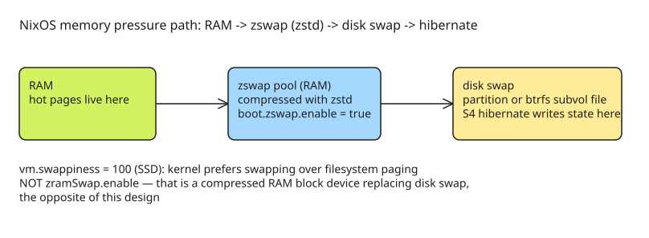

# Swap, ZRAM, Zswap and Hibernate on NixOS — A Two-Line Final Config

Goal: a desktop/laptop that can **suspend-then-hibernate** (ACPI S3 first, then S4 after a delay) with swap configured correctly. The end state is deliberately tiny:

```nix
boot.zswap.enable = true;
boot.kernel.sysctl."vm.swappiness" = 100;
```

Everything below explains why that's the whole config and what went wrong before arriving at it.

## Why hibernate forces a swap decision

Hibernate (S4) saves system state to disk — which requires swap space. The author's target behavior is KDE's "Standby, then hibernate": S3 suspend-to-RAM for short absences, automatic S4 after a delay so forgetting to power off doesn't drain the battery. That requirement alone rules out "no swap" configurations on workstations (the server-vs-workstation conflation muddles most online advice).

## Swap file vs swap partition — the hibernate wrinkle

- **Swap files complicate hibernate**: at resume, `initramfs` must locate the swap space *before* filesystems are mounted. On UEFI systems the location is saved into an EFI variable when hibernation starts.
- Desktop setup (simple): a dedicated swap partition:

```nix
swapDevices = [
  {device = "/dev/disk/by-uuid/f2fc399a-9703-450b-88df-5671b776fc71";}
];
```

- Laptop setup (LUKS + btrfs subvolume swap file, based on the [disko luks-btrfs-subvolumes template](https://github.com/nix-community/disko/blob/master/example/luks-btrfs-subvolumes.nix)):

```nix
fileSystems."/.swapvol" = {
  device = "/dev/disk/by-uuid/33682d1d-87c4-4166-8d3b-66d900387e42";
  fsType = "btrfs";
  options = ["subvol=swap"];
};

swapDevices = [
  {
    device = "/.swapvol/swapfile";
    size = 32 * 1024;   # MiB
  }
];
```

NixOS now understands hibernate-on-swap-file nuances (offset computation) itself, so the file-based setup works despite the initramfs ordering problem.

## The zram vs zswap distinction (the mistake that took a year to catch)

| | zram (`zramSwap.enable`) | zswap (`boot.zswap.enable`) |
|---|---|---|
| What it is | A compressed RAM block device used **as** the swap area | A compressed cache **in front of** disk-backed swap |
| Relationship to disk swap | Replaces it | Requires a real disk swap behind it |
| Right choice here? | No — wrong for hibernate + disk swap | Yes |

The author ran `zramSwap.enable` for months believing it was the recommended setup; it is actually the opposite of what [Chris Down's "Debunking zswap and zram myths"](https://chrisdown.name/2026-03-24/zswap-vs-zram-when-to-use-what.html) recommends (zswap *with* disk-backed swap). The confusion was only resolved when `boot.zswap` landed in nixpkgs ([PR #470366](https://github.com/NixOS/nixpkgs/pull/470366), April 2026) — before that, the option simply didn't exist.

## Compressor choice: lz4 → zstd

- Kernel default: `lzo` (speed/compression balance).
- NixOS default: `zstd` (best compression ratio; also good for Nix builds).
- ArchWiki leans on `lz4` (fastest, lowest latency) — but when memory is spilling to disk, **compression speed is rarely the bottleneck**; a better ratio fits more pages in the compressed pool and touches disk less.

Final config after dropping now-default settings (`boot.initrd.systemd.enable = true` is default since 26.05):

```nix
boot.zswap = {
  enable = true;
  compressor = "zstd";   # NixOS default, shown for clarity
};
boot.kernel.sysctl."vm.swappiness" = 100;
```

## Swappiness: why 100

`vm.swappiness` sets the relative cost of swapping vs filesystem paging. Chris Down's recommendation: **100 works well on SSDs**; the [kernel docs](https://docs.kernel.org/admin-guide/sysctl/vm.html#swappiness) agree you can go even higher on SSDs. It is "non-trivial to tune this value based on instinct alone" — test different values for your hardware. Open question from the article: there are no clear instructions anywhere for systematically testing/comparing swappiness values under workstation usage.

## Diagram: memory pressure path with zswap + disk swap



## Checklist

- [ ] Decide swap backing: partition (simplest for hibernate) vs LUKS+btrfs subvolume file (NixOS handles offsets).
- [ ] Use `boot.zswap.enable = true` — **not** `zramSwap.enable`.
- [ ] Pick compressor: NixOS default `zstd` (ratio-first); `lz4` only if you measure compression as the bottleneck.
- [ ] Set `vm.swappiness` (100 on SSDs is a solid start; test alternatives).
- [ ] Verify suspend-then-hibernate works end-to-end: S3 wakes instantly, S4 resume restores state from swap.

## References

- [Swap, ZRAM, Zswap and Hibernate on NixOS — Matthew Brunelle](https://blog.matthewbrunelle.com/swap-zram-zswap-and-hibernate-on-nixos/)
- [In Defence of Swap — Chris Down](https://chrisdown.name/2018-01-02/in-defence-of-swap.html)
- [Debunking zswap and zram myths — Chris Down](https://chrisdown.name/2026-03-24/zswap-vs-zram-when-to-use-what.html)
- [disko luks-btrfs-subvolumes template](https://github.com/nix-community/disko/blob/master/example/luks-btrfs-subvolumes.nix)
- [nixpkgs PR #470366 — boot.zswap option](https://github.com/NixOS/nixpkgs/pull/470366)
- [Linux kernel docs: vm.swappiness](https://docs.kernel.org/admin-guide/sysctl/vm.html#swappiness)

## Further Reading (added 2026-10-19 by KB Zookeeper audit)

- [Swap, ZRAM, Zswap and Hibernate on NixOS | Devtalk](https://devtalk.com/t/swap-zram-zswap-and-hibernate-on-nixos/250037) — Swap, ZRAM, Zswap and Hibernate on NixOS If you want to use hibernate you need swap space and that complicates your choice around ZRAM and ZSWAP.
- [Swap, ZRAM, Zswap and Hibernate on NixOS](https://forum.devtalk.com/t/swap-zram-zswap-and-hibernate-on-nixos/250037) — Swap, ZRAM, Zswap and Hibernate on NixOS If you want to use hibernate you need swap space and that complicates your choice around ZRAM and ZSWAP.
- [Swap, ZRAM, Zswap and Hibernate on NixOS | alt Hacker News](https://althacker.news/item?id=49820136) — A bettter Hacker News reader
