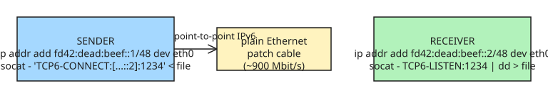

# Transfer Files Over an Ethernet Patch Cable (etherfiles)

A dead-simple way to move large files between two machines a few meters apart: connect them with an ordinary Ethernet patch cable and do a bit of IP configuration. No switch, no router, no cloud, no USB cable — just point-to-point wiring. A nothing-special patch cable reliably hits **~900 Mbit/s (~6.7 GB/min)**, far faster than USB flash or cloud storage for multi-GB transfers.

## Setup (Linux)

```bash
# On sender...
ip address add dev eth0 fd42:dead:beef::1/48
ip link set dev eth0 up

# On receiver...
ip address add dev eth0 fd42:dead:beef::2/48
ip link set dev eth0 up
```

After a few seconds, pings work:

```bash
# On receiver...
ping fd42:dead:beef::1
64 bytes from fd42:dead:beef::1: icmp_seq=1 ttl=64 time=0.649 ms
```

## Transfer with socat

```bash
# Receiver (listen)...
socat - TCP6-LISTEN:1234 | dd status=progress > big_file.tar.gz

# Sender (push)...
socat - 'TCP6-CONNECT:[fd42:dead:beef::2]:1234' < big_file.tar.gz
```

The commands assume Linux, but the underlying trick works everywhere. A ready-made `ethtransfer.sh` script wraps this for file copies.

## Why Ethernet specifically (vs. alternatives)


- **Cloud storage:** glacially slow (slow uplink + provider throttling), transfers data twice, often costs money.
- **WiFi / LAN TCP:** multi-gigabit claims are dubious in practice — walls, interference, dropouts; rarely reached at home.
- **Removable/USB storage:** slow unless you spend a lot, and the *cable* is usually the bottleneck (only one cable+peripheral pair actually hit gigabit, at the right angle). Also copies data on/off the drive, halving effective speed. USB's host/device model makes direct device-to-device awkward — though Linux recently added `/dev/tbstreamX` for USB-C/Thunderbolt/USB4 devices.
- **Ethernet wins:** it's the only common connection that reliably reaches gigabit between two random devices with cheap cables. It's truly differential (transformers), so it resists RFI and ground-level shifts, works point-to-point without a local network, and doesn't even need TCP/IP — raw link-layer frames are fine on a switched LAN, which also makes it a clean way to move data to/from a microcontroller.

## When to use it

Any time you're moving >~10 GB between two machines that are physically close (same room / desk). It's underappreciated for non-internet applications and needs no network infrastructure at all.

## References

- [Transfer files over an Ethernet patch cable (maurycyz.com)](https://maurycyz.com/misc/etherfiles/)
- [ethtransfer.sh helper script](https://maurycyz.com/misc/etherfiles/ethtransfer.sh)

## Further Reading (added 2026-10-19 by KB Zookeeper audit)

- [Transfer files directly between computers over ethernet cable?](https://superuser.com/questions/510508/transfer-files-directly-between-computers-over-ethernet-cable) — I often need to transfer files over my home network between computers and have found that WiFi transfers really aren't the best idea. or 6 cable lying around 
- [Patch Cord vs Ethernet Cable - Fibconet Communicate](https://fibconet.com/patch-cord-vs-ethernet-cable-are-they-the-same/) — Can I Use a Patch Cable as an Ethernet Cable? it is possible to use a patch cable as a temporary substitute for an Ethernet cable in certain scenarios.
