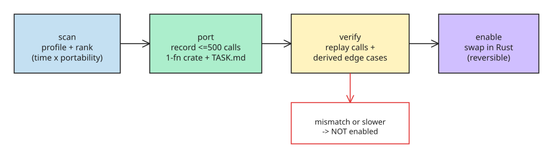

# fast-anything: Profile-Driven Rust Ports of the 5% That's Slow (Instead of Full Rewrites)

**fast-anything** (EL4CTEO, MIT, ~2k stars, trending on GitHub) operationalizes the counter-thesis to "rewrite it in Rust": most runtime sits in a handful of functions, so *profile first, port only the hot functions, and prove behavioral equivalence against recorded real calls before swapping the port in*. The port is one-command and fully reversible.

## The workflow

Install and run end-to-end:

```shell
npm i -g @el4cteo/fast-anything      # or: cargo install fast-anything

fast-anything go --agent claude -- python app.py
# also accepts: -- node app.ts / bun app.ts / deno run -A app.ts /
#   ruby app.rb / java App.java / mvn exec:java / gradle run / go run . /
#   php app.php / clang -O2 main.c / dotnet run -c Release / Rscript app.R
```

Step-by-step commands:

| Command | What it does |
| --- | --- |
| `scan -- <cmd>` | Profiles the app, ranks functions by *time × portability* |
| `port [id]` | Records up to **500 real calls**, creates a one-function Rust crate + `TASK.md` |
| `verify` | Release-builds the port and replays every recorded call |
| `enable` / `disable` | Swaps the Rust in/out (one marked block, removed byte for byte) |
| `bench` | Times whole app, original vs Rust, interleaved runs |
| `report` | Markdown + SVG card for the PR |
| `doctor` | Checks Rust toolchain, runtimes, agents |

`--agent` takes `claude`, `codex`, or any command that reads a prompt from stdin — the coding agent writes the port from `TASK.md`; without it you hand the task file to any tool.

## "Proof, not vibes": the verification gate

Nothing is enabled until **every** case matches — this is the genuinely novel part versus ad-hoc "port it with an LLM" workflows:

- Replays the ≤500 recorded real calls, plus **derived edge cases**: `NaN`, ±infinity, `-0.0`, zero and ±1, non-ASCII text, empty and up to 16× bigger inputs, plus shrunk/random slices.
- Matching means same values (floats within **1e-9**) and errors where the original errors. The README's demo case: a port that "looked right" but compared bytes instead of characters was caught by **148 of 500** recorded calls.
- A port that is correct but *slower per call* (crossing into Rust costs more than the work saved) is also not enabled.
- `FAST_ANYTHING_DISABLE=1` forces the original at any time.

## Key design decisions

- **Port the outermost loop it can**, not the tiny inner function — so the app crosses into Rust *once* instead of millions of times. (Porting only the inner `levenshtein` gave 1.9× vs 116× for the outer loop in their Python benchmark.)
- Each port is a **one-function crate** sharing one `.fast/target` cache — seconds to compile, not minutes.
- **Single C ABI + JSON bridge** for most languages: the port is a plain Rust library with one C entry point taking and returning JSON; Ruby (Fiddle), Java 22+ (FFM API), Go (cgo/dlopen), PHP (FFI ext), C/C++ (dlopen), C# (`NativeLibrary`), R (`.C()`) all need no headers or bindings. Python uses **PyO3**, JS/TS uses **napi-rs**.
- Only **top-level deterministic functions over plain data** are portable (numbers, strings, lists, dicts, typed arrays); `scan` explains why anything else can't move yet.

## Agent integration

- Claude Code plugin: `/plugin marketplace add EL4CTEO/fast-anything` → `/plugin install fast-anything@fast-anything` → `/fast-anything:fast python app.py`
- MCP server built into the binary: `claude mcp add fast-anything -- fast-anything mcp` — 8 tools (`fast_scan`, `fast_port`, `fast_verify`, `fast_enable`, `fast_disable`, `fast_bench`, `fast_report`, `fast_status`)
- Agent Skill in `skills/fast-anything/SKILL.md`

## Reported results (i5-10500, Windows 11; reproducible from `examples/`)

| App | Before | After |
| --- | --- | --- |
| Python fuzzy dedupe (700 names) | 4.91 s | **42 ms — 116×** |
| TypeScript fuzzy dedupe (2,000) | 3.11 s | **155 ms — 20×** |
| PHP fuzzy dedupe (600) | 2.94 s | **53 ms — 55×** |
| Go fuzzy dedupe (3,000) | 3.02 s | **144 ms — 21×** |
| Java fuzzy dedupe (4,000) | 3.50 s | **1.18 s — 3×** (11× on the function; rest is JVM startup) |
| C mandelbrot (8 zooms) | 431 ms | **127 ms — 3.4×** |

## When to use it (and when not)

Use it when: a profile shows a few deterministic hot functions, you want the win without a rewrite project, and you want *evidence* the port matches (recorded-call replay beats hand-written unit tests for equivalence). Not applicable to: I/O-bound code, functions with side effects or non-plain-data types, or whole-app architectural rewrites — `scan` will tell you what can't move.



## References

- Repository: [fast-anything on GitHub](https://github.com/EL4CTEO/fast-anything)
- Hacker News discussion: [Fast-Anything: Don't rewrite it in Rust. Rewrite the 5% that's slow](https://news.ycombinator.com/frontpage)
- npm package: [@el4cteo/fast-anything](https://www.npmjs.com/package/@el4cteo/fast-anything) · crates.io: [fast-anything](https://crates.io/crates/fast-anything)
