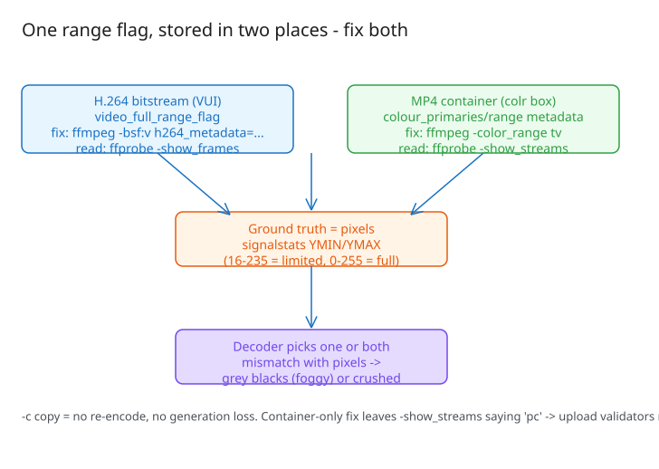

# How to Fix a Washed-Out MP4 Without Re-encoding (Rewrite the Range Tag in Both Places)

Symptom: "the clip I uploaded looks foggy, the blacks are grey". If the file is H.264 and only the **colour-range tag** is wrong, re-encoding is a waste — one ffmpeg command with `-c copy` fixes it. The catch: an MP4 stores the range in **two places**, and the one-line fix most people use only touches one.



## Understand the two failure directions first

Limited-range video uses luma **Y 16–235**; full range uses **0–255**. The tag tells the decoder whether to stretch:

| Pixels | Tag | Decoded result | User says |
|---|---|---|---|
| Limited (16–235) | `pc` (full) | No stretch: black renders 16, white 235, everything pulled to mid | "washed out / foggy" |
| Full (0–255) | `tv` (limited) | Stretch applied wrongly: 0–16 crushed to 0, 235–255 clipped to 255 | "crushed", not washed out |

Measured on a test pattern (8-bit H.264, CRF 10, BT.709): flat patches at 0/8/16/…/255 mis-tagged `pc` decoded as 16/23/30/71/126/181/218/228/235. The asymmetry means the user's sentence alone tells you the direction — but **check pixels, not the tag, before touching the file**, because the fix below turns a *correct* full-range file into the crushed version.

## Step 1 — Diagnose: compare pixels against the tag

```bash
# what does the container claim?
ffprobe -v error -select_streams v:0 -show_entries stream=color_range -of csv=p=0 in.mp4
# what do the pixels actually use?
ffmpeg -i in.mp4 -vf signalstats -f null - 2>&1 | grep YMIN
```

Washed-out case = `signalstats` reports `YMIN 16 / YMAX 235` (limited pixels) while ffprobe says `pc`. The tag is wrong, the pixels are fine.

## Step 2 — Fix both tag locations in one command

```bash
ffmpeg -i in.mp4 -c copy \
  -bsf:v h264_metadata=video_full_range_flag=0 \
  -color_range tv out.mp4
```

- `-bsf:v h264_metadata=video_full_range_flag=0` flips the flag **inside the H.264 bitstream** (the VUI) — what decoders read.
- `-color_range tv` changes what the muxer writes into the **`colr` box** — the container-level copy.
- `-c copy` means no decode/encode round-trip: zero generation loss.

Verified outcome: `ffprobe` reports `color_range=tv` and patches decode back to 0 / 128 / 255.

## Why the bitstream filter alone is not enough

With a `tv` bitstream flag but a stale `pc` container tag, ffmpeg and desktop Chromium `<video>` both decoded identically to the fully consistent file (≤1 level difference per patch) — so on those paths the container tag seemed irrelevant. Write both anyway because:

1. **Validators read the container**: `ffprobe -show_streams` reports the container (`colr`) value, while `-show_frames` reports the bitstream (VUI) value. After a filter-only fix, `-show_streams` still prints `pc` — an upload validator checking that field sees a "broken" file and may re-transcode it back.
2. **Unknown players** (QuickTime, VLC, Safari, phone galleries) may prefer `colr` over the VUI — writing the same value in both places makes the question moot.

## Step 3 — Fix the producer, and gate the upload path

The file fix closes the ticket; the real bug is the pipeline step that emitted limited pixels with a full-range tag. Cheap guard for an upload path:

```bash
# flag files tagged pc whose luma never leaves 16-235
ffprobe -v error -select_streams v:0 -show_frames -of csv=p=0 -show_entries frame=color_range in.mp4
ffmpeg -i in.mp4 -vf signalstats -f null -   # check YMIN>=16 && YMAX<=235
```

Do **not** auto-fix on that rule — a genuinely full-range dim clip can also sit inside 16–235; flag for human review. Scope limits: this covers H.264 only (`h264_metadata` bitstream filter); HEVC was not tested and needs its own bsf.

## References

- [Original article — Fix a washed-out MP4 without re-encoding (DEV.to)](https://dev.to/shu_jing_915fa287b22539ad/fix-a-washed-out-mp4-without-re-encoding-rewrite-the-range-tag-in-both-places-1gne)
- [ffmpeg h264_metadata bitstream filter documentation](https://ffmpeg.org/ffmpeg-bitstream-filters.html#h264_005fmetadata)
- [ITU-R BT.709 / limited vs full range explainer (fourcc fourcc.org)](https://www.fourcc.org/fccyvrgb.php)
