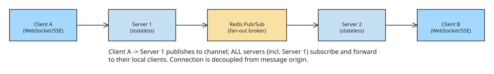

# Scaling Real-Time APIs to 100k+ Concurrent Connections with WebSockets, SSE, and Redis Pub/Sub

A single Node.js process handles roughly **10k–50k concurrent WebSocket connections** (depending on memory/CPU). Beyond that you must scale out horizontally — which introduces the **sticky session problem**: a client connected to server A may need events triggered by a client on server B. Without a shared message bus, those events are lost.

## Goal architecture: three layers

1. **Client connection layer** — WebSocket or SSE endpoints terminated by a fleet of stateless API servers.
2. **Message broker layer** — Redis Pub/Sub (or Kafka/NATS) relaying messages between servers.
3. **Persistence layer** (optional) — message history / offline delivery.



When Client A sends a message, Server 1 publishes it to a Redis channel. All servers (including Server 1) subscribe and forward the message to their local interested clients. This decouples the connection from the message origin.

## Protocol choice: WebSocket vs SSE

| Criterion | WebSockets | SSE |
|-----------|-----------|-----|
| Direction | Bidirectional | Unidirectional (server → client) |
| Transport | Own protocol after handshake | Rides on HTTP (HTTP/2 multiplexing friendly) |
| Reconnection | Manual | Automatic (`Last-Event-ID`) |
| Firewalls/proxies | Can be blocked | Simpler — plain HTTP |
| Best for | Chat, collaborative editing, games | Live feeds, notifications, tickers |

Rule of thumb: **WebSockets** for bidirectional low-latency apps; **SSE** for one-way streaming where you want less code and better proxy compatibility. For bidirectional over SSE you need a companion POST endpoint (SSE + POST).

## Production Node.js example (`ws` + `ioredis`)

```javascript
import express from 'express';
import http from 'http';
import { WebSocketServer, WebSocket } from 'ws';
import Redis from 'ioredis';

const app = express();
const server = http.createServer(app);

// noServer: handle the HTTP upgrade manually (auth happens here)
const wss = new WebSocketServer({ noServer: true });

// ioredis REQUIRES separate connections for pub and sub —
// a subscriber-mode connection cannot run other commands.
const redisPublisher  = new Redis({ host: 'redis-1', port: 6379, maxRetriesPerRequest: null });
const redisSubscriber = new Redis({ host: 'redis-1', port: 6379, maxRetriesPerRequest: null });

// In-memory client registry per server instance
const clients = new Map(); // clientId -> WebSocket

redisSubscriber.subscribe('chat:global');
redisSubscriber.on('message', (channel, message) => {
  if (channel === 'chat:global') {
    const { clientId, data } = JSON.parse(message);
    clients.forEach((ws) => {
      if (ws.readyState === WebSocket.OPEN) {
        ws.send(JSON.stringify({ from: clientId, data }));
      }
    });
  }
});

server.on('upgrade', (request, socket, head) => {
  // Authenticate here (JWT in query string or cookie). Don't trust Origin headers.
  wss.handleUpgrade(request, socket, head, (ws) => {
    wss.emit('connection', ws, request);
  });
});

wss.on('connection', (ws, request) => {
  const clientId = new URL(request.url, 'http://localhost').searchParams.get('clientId');
  if (!clientId) { ws.close(4001, 'Missing clientId'); return; }

  clients.set(clientId, ws);

  ws.on('message', (message) => {
    // Fan out to every other server via Redis
    redisPublisher.publish('chat:global', JSON.stringify({ clientId, data: message.toString() }));
  });

  ws.on('close', () => clients.delete(clientId));
  ws.on('error', (err) => { console.error(err); ws.close(1011, 'Internal error'); });
});

server.listen(process.env.PORT || 3000);
```

### Critical engineering decisions in that code

- **Separate Redis connections for pub/sub.** `ioredis` enters subscriber mode on the subscribing connection; mixing publish and subscribe on one connection throws errors.
- **`maxRetriesPerRequest: null`.** Prevents the client from buffering commands while disconnected (memory leak risk); instead it emits errors so you can drive reconnection with exponential backoff (`ioredis` has a built-in retry strategy).
- **Backpressure.** `ws.send` buffers for slow consumers — monitor `ws.bufferedAmount` and drop or disconnect slow clients.
- **Graceful degradation.** If Redis fails, fall back to local-only broadcast (with a warning) rather than dropping all real-time functionality.

## Performance numbers (approximate, from real deployments)

| Metric | Value |
|--------|-------|
| WebSocket throughput per Node process | ~10k msg/s at &lt;5 ms latency on modest hardware |
| Redis Pub/Sub capacity | 100k+ ops/sec — becomes the bottleneck after scaling out |
| Memory per connection | ~20–50 KB (incl. buffers) → **100k connections ≈ 2–5 GB RAM per server** |
| Added latency from Redis Pub/Sub | ~0.1–0.5 ms; end-to-end stays &lt;10 ms in a well-configured cluster |

## Trade-offs to decide explicitly

- **Redis Pub/Sub vs Redis Streams.** Pub/Sub is faster and simpler but fire-and-forget: if no subscriber is present, the message is lost. Streams add persistence + consumer groups at the cost of complexity and latency. Use Streams for critical messages.
- **Sticky sessions vs broker.** LB sticky sessions avoid Redis entirely but cause uneven load and failover pain; a broker decouples nodes but adds a single point of failure (mitigate with Sentinel/Cluster).
- **SSE vs WebSockets** — see table above.
- **Raw `ws` + manual fan-out vs Socket.IO.** If you're already on Socket.IO, its built-in Redis adapter (`@socket.io/redis-adapter`) gives you the same cross-node broadcast without hand-rolling pub/sub; it also adds namespace partitioning for sharding event traffic across nodes. The trade-off is Socket.IO's protocol overhead and polling-fallback behavior — disable polling in production (`transports: ['websocket']`, set `pingInterval`/`pingTimeout`) if you only need raw WebSocket semantics.

## Fan-out amplification and Redis 7 sharded Pub/Sub (enriched 2026-11-23)

The naive `chat:global` single-channel pattern above hides the **fan-out amplification problem** that appears at scale: every server node receives *every* message and filters locally, so a global channel makes each node's Redis ingress proportional to total cluster traffic, not to its own client population. Two fixes, in order of preference:

1. **Per-room targeted channels instead of pattern subscriptions.** `psubscribe('room:*')` does not scale — pattern matching is executed against every pattern on every node for every published message, and it cannot be sharded. Model rooms as concrete channels (`room:<id>`) and have each node subscribe only to the channels its connected clients actually need (join/leave drives subscribe/unsubscribe). This turns O(all traffic) per node into O(interested traffic).
2. **Redis ≥ 7.0 sharded Pub/Sub** in Cluster mode: `SPUBLISH`/`SSUBSCRIBE` (ioredis: `ssubscribe()`/`spublish()` on a clustered client). The channel name is hashed to a slot and the message is replicated/broadcast only within the shard that owns that slot, instead of being forwarded to every node in the cluster. This removes the cross-cluster broadcast storm for hot channels and is the default recommendation for new builds on Redis Cluster. Constraint: sharded channels live in keyspace slots, so `SPUBLISH` and `SSUBSCRIBE` for the same channel must be addressed to the node owning that slot — client libraries handle this, but raw clients must follow MOVED/ASK.

Also mind the **publisher side**: a single hot channel with thousands of subscribers on one node can saturate that node's egress. Shard hot rooms across sharded channels (`room:<id>#<shard>`) or use per-room channels with a directory service mapping room → node set when a room grows past a few thousand concurrent members.

## Security checklist

1. Validate tokens during the WebSocket handshake; never rely on `Origin` headers alone.
2. Per-connection message rate limiting to prevent abuse.
3. Use WSS (TLS); terminate TLS at the load balancer to keep app-server CPU low.

## Actionable checklist

1. Choose protocol: WebSockets for bidirectional, SSE for one-way streaming.
2. Design for horizontal scaling with a broker (Redis Pub/Sub or similar).
3. Separate pub/sub Redis clients; configure retry strategies with exponential backoff.
4. Handle backpressure via `bufferedAmount`; disconnect slow consumers.
5. Graceful degradation when the broker is down.
6. Monitor: connection count, message rates, Redis latency, error rates.
7. Load test with `k6` or `wrk` at target scale (100k connections) before launch.

## References

- [Scaling Real-Time APIs to 100k+ Concurrent Connections: WebSockets, SSE, and Redis Pub/Sub](https://dev.to/dzakiamriz/scaling-real-time-apis-to-100k-concurrent-connections-websockets-sse-and-redis-pubsub-5hhm)
- [MDN: WebSockets API](https://developer.mozilla.org/en-US/docs/Web/API/WebSockets_API)
- [MDN: Server-Sent Events](https://developer.mozilla.org/en-US/docs/Web/API/Server-sent_events)
- [Redis pub/sub use-case documentation (node-redis)](https://redis.io/docs/latest/develop/use-cases/pub-sub/nodejs/)
- [Redis sharded Pub/Sub (SPUBLISH/SSUBSCRIBE, Redis 7 Cluster)](https://redis.io/docs/latest/develop/pubsub/shardedpubsub/)
- [ADR 0002: Redis Pub/Sub for scale-out routing (Spring Boot 4 real-time messaging)](https://github.com/jinwovo/realtime-messaging/blob/main/docs/adr/0002-redis-pubsub-for-scale-out-routing.md) — a worked architecture-decision record for the same three-layer pattern

## Related
- [[example-webrtc-p2p-file-transfer-browser]]
- [[choosing-and-implementing-pub-sub-tracing-modes-single-vs-multi-trace]]
