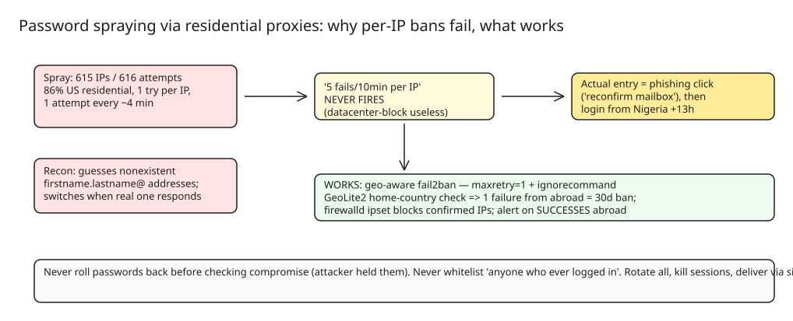

# Defending a Mail Server Against Password Spraying Through Residential Proxies: Geo-Aware fail2ban

A real incident (November 2026, mid-sized manufacturer on a shared mail platform)
shows why "ban an IP after 5 failures in 10 minutes" is dead against modern
spraying, and how to fix it with **zero extra infrastructure** — just fail2ban,
GeoLite2, and firewalld on the existing mail server.



## The attack, as measured

- **616** failed logins, **615** attacking IPs, **36** countries — **614 IPs used exactly once**
- 86% of attacking addresses were US residential/mobile (rented through proxy networks)
- Pace: ~one attempt every four minutes, around the clock — below any per-account lockout threshold
- Reconnaissance tell: three weeks of attempts against `firstname.lastname@`
  combinations that **did not exist** (names scraped from public employee info);
  when one real address answered differently, the campaign concentrated on it

Why classic defenses saw nothing:

| Defense | Why it failed |
| --- | --- |
| N failures per IP | 614 of 615 IPs tried once and never returned |
| Datacenter-IP blocking | Traffic came from home routers and phones |
| Per-account lockout | 1 attempt / 4 min stays under every threshold |

**And the spray never actually got in.** The breach was a credential-phishing email
(`[Ticket ID: #CFD-…] Employee's Urgent reconfirmation needed for <user>@<company>`,
delivered from a compromised server in Vietnam). 13 hours later the mailbox was
being polled from Nigeria — first-attempt success with the correct password.
A second (finance) mailbox, logged in from rotating US residential IPs with **no
failed attempt first** (signature of an attacker who already holds the password),
was used to send 17 ING-Bank-impersonating phishing messages to German recipients,
paced ~13 minutes apart, bounce reports deleted from the mailbox.

## Step 1 — Detect on geography relative to the mailbox's normal users

The signal that works is **where** the attempt comes from relative to **who**
normally uses the mailbox. Staff connect from Egypt; a failed login from Ohio is
not a typo. Alert on **successful** logins from unexpected countries, not only failures.

## Step 2 — First failure from abroad = ban (fail2ban + GeoLite2)

fail2ban's `ignorecommand` runs a script per candidate IP; exit 0 = skip banning:

```ini
# /etc/fail2ban/jail.d/customer-spray.conf
[customer-spray]
enabled       = true
filter        = customer-spray        # Dovecot "auth failed" + Postfix SASL failures, per domain
logpath       = /var/log/maillog
maxretry      = 1
findtime      = 1d
bantime       = 30d
ignorecommand = /usr/local/sbin/f2b-ignore-home-country <ip>
```

```bash
#!/bin/bash
# /usr/local/sbin/f2b-ignore-home-country — exit 0 = do not ban
ip="$1"
grep -qw -- "$ip" /etc/fail2ban/jail.d/zz-goodips.local && exit 0
cc=$(mmdblookup --file /usr/share/GeoIP/GeoLite2-Country.mmdb --ip "$ip" country iso_code \
     | grep -oE '"[A-Z]{2}"' | tr -d '"')
[ "$cc" = "EG" ] && exit 0    # home country of this tenant's users
exit 1
```

One wrong password from another country is enough: `maxretry = 1` +
`findtime = 1d` + `bantime = 30d`. The provider applied it per customer domain.

## Step 3 — Block what already got in

Permanently block confirmed attacker addresses on mail ports with firewalld ipset
(637 addresses blocked in the incident). Rotate every password, terminate all
sessions, deliver new credentials through a **single-use link gated on an
out-of-band second channel** (WhatsApp code to the account owner), and publish a
self-service change page so temporary passwords are replaced immediately.

## Step 4 — Scan every other tenant for the same pattern the same day

Doing so found a second compromised mailbox at a different customer (valid-password
logins from US residential IPs) — blocked that afternoon.

## Mistakes made (learn from them)

1. **Never roll passwords back before checking for compromise.** Under user-lockout
   pressure the team briefly restored the *old* passwords — the ones the attacker
   held. The firewall had already blocked the sending IP, but the door was open for
   hours. If users are locked out, deliver **new** credentials fast instead.
2. **Never whitelist "anyone who ever logged in successfully."** The first
   known-good list contained the attacker. Whitelist only domestic addresses with a
   successful login in the last 14 days.

## Checklist for your own mail server

1. Know where your users log in from; alert on **successful** logins from elsewhere.
2. Geo-aware rule: one failure from an unexpected country = ban.
3. No "logged-in-successfully" whitelists.
4. Train users on one rule: never type the mail password into a page opened from an email link.
5. Give users a real self-service password page; rotate on a schedule.
6. After any incident, scan every tenant for the same pattern the same day.

## Indicators (campaign IOCs)

| Type | Value | Context |
| --- | --- | --- |
| IP | `176.53.159.177` | Sent ING-themed phishing via compromised mailbox (TR) |
| Host | `mail.digiwall.vn` (223.27.104.11) | Delivered the "Urgent reconfirmation" lure (VN) |
| Email | `subsectorcolony6@web.de`, `unwittingchase3@web.de` | Attacker test inboxes |
| Subject | `[Ticket ID: #CFD-…] Employee's Urgent reconfirmation needed for …` | Credential-phishing lure |

Outcome: no phishing left the platform after the response; the mail server stayed
off Spamhaus/SpamCop/Barracuda; extra infrastructure cost: zero.

## References

- [DEV.to: Password spraying through residential proxies — how we caught a mailbox takeover rate-limits could not see](https://dev.to/ahmedezzzat/password-spraying-through-residential-proxies-how-we-caught-a-mailbox-takeover-that-rate-limits-blk)
- [Original field report at GeoTech Engineering](https://geotech.dev/engineering/password-spraying-residential-proxies-smb-email/)
- [mail-spray-guard (open-source implementation of the geo rule)](https://github.com/geotech-engineering/mail-spray-guard)

## Related

- [[howto-outlook-dmarc-enforcement-fix]] — outbound-side mail reputation hardening
