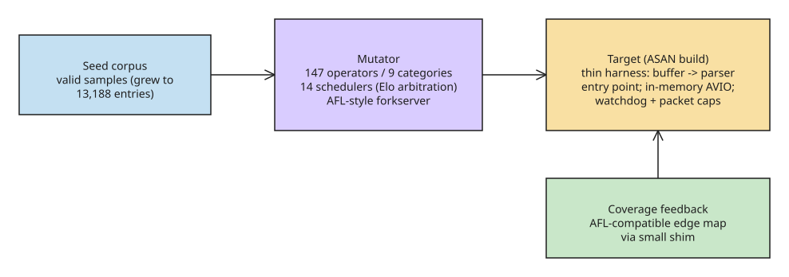

# How to Build an ASAN-Instrumented Fuzz Harness for Your Parser — Lessons from a Vibecoded FFmpeg Fuzzer

An AI-assisted coverage-guided fuzzer ([fuzzer-tool](https://github.com/daedalus/fuzzer/) on GitHub) found a deterministic crash in FFmpeg's VPK (PS2 video package) demuxer with **21 bytes of input** — in a library that has been continuously fuzzed by OSS-Fuzz for most of the past decade. One machine, one overnight run: 10 hours 43 minutes to a reportable bug with suggested fix and regression test. The fuzzer itself is a coverage-guided binary fuzzer with 147 mutation operators across 9 categories, 14 scheduler modules under Elo arbitration, AFL-style forkserver execution, shared-memory edge coverage, and comparison tracing down to individual call sites — and its README honestly admits it is slower in raw throughput than the AFL family (AFL remains the better choice for production-scale fuzzing).

The article's core argument: this was **engineering with guardrails, not lucky vibes**. The repo's `AGENTS.md` (human-maintained instructions for the AI agents working on the codebase) enforces rules like: always find the closest existing example and match its conventions before adding anything; never bypass pre-commit hooks; register new mutation operators in a single source-of-truth registry so every scheduler discovers them automatically; never commit corpus directories. Findings documents follow a template with crash metadata, GDB backtraces, an exploitability assessment separating "this is a DoS primitive" from "this is memory corruption," a suggested fix, and a regression test.

## The 21-byte VPK crash — and why your reproduction may fail (instructively)

The issue's trigger chain requires **probe-time data and packet-read-time data to diverge**, which happens in the fuzzer's custom `AVIO` path where the harness feeds FFmpeg from an in-memory buffer it controls. The CLI reading a file from disk takes a different I/O path — so reproducing with:

```bash
printf '\x20\x4b\x50\x56\x56\x50\x00\xf8\x04\x00\x3b\x03\x61\x39\x56\x32\x36\x36\x30\x38\x50' > vpk_crash.bin
ffmpeg -i vpk_crash.bin -c:a copy -f null -
```

on FFmpeg 6.1.1 (Ubuntu) yields **no crash**: FFmpeg detects the VPK container, reports an absurd audio stream (942,683,702 Hz sample rate, 80 channels), fails to open the ADPCM decoder, and exits cleanly with a demuxing error — exactly the behavior you want. The mismatch is itself evidence for the root cause: the channel count genuinely depends on *which snapshot of the data you ask*, and that ambiguity kills the dividing instruction when the wrong snapshot wins.

Two takeaways from the failed-then-understood reproduction:

1. **A crash report without the exact harness is not a reproduction.** Environment, version, and I/O setup all matter — which is why the issue includes the full backtrace, target hash, and seed.
2. **The parse result alone is a finding.** Even on the "safe" path, FFmpeg happily reported a 942 MHz sample rate and 80 channels from 21 bytes before erroring out. Malformed-input tolerance is a spectrum; watching where your parser lands on it is free intelligence.

## The harness anatomy (the part you can copy)

The fuzzer's FFmpeg target, `ffmpeg_read.c`, is a model of what a fuzz harness should be — the core loop is five FFmpeg API calls:

```c
avformat_open_input(&fmt_ctx, NULL, NULL, NULL);
avformat_find_stream_info(fmt_ctx, NULL);
while (av_read_frame(fmt_ctx, pkt) >= 0) {
    avcodec_send_packet(dec_ctx, pkt);
    while (avcodec_receive_frame(dec_ctx, frame) >= 0) { /* got frames */ }
}
avformat_close_input(&fmt_ctx);
```

Around that skeleton sit the details that separate a toy from a bug finder:

- **Custom in-memory I/O.** Instead of writing files to disk, the harness allocates an `AVIOContext` backed by a memory buffer — each mutated input is fed at memory speed and, crucially, through the custom-I/O path where probe and packet data can diverge. That is precisely where the VPK bug lived.
- **ASAN, always.** The target compiles with `-fsanitize=address`. Memory bugs that would silently corrupt data on a normal build become loud, attributed crashes on an instrumented one.
- **Coverage feedback.** An AFL-compatible edge map updated from the target via a small shim rewards mutations that reach new code. Blind mutation finds the shallow stuff; coverage guidance digs into a specific demuxer's final-block branch.
- **Guardrails against false positives.** The harness caps packets per input, runs a watchdog timer so a hung demuxer cannot stall the campaign, and deliberately routes subtitle streams through a different decode API — driving them through the modern packet API trips an internal FFmpeg assertion that would be a *harness artifact*, not a real finding. That comment alone saved them from reporting a bug that does not exist.

## The five-step recipe for your own parser

1. **Pick a target that parses untrusted input** — anything accepting bytes from users: media, documents, archives, protocol messages.
2. **Write the thinnest possible harness.** Feed a byte buffer straight into the parser's public entry point; resist adding logic.
3. **Instrument with a sanitizer.** ASAN or UBSAN for C/C++, equivalent checkers elsewhere. A fuzzer without instrumentation misses the bugs that matter most.
4. **Seed with real samples.** A handful of valid files give the mutator structure to break — the campaign that found the VPK bug grew a corpus of 13,188 entries.
5. **Triage like the findings doc does.** Deduplicate by stack trace, minimize the input, classify the signal (DoS primitive vs. memory corruption), write the two-line fix and regression test while context is fresh. A crash you cannot explain is a crash you cannot report.



## What to do this week (defender checklist)

- **Inventory your parsers** — every place your systems accept bytes from outside; rank by exposure, not code age.
- **Point an ASAN build plus a fuzzer at the top one.** libFuzzer, AFL++, or the AI-assisted route above: hours, not weeks.
- **Adopt the findings-doc template** for every crash: backtrace, minimization, severity honesty, suggested fix, regression test — it converts a scary stack trace into a mergeable pull request.
- **Close your known-but-unfixed guards.** The VPK division had a proposed fix sitting in a mailing-list archive for almost two years; every codebase has its own version of that thread.

The uncomfortable implication: the marginal cost of finding a real, reportable bug in critical infrastructure just dropped to "leave your laptop running while you sleep," and the bug classes that fall first are the unglamorous ones — rarely-touched demuxers and obscure format branches where a validation guard has been missing for years. Anything that parses attacker-controlled bytes needs a fuzzing story; "nobody will bother" is no longer an excuse, because bothering now costs pennies of compute.

## Harness correctness rules and continuous fuzzing (enriched 2026-11-10)

The canonical libFuzzer entry point and the three rules that decide whether a harness is trustworthy:

```c
#include <stdint.h>
#include <stddef.h>
#include "mylib.h"

int LLVMFuzzerTestOneInput(const uint8_t *data, size_t size) {
    if (size < 4) return 0;          // early-return on degenerate input
    mylib_ctx *ctx = mylib_ctx_new();
    if (!ctx) return 0;
    mylib_parse(data, size);
    mylib_ctx_free(ctx);             // free everything — leaks are bugs under ASan
    return 0;
}
```

1. **Never call `exit()`/`abort()`** — the fuzzer must survive every input; always return 0.
2. **Free all memory before returning** — AddressSanitizer flags leaks as bugs when leak detection is on.
3. **One coherent code path per harness** — cramming ten parsers into one harness dilutes coverage guidance (mutations that help parser A don't help parser B). One harness per logical subsystem, targeting attacker-reachable entry points.

Support practices that make the difference between hours and days of CPU:

- **Seed corpus is the multiplier.** Without seeds the fuzzer starts from random bytes and may burn hours before reaching deep paths in a binary-format parser; with real-world valid inputs (one file per input, including edge-case and minimal-valid samples) it reaches deep paths within minutes. libFuzzer merges newly-discovered interesting inputs back into the corpus directory — persist that corpus and reuse it across runs.
- **`LLVMFuzzerInitialize`** for one-time library/global init; minimum-length guards (`if (size &lt; 4) return 0;`) to avoid false positives on degenerate inputs.
- **Build recipe:** `clang -g -fsanitize=address,fuzzer -fprofile-instr-generate -fcoverage-mapping fuzz_target.c mylib.c -o fuzz_target` (ASan + coverage instrumentation in one shot). Go ≥1.18 needs no external tooling — `go test -fuzz` with `f.Add()` seeds and a `f.Fuzz(func(t, data []byte){...})` target.
- **Continuous fuzzing as a supply-chain control.** OSS-Fuzz has found 10,000+ vulnerabilities in open source since 2016 (libpng, FreeType, SQLite, curl), typically before any public exploit — recall that Log4Shell (2021) and CVE-2022-3602 (OpenSSL X.509 heap overflow) both lived in parsing code. Fuzzing complements SLSA provenance and SBOMs: provenance says what went in, SBOM says what is present, fuzzing says whether the code is *exploitable* under attacker-controlled input.
- **ClusterFuzzLite pattern without dedicated infra:** short (~600 s) PR-gate fuzzing as a required status check catches the obvious class (null deref on empty input, integer overflow on max-length fields, refactor-induced UAF), plus long nightly batch fuzzing on main with `file-github-issue: true` auto-opening issues with the crash input attached. Share the corpus between both jobs. For widely-distributed parsing libraries, layer OSS-Fuzz (project.yaml + Dockerfile + build.sh) for free 24/7 fuzzing on Google's infrastructure with managed disclosure.

## References

- [OSS-Fuzz and ClusterFuzzLite: Continuous Fuzzing as a Supply Chain Security Control](https://www.systemshardening.com/articles/cicd/oss-fuzz-clusterfuzzlite-integration/) — harness rules, seed corpus practice, CI gating patterns
- [libFuzzer — LLVM docs](https://llvm.org/docs/LibFuzzer.html) and [google/fuzzing libFuzzer tutorial](https://github.com/google/fuzzing/blob/master/tutorial/libFuzzerTutorial.md)

- [21 Bytes Can Crash FFmpeg: Inside the Vibecoded Fuzzer That Found What Years of Audits Missed (dev.to)](https://dev.to/jamilxt/21-bytes-can-crash-ffmpeg-inside-the-vibecoded-fuzzer-that-found-what-years-of-audits-missed-fpe)
- [fuzzer-tool — the AI-assisted coverage-guided fuzzer](https://github.com/daedalus/fuzzer/)

## Related
- [[howto-cicd-compromise-response-jetbrains-cadence]]
- [[howto-build-service-map-from-traces]]
- [[howto-agentic-rag-pipeline-with-real-time-web-search]]
