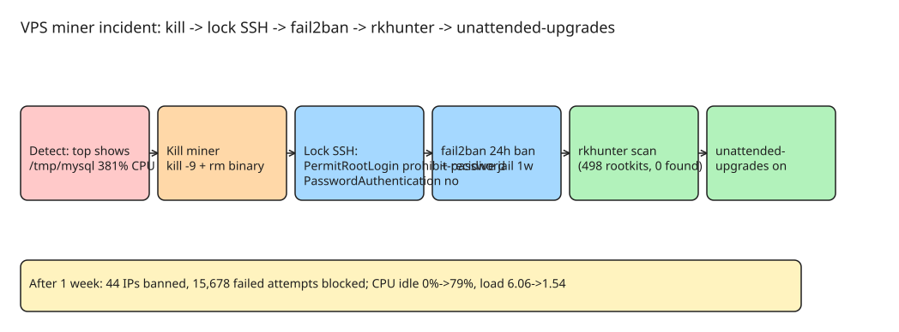

# Harden a VPS After an SSH Brute-Force Crypto-Miner Compromise

Real incident: a self-hosted VPS became unresponsive; `top` showed a process named `/tmp/mysql` burning **381% CPU and 2.4 GB RAM** — not MySQL, but a crypto miner dropped through a **brute-forced SSH password login**. Three doors were open: `PermitRootLogin yes`, password authentication enabled, no brute-force protection. Logs showed 30+ failed SSH attempts per hour from rotating IPs until one weak credential fell.

This is the full remediation + hardening sequence (took ~2 hours end to end).

## 1. Detect and kill the miner

```bash
top                      # or: ps aux --sort=-%cpu | head
kill -9 <PID>
rm -f /tmp/mysql         # delete the masquerading binary; check /tmp, /var/tmp, ~/.cache
```

Masquerading as a familiar daemon name in a world-writable path (`/tmp/...`) is the classic pattern — a real `mysqld` never runs from `/tmp`.

## 2. Lock SSH to keys (removes the attack surface entirely)

In `/etc/ssh/sshd_config`:

```text
PermitRootLogin prohibit-password
PasswordAuthentication no
```

Then `systemctl reload sshd` — **keep your current session open** while verifying a new key-based login from a second terminal. No password = nothing left to brute-force.

## 3. fail2ban with real teeth

- Ban time raised from 1 hour to **24 hours** for the `sshd` jail.
- Add a `recidive` jail: repeat offenders are banned for **a week**.

Within one week the box had blocked **44 IPs across 15,678 failed attempts** — the brute-force noise never stops, it just stops mattering.

## 4. Rootkit sweep

```bash
rkhunter --check    # 498 rootkits in its database; 0 found in this incident
```

Confirms nothing else was hiding after the miner was removed.

## 5. Automatic patching

Enable `unattended-upgrades` so the next SSH or kernel CVE patches itself instead of waiting for an operator to notice.

## Verified before/after

| Metric | Before | After |
|---|---|---|
| CPU idle | 0% | 79% |
| Load average | 6.06 | 1.54 |
| Free RAM | 1.5 GB | 3.9 GB |

## Lesson

A cheap VPS exposed to the internet is a target the moment it boots. Every fix above is day-one hygiene: key-only SSH, no root password logins, fail2ban, auto-updates — do it **before** the miner finds you.



## References

- [An unresponsive VPS was a crypto miner, dropped through a brute-forced SSH login (DEV.to)](https://dev.to/igor_rakov_3d397069722c96/an-unresponsive-vps-was-a-crypto-miner-dropped-through-a-brute-forced-ssh-login-3ak)
- [Full write-up with configs (igornews.com)](https://igornews.com/2026/11/08/ssh-brute-force-crypto-miner-vps-hardening/)
