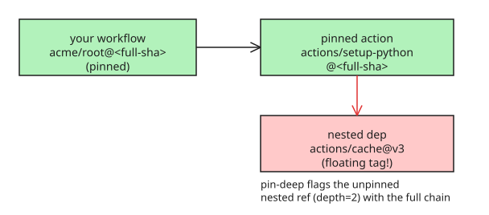

# How to Audit Transitive GitHub Action Dependencies with pin-deep

## The depth problem nobody checks

The standard advice is: pin every GitHub Actions `uses:` to a **full commit SHA** so a compromised tag can't rug-pull your CI. That protects *your* workflow file — but not what those pinned actions themselves depend on.

The **tj-actions incident (CVE-2025-30066)** is the textbook case: the compromise reached victims *through* reviewdog, which referenced the compromised action. Pinning reviewdog itself wasn't enough — the hole was one level deeper, inside **the dependency of a pinned dependency**.

> "You pinned your Actions, but the Actions you pinned didn't pin their dependencies."

`pin-deep` checks exactly that: give it a workflow file or a single pinned `uses:` value, and it **recursively fetches the `action.yml` of every SHA-pinned action** — up to a configurable depth, with cycle protection — and flags every nested `uses:` that isn't pinned to a full commit SHA.

## How to use it

```bash
pip install pin-deep
pin-deep .github/workflows/ci.yml
```

Example output — note the full **chain** that produced the hole:

```
[unpinned] depth=2 actions/cache@v3
    source: action.yml of actions/setup-python@aaaaaaaaaaaaaaaaaaaaaaaaaaaaaaaaaaaaaaaa
    chain:  acme/root@aaa...  ->  actions/setup-python@aaa...  ->  actions/cache@v3
    note:   not pinned to a full commit SHA
```

## Design decisions that matter

- **Only full SHAs get recursed into.** A floating tag has no fixed content to analyze — auditing its children would audit *today's* state, not the state you ship. Unpinned refs are flagged, never followed.
- **Short SHAs are warnings, not passes.** Seven hex chars technically resolve, but they're weaker than a full 40/64-char SHA. `--strict` fails CI on short SHAs too.
- **Depth defaults to 3** — deep enough to catch the reviewdog-shaped hole, shallow enough to finish quickly.
- **Exit code 1 on findings**, so it drops straight into CI. `GITHUB_TOKEN` is used for the API fallback; public repos need nothing.
- Standard library only, no dependencies.

## Why not just a workflow linter?

Static linters like **zizmor** analyze *your* `uses:` lines. `pin-deep` checks one level further: what your *pinned* actions themselves depend on, recursively. Pinning has a **depth dimension** that flat linting doesn't model — and when it finds a hole it tells you the exact chain of actions that put it there.



## References

- [pin-deep: you pinned your Actions, but your Actions didn't pin theirs (DEV.to)](https://dev.to/haoli/pin-deep-you-pinned-your-actions-but-your-actions-didnt-pin-theirs-3830)
- [pin-deep on GitHub](https://github.com/hahahahahahahahah6/pin-deep)
- [pin-deep on PyPI](https://pypi.org/project/pin-deep/)
- [GitHub: pinning actions to commit SHAs](https://github.com/orgs/community/discussions/25756)
- [Mini Shai-Hulud — the TanStack npm worm (related KB note)](../../../explanations/securityprivacy/supplychain/explanation-tanstack-mini-shai-hulud-npm-worm-supply-chain-attack.md)
