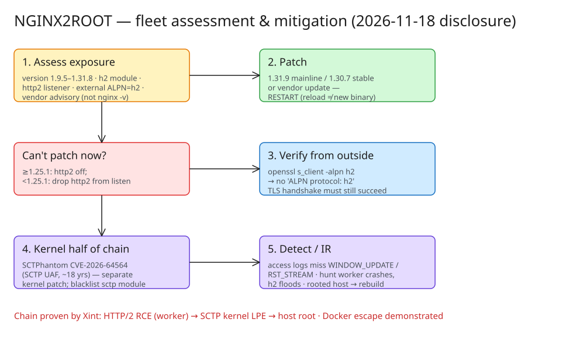

# How to Assess and Patch NGINX HTTP/2 RCE Exposure Fleet-Wide (NGINX2ROOT)

On 2026-11-18 Xint (Theori) disclosed **NGINX2ROOT**: five distinct NGINX vulnerabilities (`CVE-2026-123007`, `CVE-2026-123634`, `CVE-2026-123633`, `CVE-2026-121810`, `CVE-2026-113425`), each with a proven exploit, chainable with a **separate Linux kernel SCTP vulnerability** ("SCTPhantom", `CVE-2026-64564`, an ~18-year-old use-after-free) to reach **root on the host — remotely and unauthenticated**, including escaping a Docker container running NGINX. In Xint's 2026-11-10 Shodan snapshot, **11.8M of 11.94M version-identifiable NGINX hosts ran an affected release** (version prevalence, not exploitable-endpoint count). This note is the operational checklist; for the vulnerability internals see [[explanation-nginx-http2-rce-cve-2026-123633-123007]].



## Step 1 — Determine exposure (all five conditions must hold)

For the most severe HTTP/2 finding (`CVE-2026-123007`):

1. **NGINX version** in `1.9.5 – 1.31.8`
2. **HTTP/2 module** compiled into the build
3. **Active HTTP/2 listener** — `http2` present in the running config
4. **External h2 negotiation** — an ALPN check from outside must return `h2`
5. **Vendor patch status** — confirmed from the vendor advisory, *not* from `nginx -v`

Distribution packages, appliances, and container images **may backport the fix while keeping the old version string**. Confirm patch status from the relevant vendor advisory or changelog instead of relying on `nginx -v` alone.

```bash
# Verify from outside whether the endpoint still negotiates HTTP/2
openssl s_client -connect HOST:443 -servername HOST -alpn h2 </dev/null 2>&1 \
  | grep -F 'ALPN protocol: h2'
```

A missing `h2` result is meaningful **only if the TLS handshake itself succeeded** — a failed handshake also "passes" this test.

## Step 2 — Patch

- Upgrade to **NGINX 1.31.9** mainline (or **1.30.7** stable) from nginx.org, or install your vendor's security update.
- **Restart** NGINX after updating: `nginx -s reload` **does not load the new binary** — old workers keep running the vulnerable code.

The same 1.31.9/1.30.7 release also fixes the HTTP/3 proxy UAF (`CVE-2026-121810`), the DNS-resolver UAF (`CVE-2026-123634`, RCE when an attacker controls the upstream host name), and the mail-proxy UAF (`CVE-2026-113425`, with `auth_http`). Each has its own affected range — check the individual advisory rather than applying the HTTP/2 range to all five.

## Step 3 — Interim mitigation when you cannot patch immediately

Disable HTTP/2 on every affected listener:

```nginx
# NGINX >= 1.25.1
listen 443 ssl;
http2 off;
```

```nginx
# NGINX 1.9.5 – 1.25.0: remove http2 from the listen directive
listen 443 ssl;
```

Then test, reload, and re-run the ALPN check from outside. This mitigates the HTTP/2 finding only; the other four CVEs need their own mitigations.

## Step 4 — Close the kernel half of the chain

Patching NGINX closes the **entry point**, not the whole chain. `CVE-2026-64564` (Linux kernel SCTP, local privilege escalation to root) is a **separate vulnerability needing its own kernel patch**, which lands in the coming weeks after disclosure. Assess it separately per host (SCTP module presence, distro advisory). Hardening in the meantime: blacklist the `sctp` kernel module where unused (`modprobe.d` `install sctp /bin/false`), since it is rarely needed in web-serving images.

## Step 5 — Detection and suspected compromise

- **Ordinary access logs cannot prove absence of an attack**: they do not record the HTTP/2 control frames used (`WINDOW_UPDATE`, `RST_STREAM`). Review error logs, process-execution records, and network captures.
- Hunt for NGINX worker crashes, worker-spawned child processes, and long-lived HTTP/2 connections pushing large data with `WINDOW_UPDATE` floods.
- On confirmed compromise: isolate, preserve evidence, inventory files/credentials/services reachable from the worker account, rotate exposed secrets, and investigate host compromise. **If the host was rooted, patching alone is not remediation — rebuild from a trusted image.**

## Why this mattered so fast

The HTTP/2 code path dates to NGINX 1.9.5 (2015); pre-auth RCE in NGINX had not happened meaningfully since 2013. Xint's AI pentesting platform flagged high-severity issues in a ~50,000-line NGINX slice in **90 minutes**, with reproduction steps that became a working exploit in under 10 minutes; after a human researcher found the default-config bug, the harness found the other four criticals with no human guidance. Discovery-to-fix took 38 days (Oct 11 → Nov 18). Expect the AI-assisted backlog-digging wave (PHP2Shell, Java4Shell, NGINX2ROOT) to keep surfacing old memory-safety bugs faster than patch cycles absorb them.

## Related

- [[explanation-nginx-http2-rce-cve-2026-123633-123007]] — internals of the two critical HTTP/2 flaws (UAF + send_window underflow)
- [[explanation-machine-speed-vulnerability-discovery]] — patch SLAs as architecture

## References

- [NGINX2Root — From NGINX visitor to root of the server host (Xint)](https://nginx2root.com/) — exposure checklist, fix commands, chain details
- [NGINX2Root full writeup — Xint blog](https://xint.io/blog/nginx2root-remote-code-execution) — technical details, SCTP chain, Docker escape
- [NGINX release 1.31.9](https://github.com/nginx/nginx/releases/tag/release-1.31.9) — the fix release
- [TR-105 NGINX2ROOT — CIRCL advisory](https://www.circl.lu/pub/tr-105/) — coordinated disclosure summary
- [18-year-old Linux kernel SCTP vulnerability "SCTPhantom" (CVE-2026-64564) — GBhackers](https://gbhackers.com/18-year-old-linux-kernel-sctp-vulnerability/) — kernel half of the chain
- [LWN: NGINX2Root RCE vulnerabilities in nginx](https://lwn.net/Articles/1108362/) — independent coverage
