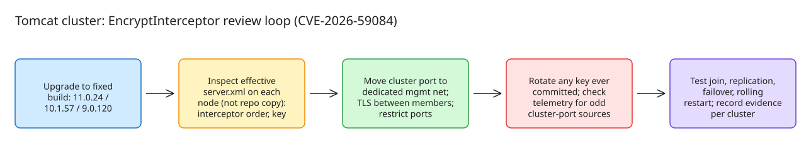

# Reviewing Apache Tomcat EncryptInterceptor After CVE-2026-59084: Fixed Builds, Effective Config, and Evidence

CVE-2026-59084 — reported 2026-06-29, **made public 2026-07-14** (fixed in 11.0.24, released 2026-07-08; NVD `lastModified` 2026-10-24) — is an **insufficient-technical-documentation** vulnerability (CWE-1059) in Apache Tomcat's cluster `EncryptInterceptor` — the component meant to encrypt session-replication traffic between nodes. Apache rates it **Low**; the NVD *secondary* CVSS 3.1 score assigned by the CISA Coordinator is **9.1 Critical** (`AV:N/AC:L/PR:N/UI:N/S:U/C:H/I:H/A:N`, SSVC: exploitation none, automatable yes, technical impact total). Both readings are correct, and the gap between them is the actual work item.

## Why the CVSS split exists

Tomcat's security model says cluster traffic requires a **trusted network** unless `EncryptInterceptor` is used. The CVE is not remote code execution: the code path depends on an administrator's configuration choice. But a misunderstood setup — weak algorithm, reusable/shared key string, incomplete replay protection, interceptor absent or misordered in the channel's interceptor list — leaves privileged session traffic readable or modifiable by anyone who can reach the cluster port. Scanners score the *outcome* (unencrypted session replication); Apache scores the *product defect* (unclear docs). Upgrading alone produces **no security property** unless the deployed configuration is verified.

## Fixed builds and affected ranges

| Branch | Fixed version | Affected |
|---|---|---|
| 11.0.x | **11.0.24** | 11.0.0-M1 → 11.0.23 |
| 10.1.x | **10.1.57** | 10.1.0-M1 → 10.1.56 |
| 9.0.x | **9.0.120** | 9.0.13 → 9.0.119 |
| 8.5.x (EOL) | none | 8.5.38 → 8.5.100 (listed by NVD, not by the Apache advisory) |
| 7.0.x (EOL) | none | 7.0.100 → 7.0.109 (listed by NVD, not by the Apache advisory) |

The Apache advisory itself lists only the 11/10.1/9.0 ranges plus "older unsupported versions may also be affected"; the 8.5.x and 7.0.x ranges above come from the NVD affected-version data. Fix commit: `57e80e9b8bb7cb563929db47fd24fe787251f478`.

> [!warning] The interceptor itself is being retired
> In the 11.0.29 advisory (2026-11-13), Apache declared under **CVE-2026-95517** (Moderate) that the multiple `EncryptInterceptor` vulnerabilities "have not been addressed" and that the interceptor **has been deprecated in favour of TLS encryption using TLS-PSK** — all users should switch to TLS. Related: **CVE-2026-55955** (Low — no replay protection, contrary to earlier docs) and **CVE-2026-34486** (Important — the fix for CVE-2026-29146 allowed bypassing the interceptor). When adopting TLS-PSK, use **TLS 1.2** until 11.0.30: TLS 1.3 TLS-PSK peer verification was not implemented (**CVE-2026-133325**).

## Step 1 — Inventory the real cluster configuration

Grep `server.xml` and included fragments for `Cluster`, `Channel`, `Interceptor`, `EncryptInterceptor`, `TcpFailureDetector`, and membership settings. For each cluster record:

- encryption algorithm and **key source** (and a key rotation plan),
- replay-window settings,
- trusted membership list,
- whether the cluster port crosses a host, subnet, or trust boundary.

Never print encryption keys in tickets or chat.

## Step 2 — Harden the transport

- **Migrate to TLS (TLS-PSK) between cluster members** — this is the vendor's declared direction since the interceptor was deprecated (see the deprecation warning above); keep `EncryptInterceptor` only as a transitional control, and follow the revised Tomcat docs for any remaining use.
- Keep the channel on a **dedicated management network**; restrict ports with host and network policy. A firewall reduces who can inject traffic — it does **not** provide message integrity, and the interceptor never protects *availability*.

## Step 3 — Upgrade and verify from the running node

Upgrade to the fixed branch, then read the **effective** configuration from each deployed node (management endpoint or live config inspection), not the repository copy — container images and configuration-management systems carry stale templates. Confirm every node uses the intended protocol and key material: a **mixed cluster can silently fall back** to an older path or fail over leaving one segment unprotected.

## Step 4 — Hunt for prior exposure

Search history and configuration backups for committed cluster keys or plaintext captures. If a key ever reached source control, rotate after the upgrade and invalidate old copies. Review network telemetry for connections to the cluster port from unexpected hosts — a valid TCP connection is not proof of compromise, but an unusual source is a reason to pull logs.

## Step 5 — Test and record evidence

After any change, exercise: node join, session replication, failover, rolling restart. The response record should name, per cluster: Tomcat branch and fixed build, effective interceptor settings, key custody, network scope, and validation result. Because this vulnerability is fundamentally "can people configure the feature correctly," the audit answer is documentary.

## References

- [CVE-2026-59084 record — CVE Program](https://www.cve.org/CVERecord?id=CVE-2026-59084)
- [NVD record CVE-2026-59084](https://nvd.nist.gov/vuln/detail/CVE-2026-59084)
- [Apache Tomcat 11 security page (EncryptInterceptor advisory cluster)](https://tomcat.apache.org/security-11.html)
- [Apache Tomcat CVE-2026-59084 advisory (dev mailing list)](https://www.mail-archive.com/dev%40tomcat.apache.org/msg195108.html)
- [Apache Tomcat Security Model](https://tomcat.apache.org/security-model)
- [Cluster Channel Interceptor configuration reference (Tomcat 11)](https://tomcat.apache.org/tomcat-11.0-doc/config/cluster-interceptor.html)
- [Original DEV.to article — Kozhevniko](https://dev.to/kozhevniko/apache-tomcats-encryptinterceptor-needs-a-configuration-review-and-a-fixed-build-4454)
