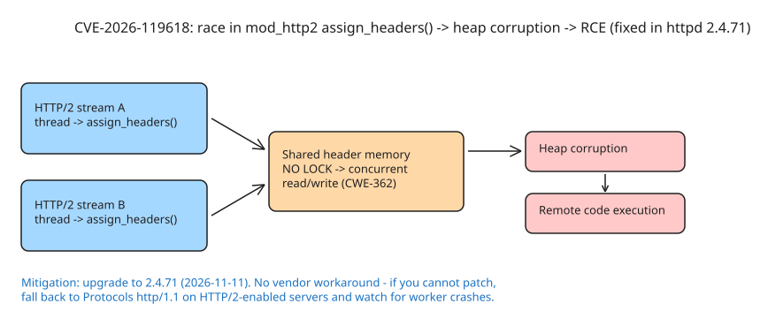

# Emergency Patch for Apache HTTP/2 RCE (CVE-2026-119618): mod_http2 Race to Heap Corruption

On **2026-11-11** the Apache HTTP Server project released **2.4.71**, fixing three CVEs — one rated **critical**: a remote code execution bug in the HTTP/2 module. Apache reserves the "critical" rating for flaws a remote attacker can use to execute code on the server (wormable-class bugs).



## The vulnerability surface (all three CVEs fixed in 2.4.71)

| CVE | Impact | Module | Bug class | Affected versions |
|---|---|---|---|---|
| CVE-2026-119618 | **critical** | `mod_http2` | Concurrent use of shared resource with improper synchronization in `assign_headers()` → heap corruption → **RCE** | httpd 2.4.55 → 2.4.70; standalone `mod_h2` (GitHub) 2.0.8 → 2.0.42 |
| CVE-2026-106023 | important | `mod_md` | NULL pointer dereference during request processing → child process crash (DoS) | httpd 2.4.30 → 2.4.70 |
| CVE-2026-109163 | low | `mod_vhost_alias` | 1-byte stack buffer overwrite (regression after CVE-2026-63292) | httpd 2.4.69 and 2.4.70 only |

Provenance of the critical find (per the official Apache advisory):

- **Anthropic's OSS Scanner** reported it on 2026-10-26 (as vulnerability ANT-2026-MAPKT6MZ)
- **Anthony Weems and Simon Scannell** (Google Cloud Vulnerability Research) reported it independently on 2026-11-03
- Fixed in 2.4.x by commit `824beab` (2026-11-11)

Two independent teams finding the same bug within days is a signal of how much research attention HTTP/2 parsing code is getting — consistent with the June 2026 "HTTP/2 Bomb" DoS that hit default HTTP/2 configs of several popular servers, including Apache.

The CVE entry was still marked "RESERVED" at publication time: **no public CVSS score or detailed technical write-up exists yet — do not wait for them before patching.**

## Response procedure

### 1. Identify exposed inventory

The bug lives in the HTTP/2 module: **servers actively serving HTTP/2 traffic are the highest priority.**

```bash
# Is HTTP/2 loaded and negotiated?
apachectl -M | grep -i http2
httpd -v                       # running version
curl -sIv --http2 https://your-host/ 2>&1 | grep -i "using HTTP"
```

Remediate in order: public-facing servers with HTTP/2 enabled → internal servers → servers where `mod_http2`/`mod_h2` is not loaded (lowest risk, still patch).

### 2. Upgrade to 2.4.71

```bash
# Verify after upgrade
apachectl -v        # expects 2.4.71 (2026-11-11)
```

**Distribution caveat:** many Linux distributions backport security fixes **without bumping the version string**. Check your vendor's security advisory and package changelog before assuming a server with `2.4.6x` is still vulnerable — and before assuming an upgrade is needed.

### 3. If you cannot patch immediately: fall back to HTTP/1.1

**Apache published no workaround for this flaw.** The only viable mitigation is disabling HTTP/2 until 2.4.71 is deployed:

```apache
# Disable the h2 protocol negotiation (comment out / remove)
# Protocols h2 http/1.1
Protocols http/1.1
```

Test this change in staging first — it can affect performance (no multiplexing) and some HTTP/2-only clients.

### 4. Hunt for probing activity

Exploitation attempts of a memory-corruption bug are often preceded by scanning that crashes workers. Monitor for:

- Unusual child/worker process crashes or restarts (`apachectl status`, systemd journal, core dumps)
- Repeated connection resets against HTTP/2 endpoints in access/error logs

### 5. Track the patching cadence context

This is the third major Apache patch round of 2026: **2.4.69** (October) fixed **20 CVEs**, **2.4.68** (June) fixed **13**. Admins who patched in October must patch again weeks later — build the HTTP/2 module into your regular patch cadence rather than treating it as stable.

## See also

- `howto-emergency-response-critical-php-rce-audit-patch-offline.md` — same audit/patch-window/offline-switch playbook applied to the October 2026 PHP RCEs
- `explanation-weekly-security-advisories-node2shell-php2shell-pillow.md` — HTTP/2 Bomb context

## References

- [Apache HTTP Server 2.4 vulnerabilities (official advisory page)](https://httpd.apache.org/security/vulnerabilities_24.html)
- [Developpez report on the critical HTTP/2 fix (FR)](https://web.developpez.com/actu/389058/Le-serveur-web-libre-open-source-et-multiplateforme-Apache-corrige-une-faille-critique-dans-HTTP-2-permettant-l-execution-de-code-a-distance-sur-les-serveurs-Web/)
- [Fix commit 824beab in apache/httpd](https://github.com/apache/httpd/commit/824beab9b9424d6cfb29595248fdbf6c3dddeab1)
