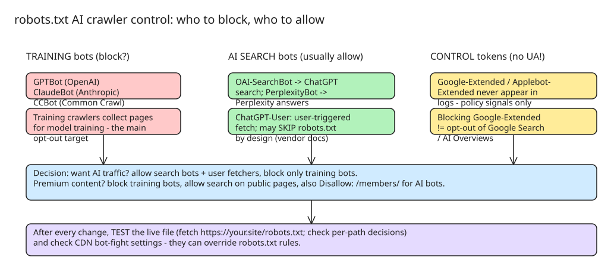

# How to Configure robots.txt for AI Crawlers: Block Training, Keep AI Search

AI crawlers fall into three functional classes, and the correct robots.txt policy depends on which class a bot belongs to. Getting this wrong either hands your content to every training pipeline or quietly removes your site from AI-generated answers.



## The AI user agents you should know

| Bot | Company | What it does |
| --- | --- | --- |
| `GPTBot` | OpenAI | Collects pages for model training |
| `OAI-SearchBot` | OpenAI | Finds pages for ChatGPT search results |
| `ChatGPT-User` | OpenAI | Opens a page when a user asks ChatGPT to |
| `ClaudeBot` | Anthropic | Collects pages for model training |
| `PerplexityBot` | Perplexity | Indexes pages for Perplexity answers |
| `Google-Extended` | Google | Controls use of content for Gemini training |
| `CCBot` | Common Crawl | Builds the open web dataset many models use |
| `Applebot-Extended` | Apple | Controls use of content for Apple AI training |

Two subtleties confirmed by vendor documentation:

- **`Google-Extended` and `Applebot-Extended` are control tokens, not crawlers.** They have no user-agent string and never appear in your server logs. Blocking `Google-Extended` opts you out of Gemini training only — it does **not** affect Google Search, AI Overviews, or AI Mode, which run on normal Googlebot.
- **User-triggered fetchers may skip robots.txt by design.** OpenAI, Perplexity, Google, Meta and Amazon all state in their docs that user-initiated fetches (like `ChatGPT-User`) can ignore robots.txt directives. robots.txt is a polite request, not enforcement.

## Example 1: Block all AI training bots, keep AI search

The most common business choice — content not used for training, still citable in AI answers:

```text
User-agent: GPTBot
Disallow: /

User-agent: ClaudeBot
Disallow: /

User-agent: CCBot
Disallow: /

User-agent: Google-Extended
Disallow: /

User-agent: OAI-SearchBot
Allow: /

User-agent: ChatGPT-User
Allow: /

User-agent: PerplexityBot
Allow: /
```

## Example 2: Block AI bots from one folder only

For paid content, client areas, or internal docs:

```text
User-agent: GPTBot
Disallow: /members/
Disallow: /internal/

User-agent: ClaudeBot
Disallow: /members/
Disallow: /internal/
```

## Example 3: Allow everything

For maximum visibility in AI answers, no AI-specific rules are needed:

```text
User-agent: *
Allow: /

Sitemap: https://example.com/sitemap.xml
```

## Common mistakes

1. **Blocking everything by accident** — a leftover `Disallow: /` under `User-agent: *` from a staging site blocks every bot, Google included.
2. **Blocking AI search bots while wanting AI traffic** — copying a "block all AI" list from a forum then wondering why ChatGPT never cites you.
3. **Treating robots.txt as security** — good bots follow it, bad scrapers ignore it. Use logins or firewall rules for private data.
4. **CDN bot-fight rules overriding robots.txt** — some CDN "bot fight" settings block AI crawlers even when robots.txt allows them. Check both layers.
5. **Typos in user-agent names** — `GPT-Bot` or `Claude-Bot` match nothing.

## How to test

After every change, test the live file: fetch `https://your.site/robots.txt`, verify the per-path decisions for each bot class, and confirm AI crawlers can actually reach your pages (not just read your rules). Cross-check against the Cloudflare-side controls described in [[explanation-cloudflare-disallow-ai-training-mixed-use-crawlers]] — CDN-level "block AI training" toggles act independently of robots.txt.

## Decision guide

- **Selling products/services, want leads:** allow AI search bots; block training bots only with a strong reason.
- **Premium content:** block training bots, allow search bots on public pages, block member folders.
- **News/media:** decide per bot and review every few months — new bots appear often.

## References

- [robots.txt AI Block: How to Block or Allow GPTBot, ClaudeBot and Other AI Crawlers (DEV.to)](https://dev.to/mywebrank/robotstxt-ai-block-how-to-block-or-allow-gptbot-claudebot-and-other-ai-crawlers-2h2a)
- [Overview of OpenAI Crawlers (OpenAI help)](https://help.openai.com/en/articles/10618827)
- [AI crawlers list: user agents and robots.txt (AI Rank Lab)](https://airanklab.com/ai-crawlers-list/)
