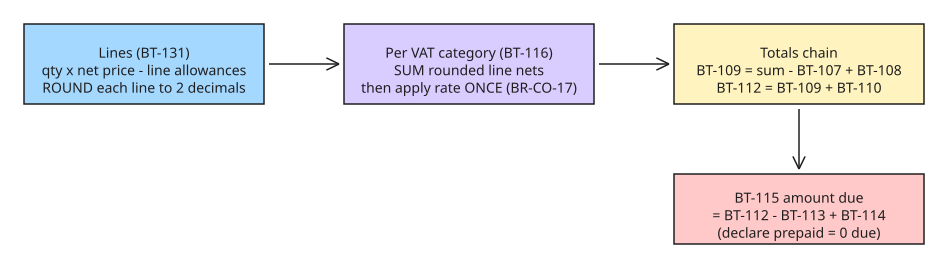

# Fixing the EN 16931 Validation Errors That Reject Most E-Invoices

If you generate **Factur-X, ZUGFeRD, XRechnung or Peppol** invoices, validators eventually answer with codes like `[BR-CO-14]` and sentences full of BT numbers. These codes come from the European standard **EN 16931**, and a handful account for most rejections. Almost all are about **arithmetic and rounding, not XML**.

## The core mental model: round once, at the right level



## BR-CO-17 — VAT is computed per category, not per line

> VAT category tax amount (BT-117) = VAT category taxable amount (BT-116) × (VAT category rate (BT-119) / 100), rounded to two decimals.

The classic rejection. Many systems compute VAT on **each line**, round it, then add the rounded values. EN 16931 does the opposite: **sum the net amounts per VAT rate first, apply the rate once, then round**. With enough lines the two methods differ by a cent and the invoice is rejected.

```javascript
// Build the VAT breakdown the way EN 16931 expects it
function vatBreakdown(lines) {
  const byRate = new Map();
  for (const l of lines) {
    const key = `${l.category}:${l.rate}`;
    byRate.set(key, (byRate.get(key) ?? 0) + l.netCents);
  }
  return [...byRate].map(([key, taxableCents]) => {
    const [category, rate] = key.split(':');
    return { category, rate: Number(rate), taxableCents,
             taxCents: Math.round(taxableCents * Number(rate) / 100) };
  });
}
```

Rules of thumb: **work in integer cents**, and round **once, at the category level**.

## BR-CO-10 and BR-S-08 — sums must use rounded line amounts

> Sum of Invoice line net amount (BT-106) = Σ Invoice line net amount (BT-131).

Each line net amount (quantity × net price, minus line allowances) is **rounded to two decimals first**; document totals are sums of those rounded values. Summing unrounded values and rounding at the end fails BR-CO-10. BR-S-08 applies the same rule per standard VAT rate: the taxable amount of each rate = sum of that rate's line nets + document-level charges − document-level allowances of that rate. A shipping charge declared at document level but forgotten in the 20% bucket is a typical BR-S-08.

## BR-CO-13 — document-level allowances and charges

> Invoice total amount without VAT (BT-109) = Σ BT-131 − Sum of allowances on document level (BT-107) + Sum of charges on document level (BT-108).

Usual causes: a discount applied twice (once on lines, once at document level), or shipping added to the total but not declared as a charge.

## BR-CO-14 / 15 / 16 — the chain of totals

> BT-110 = Σ BT-117 · BT-112 = BT-109 + BT-110 · BT-115 = BT-112 − BT-113 (paid) + BT-114 (rounding)

Once the breakdown is right, these follow — **as long as you derive each total from the previous one instead of recomputing it independently**. For an already-paid invoice (online order), declare the prepaid amount (BT-113) so the amount due is zero.

## BR-S-02 — no VAT number, no standard-rated line

> An invoice containing a line with VAT category "Standard rated" (BT-151) shall contain the Seller VAT Identifier (BT-31), the Seller tax registration identifier (BT-32) and/or the Seller tax representative VAT identifier (BT-63).

Not arithmetic: the seller VAT identifier is simply missing, often because it lives in a settings screen nobody filled in. Hits commonly in accounting sandboxes whose company has no VAT number.

## Checklist before shipping an invoice generator

1. All money math in integer cents; no float arithmetic.
2. Round each line net (BT-131) to 2 decimals; sum only rounded values.
3. Group by (category, rate); apply the rate once per group; round once.
4. Document-level charges/allowances land in the correct rate bucket (BR-S-08) and in the BT-109 chain (BR-CO-13).
5. Totals derived as a chain, never recomputed independently.
6. Seller VAT identifier present whenever standard-rated lines exist.
7. Prepaid orders: set BT-113 so BT-115 (amount due) = 0.

On the receiving end, browser tools like the Factur-X Viewer reader re-run these arithmetic checks (line sums, VAT per rate, totals, amount due, IBAN checksum) as a preflight, though they are not a full Schematron validation.

## References

- [The EN 16931 errors that reject most e-invoices, and how to fix them — DEV.to](https://dev.to/agence_exert/the-en-16931-errors-that-reject-most-e-invoices-and-how-to-fix-them-55e1) (original article)
- [Peppol BIS Billing 3.0 rules — BR-CO-17](https://docs.peppol.eu/poacc/billing/3.0/rules/ubl-tc434/BR-CO-17/) (official rule text, cross-checked May 2026 release)
- [Factur-X Viewer reader (browser preflight checks)](https://facturxviewer.fr/en/reader)
