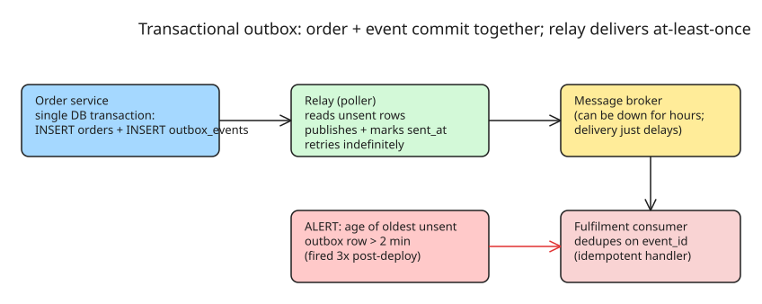

# How to Make Two Writes Commit Together — The Transactional Outbox Pattern (Postmortem)

A real incident: a finance reconciliation flagged **214 orders** taken over one weekend that were paid but never dispatched. Four customers had already called. Nothing in any log was an error, no alert fired, every dashboard green — because as far as the systems were concerned, nothing failed.

## The failure mode

The order service writes the order row, commits, then publishes an event that fulfilment consumes. On Saturday morning the message broker was unreachable for 12 minutes during its own cluster maintenance. The publish threw. Years earlier someone wrapped that call in a try/catch and logged the failure at **warning level**, on the grounds that "the order is already saved; don't fail checkout over a messaging problem."

Result: customers got confirmations, rows existed, payments were captured — and the only trace of the missing half was 214 warning lines in a log nobody queries.

The core insight: **two writes to two systems inside one request have four outcomes, and most designs handle only two.** The state where write #1 succeeds and write #2 fails is not an error condition — it's a system that recorded something untrue about itself and carried on with complete confidence. A system that can only record its *successes* will lose exactly the work that failed in the middle.

## How to fix it: transactional outbox + relay

Goal: if two things have to be true together, write them together — or build something whose job is to notice when they aren't.

### Step 1 — Write the event into an outbox table in the same transaction as the order

```sql
BEGIN;
INSERT INTO orders (id, customer_id, amount, status) VALUES (...);
INSERT INTO outbox_events (event_id, aggregate_type, aggregate_id, payload, sent_at)
VALUES ('evt-...', 'Order', $orderId, $payloadJson, NULL);  -- sent_at = NULL means unsent
COMMIT;
```

The order row and the event now **commit or fail together** — there is no longer a window where one exists without the other. The broker outage can no longer silently drop the second half: if the transaction fails, nothing was recorded as done.

### Step 2 — Run a relay that reads the outbox table

A background worker (poller) continuously scans for unsent rows (`sent_at IS NULL`), publishes each to the broker, and marks it sent:

```
loop every N ms:
    rows = SELECT * FROM outbox_events WHERE sent_at IS NULL ORDER BY created_at LIMIT batch
    for row in rows:
        broker.publish(topic=row.aggregate_type, key=row.event_id, value=row.payload)
        UPDATE outbox_events SET sent_at = now() WHERE event_id = row.event_id AND sent_at IS NULL
```

The relay **retries indefinitely** — the broker being down for 12 minutes (or 12 hours) just delays delivery; nothing is lost. Delivery semantics become explicitly **at-least-once**.

### Step 3 — Make consumers idempotent via event-id deduplication

At-least-once means a consumer may see the same event twice (relay crashes after publish but before marking sent). Consumers must dedupe on the stable `event_id`:

```sql
CREATE TABLE consumed_events (event_id TEXT PRIMARY KEY, consumed_at TIMESTAMP);

-- inside the consumer handler:
INSERT INTO consumed_events (event_id) VALUES ($eventId) ON CONFLICT DO NOTHING;
-- if the insert affected 0 rows -> already processed, skip
```

### Step 4 — Alert on outbox age, not on errors

The single most useful artifact from this incident: **an alert on the age of the oldest unsent outbox row** (threshold: 2 minutes). It fired three times after deployment, each time for a reason that would otherwise have been discovered on a Wednesday by an angry customer. Also: stop swallowing the publish exception — if you keep a try/catch around it, log at error level and let the relay's retry be the recovery path, not the silence.



## Why this works (and what it costs)

- **Atomicity restored**: the two facts that must be true together are written in one transaction — there is no longer a state where the order exists but the event doesn't.
- **Broker outages become delays, not losses**: the relay retries indefinitely; a 12-minute broker maintenance window just queues events.
- **Explicit at-least-once semantics** instead of accidental at-most-once: duplicates are handled by consumer-side dedup on `event_id`, which you need anyway for any reliable messaging setup.
- **Observability where it hurts**: the outbox age alert converts "silently lost work" into a page within 2 minutes.

Costs to accept: an extra table and poller; duplicate delivery (hence mandatory idempotent consumers); and eventual consistency — fulfilment sees events seconds-to-minutes later, not synchronously. If you need synchronous cross-system atomicity instead, see [[howto-compare-2pc-vs-saga-and-choose-technique]] and [[howto-design-choreography-saga]].

## Checklist before shipping

1. [ ] Event row written in the **same transaction** as the business write (no separate insert after commit).
2. [ ] Stable, unique `event_id` generated by the producer (UUID), carried through broker message key and consumer dedup table.
3. [ ] Relay marks rows sent **after** successful publish; crash between publish and mark-sent is safe because consumers dedupe.
4. [ ] Consumer handlers are idempotent on `event_id` (dedup table or upsert).
5. [ ] Alert on age of oldest unsent outbox row (threshold tuned to your SLA, e.g. 2 min) — this alert alone would have caught the incident in minutes instead of weeks.
6. [ ] No swallowed publish exceptions: log at error level; recovery is the relay's job, not silence.

## References

- [DEV.to: The order was committed and nothing else ever heard about it (Sergey Shinder)](https://dev.to/sergey_shinder_ab2d943365/the-order-was-committed-and-nothing-else-ever-heard-about-it-2l3g)
