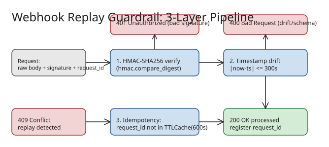

# How to Defend Webhooks Against Replay Attacks (Signature + Drift + Idempotency)

Cryptographic signature verification alone does **not** stop replay attacks: an attacker who captures a valid payload *and* its signature can resend the identical request and re-trigger state mutations. The defense is a sequential three-layer pipeline: **HMAC-SHA256 signature verification → timestamp drift validation → idempotency check**. Related: [[howto-write-strict-json-schema-contracts]], [[../../identity-security/secure-coding/INDEX|secure-coding]].



## Step 1 — Verify the HMAC-SHA256 signature (constant-time)

Compute the HMAC over the **raw request body bytes** (never the re-serialized JSON — key order/whitespace changes break it) and compare with `hmac.compare_digest` to avoid timing side channels:

```python
import hmac, hashlib

def verify_signature(secret_key: bytes, payload: bytes, signature: str) -> bool:
    expected = hmac.new(secret_key, payload, hashlib.sha256).hexdigest()
    return hmac.compare_digest(expected, signature)   # constant-time
    # signature mismatch  -> raise UnauthorizedError -> HTTP 401
```

## Step 2 — Reject stale timestamps (drift bound, ±300 s)

Bound replayable time-to-live inside the schema validator, so an old captured payload fails even with a valid signature:

```python
import time
from pydantic import BaseModel, Field, field_validator

class WebhookPayload(BaseModel):
    request_id: str = Field(..., min_length=1)
    timestamp: int
    data: dict

    @field_validator("timestamp")
    @classmethod
    def validate_timestamp(cls, v):
        if abs(time.time() - v) > 300:        # allowed clock drift: 5 min
            raise ValueError("Timestamp drift too large")   # -> HTTP 400
        return v
```

## Step 3 — Idempotency check: never process a `request_id` twice

Keep a TTL cache of seen `request_id`s and reject duplicates with **409 Conflict**. The article's implementation includes a stdlib-only `TTLCache` fallback (maxsize-bounded, evicts expired, then oldest) so it runs in restricted/offline environments without `cachetools`/`orjson`:

```python
processed_requests = TTLCache(maxsize=10_000, ttl=600)   # remember 10 min

def process_webhook(raw_body: bytes, signature: str):
    if not verify_signature(SECRET, raw_body, signature):
        raise UnauthorizedError("401 Unauthorized: Invalid Signature")
    payload = WebhookPayload(**json_loads(raw_body))      # 400 on schema/drift
    if payload.request_id in processed_requests:
        raise ConflictError("409 Conflict: Replay detected")
    processed_requests[payload.request_id] = True
    return {"status": "success"}
```

Test all three paths: happy path → `success`; replay of the same body/signature → `409`; old timestamp re-signed correctly → drift `ValueError`.

## Invariants to keep straight

- **TTL must exceed the drift bound.** Cache retention (600 s) ≥ 2× the ±300 s acceptance window — otherwise a payload can fall out of the replay cache while still being timestamp-valid.
- **Sign the raw bytes, verify before parsing.** Parsing before authentication lets attackers burn CPU on malformed input (and re-serialization invalidates signatures).
- **`request_id` must be issuer-stable**, so a retried delivery is idempotent rather than a "new" event.

## Operational considerations surfaced by the author

1. **Environment/dependency divergence:** in containerized or automated verification pipelines, undeclared third-party deps (`cachetools`, `orjson`) crash at runtime with `ModuleNotFoundError` — the guardrail must ship stdlib fallbacks or pin its dependency list explicitly.
2. **Custom fallback maintenance cost:** hand-rolled `TTLCache`/JSON shims trade dependency freedom for code you now own and must test.
3. **Single-process cache limitation (mine, not the article's):** an in-memory `TTLCache` only guards one instance. Behind a load balancer, move the seen-IDs store to Redis (`SETNX request_id EX 600`) so replay protection is cluster-wide.

## References

- [Building a Defensive Guardrail Against Webhook Replay Attacks — DEV.to](https://dev.to/toai/building-a-defensive-guardrail-against-webhook-replay-attacks-37j7)
