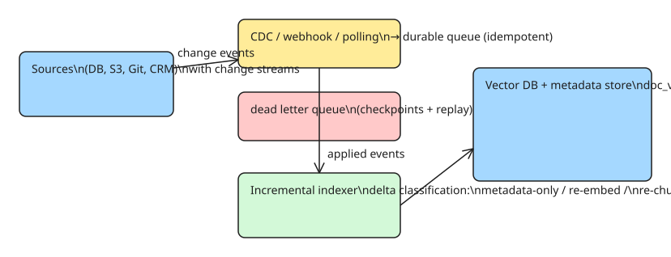

# How to Maintain RAG Freshness in Production — Incremental Indexing, Sync Patterns, and Tombstones

A RAG system answers from the index, not the source of truth. The moment your corpus changes, the index becomes a stale copy — and users ask questions whose answers *used to* be true. Rebuilding the whole index nightly is the common first answer, but it doesn't scale (re-embedding thousands of documents takes hours and costs real money) and leaves a freshness hole all day long.

This howto covers the sync pattern choice, the metadata you need for incremental updates, the update decision rules, tombstone-based deletion, and the SLA metrics that tell you freshness is actually working.

## Step 1 — Pick your sync pattern

| Pattern | Latency | Cost | Failure mode |
|---|---|---|---|
| **CDC** (change data capture — Debezium, logical replication, Kafka Connect) | Seconds–minutes | Moderate (stream infra) | Lag spikes; requires source to expose changes |
| **Webhooks** (source pushes change events) | Seconds | Low (if source supports it) | No replay story; need a durable queue behind the consumer |
| **Polling** (scan `updated_at` / checksums on a schedule) | Minutes–hours | Low (simple) | Misses changes between polls; full-scan cost grows with corpus |

Decision rule: **CDC if the source has a change stream, webhooks if it has an event API, polling as the fallback** (e.g. for S3/FTP/Git repos that only give you object listings). Whichever you pick, the consumer must be **idempotent** — events duplicate, and a document that was updated, deleted, and re-added within one window must end in the right final state.

## Step 2 — Version every document in the index

The index row must carry enough metadata to decide *what changed* without re-reading everything:

```python
DOC_METADATA_FIELDS = [
    "document_id",            # stable identity (NOT a hash of content)
    "source_id",             # which source system it came from
    "chunk_id",              # stable chunk identity within the document
    "parent_document_version",  # version of the doc at index time
    "source_timestamp",      # when the source last changed
    "content_hash",          # sha256 of the chunk text
    "embedding_model_version",# which model produced the vector
    "deletion_flag",         # tombstone marker (see step 4)
]
```

The three fields that make incremental updates possible: `parent_document_version` (is this chunk from the latest version?), `content_hash` (did the text actually change?), and `embedding_model_version` (does this vector match the current model?).

## Step 3 — Apply the update decision rules

For each incoming change event, classify the delta and do the minimum work:

| Delta | Action | Why |
|---|---|---|
| Metadata changed, text unchanged | Update metadata only | No re-embed needed |
| Text changed | Re-embed the changed chunks | New text → new vector |
| Chunking changed (split/merge) | Re-chunk the whole document and re-embed all its chunks | Chunk identity is stable, but boundaries moved |
| Embedding model upgraded | Full re-embed (batched, in priority order) | Old vectors aren't comparable to new ones |
| Document deleted | Tombstone (step 4) | Deletes must propagate as fast as inserts |

The re-chunking case is the one people miss: a single character added in one section can shift chunk boundaries and invalidate every downstream chunk of that document.

## Step 4 — Tombstone deletes; hard-delete on a schedule

Deleting a vector row immediately is a race: readers in flight may still reference it, and a delete event that arrives *before* its insert (out of order) must not create a tombstone for a chunk that doesn't exist yet. The pattern:

1. **Tombstone first**: set `deletion_flag = true` and exclude the chunk from search results immediately (the metadata filter is cheap).
2. **Hard delete later**: a background job physically removes tombstoned chunks after a retention window (longer than your maximum event reordering window).
3. **Tombstone backlog is a metric**: if tombstones accumulate, your delete pipeline is slower than your source's deletion rate — a different operational problem than insert lag.

## Step 5 — Make caches version-aware

If you cache search results (common for latency), a cache key that only contains the query is a freshness hole: the answer was valid five minutes ago. Two options:

- **Cache key includes source version** — `hash(query, max_document_version_affected)`.
- **Cache TTL + invalidation broadcast** — TTL as backstop, webhook-triggered invalidation for the keys affected by the change.

The version-aware variant is safer: it degrades gracefully to staleness-bounded-by-TTL even when invalidation events are lost.

## Step 6 — Decide re-embedding policy in advance

Embedding model upgrades are the expensive freshness event. Decide *before* you need it:

- **Triggers**: model change, or measured retrieval quality regression against a golden question set.
- **Order**: highest-traffic documents first (measure by query hit rate), so the 90%-of-queries corpus is fresh within hours, long-tail within days.
- **Cutover**: write new vectors alongside old (dual-write with `embedding_model_version`), flip reads atomically, then prune old vectors. Never delete-then-embed — a failed batch leaves a gap.

## Step 7 — Define and monitor freshness SLAs

Freshness is a property you measure, not assume:

| Metric | Definition | Typical target |
|---|---|---|
| **Freshness lag** | `now - max(source_timestamp)` over indexed docs | &lt; 5 min (CDC), &lt; 15 min (polling 5-min) |
| **Sync success rate** | events applied / events received | > 99.9% |
| **Tombstone backlog** | count of deletion_flag=true rows | trending toward 0 |
| **Stale hit rate** | golden-set questions whose indexed answer is from a superseded document version | &lt; 1% |
| **Recovery time** | time to resync after a pipeline outage (checkpoint replay) | &lt; 30 min |

Operational plumbing that makes the SLAs achievable: **checkpoints** (the sync cursor is persisted, so an outage replays from the last good cursor), a **dead letter queue** (poison events don't block the stream), and **replay** (re-running a range of events is safe because the consumer is idempotent from step 1).



## Pitfalls

- **Stable identity is not a content hash.** If `document_id` is `sha256(content)`, every edit creates a "new" document and you lose version history — back to full-rebuild behavior.
- **Re-chunking invalidates siblings.** One section growing shifts every downstream chunk boundary; re-chunk the whole document, not just the edited section.
- **Out-of-order deletes.** A delete arriving before its insert must be tolerated (skip, or queue); an immediate hard delete on a phantom chunk is a bug.
- **Cache keys without versions** are the most common freshness hole in "working" RAG systems — the pipeline is fresh, the cache is not.
- **Freshness without a golden set is unmeasurable.** Build a small question set with known-correct current answers; the stale hit rate is your SLA.

## References

- [RAG Freshness Strategies for Syncing Data in Production (DEV.to, original source)](https://dev.to/imversion_tech/rag-freshness-strategies-for-syncing-data-in-production-2026-2j54)
- Related KB note: [[How to implement a search bar with Elasticsearch (queries, indexing, ingestion)]] (the indexing side of this same pipeline — this note covers keeping that index fresh after it is built)
