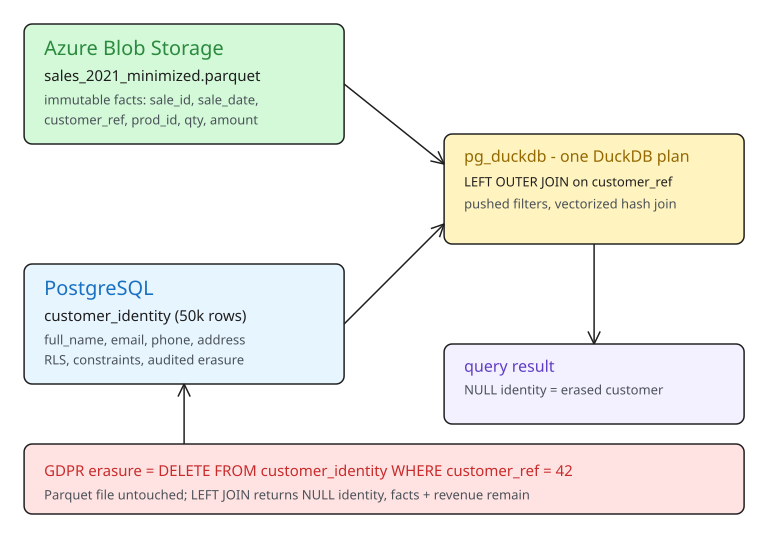

# GDPR Data Minimization with pg_duckdb — Joining Azure Blob Facts to Erasable Customer Data in Postgres

When you archive a year of cold data to immutable Parquet files, the hard question is: what happens when an old row must *change* after the file was written? Rewriting a large immutable file for every correction or erasure defeats the purpose of the archive. This tutorial walks through the pattern Franck Pachot demonstrates on a deterministic 10M-row lab: **archive immutable facts to Parquet, keep erasable personal data in Postgres, and join the two at query time with `pg_duckdb`** — so a GDPR erasure is one `DELETE` in Postgres, not a file rewrite.



## Why the split is the design

Two lifecycles collide in one sales table:

- **Historical facts** (sale date, product, quantity, amount) — the business considers them immutable once the year is closed. They belong in Parquet.
- **Personal data** (name, email, phone, address) — must be correctable and erasable at any time. It belongs in PostgreSQL, inside the operational system's existing security boundary: roles, row-level security, constraints, transactional corrections, retention procedures, audited backup/restore.

`pg_duckdb` then turns both sources into **two scan inputs of a single DuckDB relational plan**: DuckDB chooses join order and build side, pushes filters toward both sources, performs the hash join, and runs the aggregation in one vectorized pipeline.

The point is not that object storage cannot be secured. It is that *every immutable analytical file that contains personal data becomes its own governance unit* — its own access controls, audit trail, retention policy, backup handling, and erasure procedure. Keeping direct identifiers out of the archive both simplifies the file's lifecycle and satisfies GDPR's data-minimization principle (less personal data copied into the analytical tier).

## Lab setup

The lab reuses a deterministic 10-million-row dataset (no `random()`, so every count below is reproducible).

```sql
SET duckdb.force_execution = false;

DROP TABLE IF EXISTS sales;
CREATE TABLE sales AS
SELECT g AS sale_id,
       (DATE '2021-01-01' + ((g * 7) % 1826))                        AS sale_date,
       1 + (g % 50000)                                               AS cust_id,
       1 + (g % 2000)                                                AS prod_id,
       1 + (g % 5)                                                   AS channel_id,
       (ARRAY['US','CH','FR','DE','UK','JP','BR','IN'])[1 + (g % 8)] AS country,
       (ARRAY['Consumer','SMB','Enterprise'])[1 + (g % 3)]          AS segment,
       1 + (g % 10)                                                  AS qty,
       ((5 + (g % 500))::numeric(10,2))                             AS amount
FROM generate_series(1, 10000000) g;
ANALYZE sales;

CREATE EXTENSION IF NOT EXISTS pg_duckdb;
SELECT duckdb.create_azure_secret('<blob connection string>');
```

Two gotchas from the lab:

- Build the source table on the PostgreSQL executor (`duckdb.force_execution = false`). If DuckDB is forced on, it warns about `+(DATE, BIGINT)` in the `generate_series` DDL and falls back to PostgreSQL anyway.
- The identity table keeps **synthetic** values; in a real design use a stable, opaque `customer_ref` token with no business meaning, and keep the only identity mapping inside the protected operational database.

```sql
DROP TABLE IF EXISTS customer_identity;
CREATE TABLE customer_identity (
  customer_ref int PRIMARY KEY,
  full_name    text NOT NULL,
  email        text NOT NULL,
  phone        text NOT NULL,
  address      text NOT NULL
);

INSERT INTO customer_identity
SELECT g,
       format('Customer %s', lpad(g::text, 5, '0')),
       format('customer%s@example.test', lpad(g::text, 5, '0')),
       format('+41 22 555 %s', lpad(g::text, 4, '0')),
       format('%s Example Street, Test City', g)
FROM generate_series(1, 50000) g;

CREATE UNIQUE INDEX customer_identity_email_idx ON customer_identity (email);
ANALYZE customer_identity;
```

## Step 1 — Write a minimized fact file

When exporting the 2021 sales, select **only the immutable fact columns**. Do not copy names, emails, phones, or addresses into the file:

```sql
SELECT duckdb.raw_query($$
  COPY (
    SELECT sale_id,
           sale_date,
           cust_id AS customer_ref,
           prod_id,
           channel_id,
           qty,
           amount
    FROM pgduckdb.public.sales
    WHERE sale_date < DATE '2022-01-01'
  ) TO 'az://lake/archive/sales_2021_minimized.parquet'
    (FORMAT parquet)
$$);
```

`raw_query` sends the `COPY` to the embedded DuckDB engine; `pgduckdb.public.sales` is DuckDB's catalog name for the Postgres table. Verify both sides:

```sql
SELECT count(*) FROM customer_identity;          -- 50000
SELECT count(*) AS n_sales,
       count(DISTINCT (s['customer_ref'])::int) AS n_customers
FROM read_parquet('az://lake/archive/sales_2021_minimized.parquet') s;
-- n_sales = 1998938, n_customers = 50000
```

The file holds ~2M immutable sales and only an opaque bridge (`customer_ref`) to the 50,000 identity rows that stay in Postgres.

## Step 2 — The join before erasure

Customer 42 has 39 archived sales. Resolve the bridge to the live identity with a `LEFT OUTER JOIN`:

```sql
SELECT COALESCE(c.full_name, '[erased customer]') AS customer_name,
       COALESCE(c.email, '[removed]')             AS email,
       count(*)                                   AS n_sales,
       sum((s['amount'])::numeric(10,2))         AS revenue
FROM read_parquet('az://lake/archive/sales_2021_minimized.parquet') s
LEFT OUTER JOIN customer_identity c
  ON c.customer_ref = (s['customer_ref'])::int
WHERE (s['customer_ref'])::int = 42
GROUP BY c.full_name, c.email;
```

No `SET duckdb.force_execution = true` needed: DuckDB automatically executes any statement referencing `read_parquet`, including the scan of the Postgres table and the join.

## Step 3 — Delete the identity, not the history

Process the erasure in the operational database:

```sql
DELETE FROM customer_identity WHERE customer_ref = 42;
```

Run the *exact same join* again:

```
 customer_name     | email     | n_sales | revenue
-------------------+-----------+---------+---------
 [erased customer] | [removed] |        39 | 1794.00
```

The 39 sales and their revenue remain; name and email are gone. `COALESCE` shows a friendly label, but **`NULL` is semantically correct**: the customer exists, their personal data is unknown. The `LEFT JOIN` keeps the fact row alive when the identity is deleted. After the deletion, a `GROUP BY` over `CASE WHEN c.customer_ref IS NULL THEN 'erased' ELSE 'identified' END` across all ~2M archived facts confirms nothing was lost.

## Performance notes

- The full join hashes the smaller PostgreSQL input and streams the Parquet facts through it.
- `pg_duckdb` supplies base-table cardinality to DuckDB, while PostgreSQL still chooses access paths for delegated scans and can use its indexes.
- Customer-side filters can reduce both inputs, but Parquet **row-group pruning depends on physical ordering and min/max statistics**.
- For repeated selective lookups, sort within each time partition or materialize into an indexed table — do not assume object storage behaves like an OLTP index.

One file is enough to demonstrate the join; a real archive grows into a tree of yearly or monthly files. The follow-up pattern is Hive-style partitions so DuckDB prunes every file the query does not need.

## Key takeaways

- **Split by lifecycle, not by volume**: immutable facts → Parquet; erasable identities → Postgres. The archive file's governance burden shrinks to zero personal data.
- **Erasure becomes a Postgres `DELETE`**, not an object-store rewrite; the fact stays, the identity becomes `NULL` via the `LEFT JOIN`.
- Use an **opaque bridge token** (`customer_ref`), never a business-meaningful key, and keep the only identity mapping inside the protected operational boundary.
- `pg_duckdb` is a *join layer*, not just file syntax: one DuckDB plan over two scan sources with pushed filters and a vectorized hash join.
- Row-group pruning is physical, not logical: order Parquet files the way queries will slice them.

## Related notes

- `data-engineering/Medallion-Governance-Security/howto-implement-fine-grained-data-access-rls-cls-ols.md`
- `data-engineering/Data-Architecture-Evolution/howto-separate-analytical-workloads-from-oltp-systems.md`
- `data-engineering/Data-Architecture-Evolution/explanation-data-lake-pattern-limitations.md`

## References

- [GDPR data minimization with pg_duckdb: join Azure Blob facts to erasable customer data in Postgres (DEV.to, Franck Pachot)](https://dev.to/franckpachot/gdpr-data-minimization-with-pgduckdb-join-azure-blob-facts-to-erasable-customer-data-in-postgres-4ce8)
- [pg_duckdb on GitHub](https://github.com/duckdb/pg_duckdb)
