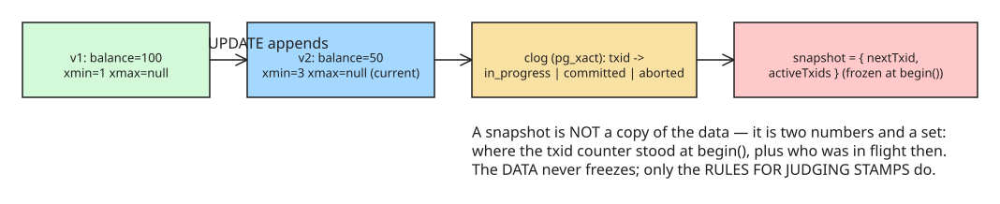

# MVCC Explained: Build Postgres-Style Snapshots in ~100 Lines of TypeScript

A hands-on tutorial that derives Multi-Version Concurrency Control (MVCC) from first
principles. The motivating demo: session A runs `BEGIN; DELETE FROM users;` on a
million-row table without committing, while session B's `SELECT count(*)` still returns
1,000,000 — no locks, no blocking, no errors. Where are the rows? **Both deleted and
not.** MVCC is how Postgres, MySQL/InnoDB, Oracle, and SQLite (WAL mode) make that
possible: readers and writers ignore each other.

## The founding decision

> **Nothing is ever updated. Nothing is ever deleted. The database only ever appends.**

Every "problem" below is a consequence of this decision; every piece of MVCC is the
minimal fix for one problem.



## Step 1 — rows become version chains

A row is not a value; it's the full history of values:

```ts
type Txid = number;

interface Version {
  xmin: Txid;          // birth certificate: which transaction created this version
  xmax: Txid | null;   // death certificate: which transaction deleted it (null = alive)
  value: unknown;
}

interface Row {
  versions: Version[]; // oldest first — nothing is ever removed or overwritten
}
```

Writes become trivial: `INSERT` pushes `{xmin: me, xmax: null}`; `DELETE` sets
`xmax = me` on the live version (a *stamp*, not a removal); `UPDATE` is literally
delete + insert. Transactions are just an incrementing counter — because txids only
increase, they double as timestamps.

## Step 2 — dirty reads: stamps need a commit log

Naive rule "visible if `xmax === null`" fails when the deleting transaction hasn't
committed yet (and then rolls back): session B would have read a state of the world
that never existed — a **dirty read**. Fix: track per-txid status in a commit log
(Postgres' `pg_xact`, historically clog):

```ts
type TxStatus = "in_progress" | "committed" | "aborted";
type Clog = Map<Txid, TxStatus>;

commit(txid) { this.clog.set(txid, "committed"); }  // ONE map write
abort(txid)  { this.clog.set(txid, "aborted"); }    // stamps stay — they just stop counting
```

Commit touches **zero rows**: one map entry flip retroactively makes a million `xmax`
stamps count (or not). That's why Postgres `ROLLBACK` after a huge write is cheap.

## Step 3 — non-repeatable reads: the snapshot

If session B reads, then A commits, then B reads again *in the same transaction*, B's
world changed under its feet. The fix is a **snapshot** taken at `begin()`:

```ts
interface Snapshot {
  nextTxid: Txid;         // counter value at my begin(); anything >= this is my future
  activeTxids: Set<Txid>; // who was still running when I began — their fate is undecided for me
}
```

A snapshot is **not a copy of the data** — copying a million rows per transaction would
be insane. It's two numbers and a set; that immutability *is* the "repeatable" in
repeatable reads.

## Step 4 — the late-committing past transaction

Transaction 5 was running when I (txid 8) began, so `xmin < snap.nextTxid` says its
writes are in my past — but if it commits while I'm running, they'd leak into my
snapshot mid-flight. The `activeTxids` set closes that door: a stamp from any
transaction in flight at my `begin()` never counts for me, no matter what it does later.

## The visibility function (the whole point)

```ts
function isVisible(v: Version, snap: Snapshot, clog: Clog, myTxid: Txid): boolean {
  // Part 1: was this version BORN, from my point of view?
  const xminVisible =
    v.xmin === myTxid ||                       // my own writes are always visible to me
    (clog.get(v.xmin) === "committed" &&       // it really happened   (else DIRTY READS)
     v.xmin < snap.nextTxid &&                 // it was in my past     (else FUTURE leaks in)
     !snap.activeTxids.has(v.xmin));          // author wasn't mid-flight at begin() (else NON-REPEATABLE)

  if (!xminVisible) return false;

  // Part 2: has this version DIED, from my point of view?
  if (v.xmax === null) return true;            // no death certificate: alive for everyone
  if (v.xmax === myTxid) return false;         // I stamped it myself -> dead to me instantly

  const xmaxApplies =                          // death plays by birth's rules (symmetry!)
    clog.get(v.xmax) === "committed" &&
    v.xmax < snap.nextTxid &&
    !snap.activeTxids.has(v.xmax);

  return !xmaxApplies;
}
```

> **A version is visible when its birth is inside your snapshot and its death is not.**

Every condition is load-bearing — delete one line and a named anomaly returns (the
tutorial's repo has a test per condition). The punchline is the symmetry: the `xmax`
half applies the *same three conditions* to judge death instead of birth. Once this
function exists, every operation becomes a one-liner over version chains — reading is
just filtering history through a pure function, which is exactly why readers never
block writers.

## What to verify against real Postgres

- `SELECT ctid FROM t` before/after an `UPDATE`: the row's physical address changes —
  same append trick.
- The tutorial points its toy implementation at real Postgres and shows the columns
  match one-to-one (`xmin`/`xmax` are visible in system catalogs).

## The bill for "never delete" — dead tuples, VACUUM, and the xmin horizon

The toy implementation has a bug that real Postgres had to solve: if nothing is ever
removed, the version chains grow forever. Real Postgres pays for append-only MVCC in
three ways.

**Dead tuples and VACUUM.** Old versions that *no running snapshot can see anymore* are
**dead tuples**. They still take heap space, slow scans, and bloat indexes (each version
can carry its own index entries). `VACUUM` walks the table, finds tuples dead to *every*
snapshot, marks their space reusable, cleans index entries, and updates the visibility
map (which is what enables index-only scans) and free space map. `AUTOVACUUM` triggers
this automatically based on how many rows changed. Watch the pressure with:

```sql
SELECT relname, n_live_tup, n_dead_tup, last_autovacuum
FROM pg_stat_user_tables
ORDER BY n_dead_tup DESC LIMIT 10;
```

**The xmin horizon.** VACUUM can only remove a tuple once it is dead to the *oldest
snapshot still in use anywhere*. One session sitting `idle in transaction` — a forgotten
`BEGIN`, a leaked pool connection, a six-hour analytics query — **pins the horizon**, and
nothing deleted or updated since it started can be cleaned up, in *any* table. Abandoned
replication slots and old prepared transactions hold the horizon back the same way. Find
the pin:

```sql
SELECT pid, state, xact_start, now() - xact_start AS age, left(query, 60)
FROM pg_stat_activity
WHERE xact_start IS NOT NULL
ORDER BY xact_start LIMIT 10;
```

Defences: `idle_in_transaction_session_timeout`, statement timeouts, short transactions
in app code, and moving long reports to a replica (where `hot_standby_feedback` has its
own horizon trade-off).

**XID wraparound and freezing.** Txids are 32-bit and the space is *circular*: from the
current counter, roughly 2 billion older ids are "past" and 2 billion are "future". Our
`v.xmin < snap.nextTxid` comparison silently breaks when the counter laps an old row —
committed data simply **vanishes from query results** (no corruption, just invisibility),
and eventually Postgres refuses new writes to protect itself. The fix mirrors the toy
model's escape hatch: VACUUM **freezes** old tuples by setting infomask bits so they are
exempt from modular comparison — visible to all, forever. Monitor the countdown:

```sql
SELECT datname, age(datfrozenxid) FROM pg_database ORDER BY 2 DESC;
```

If `age(relfrozenxid)` climbs despite autovacuum, a snapshot is pinned — check exactly
three places: `pg_stat_activity` (`backend_xmin`), `pg_replication_slots` (inactive
slots), and `pg_prepared_xacts`. Remove the blocker *first*, then plain `VACUUM`;
vacuuming before clearing the blocker "succeeds" while freezing zero tuples. Never reach
for `VACUUM FULL` in an emergency — it needs an ACCESS EXCLUSIVE lock *and* a fresh XID,
one of the few resources you may have left.

## Two refinements the toy model skips

- **Hint bits.** Checking the clog on every read is expensive, so Postgres caches each
  tuple's fate in hint bits on the tuple itself — which is why the first read after a big
  write can itself generate writes.
- **HOT updates.** If an update touches no indexed columns and the page has room, the
  new version is placed on the *same page* and linked from the old one with **no new
  index entries**; dead HOT chains are pruned during normal page access, no VACUUM
  needed. Encourage them by not indexing hot columns needlessly and lowering `fillfactor`
  (~90) on write-heavy tables; compare `n_tup_hot_upd` vs `n_tup_upd`.
- **Snapshot granularity = isolation level.** The toy model freezes the snapshot at
  `begin()` — that is exactly Postgres' `REPEATABLE READ`/`SERIALIZABLE` behaviour. The
  default `READ COMMITTED` takes a **new snapshot per statement**, which is why two
  `SELECT`s in one default-mode transaction *can* see different data. Writers still
  conflict with writers: updating a row someone else updated but hasn't committed waits
  (the row lock lives in the tuple's `xmax`).

## Practical consequences

- An `UPDATE` costs about as much as an `INSERT` — a whole-table update roughly doubles
  table size until vacuumed; batch large updates.
- `count(*)` cannot use a stored row count: every transaction may legitimately see a
  different number (the motivating million-row demo).
- Keep transactions short — never hold one open across user think-time or a slow API
  call, because every open transaction pins the global cleanup horizon.

## References

- [Original tutorial (dev.to, jatin510)](https://dev.to/jatin510/mvcc-explained-build-postgres-style-snapshots-in-100-lines-of-typescript-37be)
- [PostgreSQL: Multiversion Concurrency Control](https://www.postgresql.org/docs/current/mvcc-intro.html)
- [Heroku Dev Center: PostgreSQL Concurrency with MVCC](https://devcenter.heroku.com/articles/postgresql-concurrency)
- [EasySpawn: PostgreSQL MVCC Explained (xmin/xmax, snapshots, VACUUM, HOT)](https://easyspawn.com/blog/postgres-mvcc-explained)
- [MyDBOPS: PostgreSQL XID Wraparound — What Freezing Actually Does (2026-07-20)](https://www.mydbops.com/blog/postgresql-transaction-id-wraparound-freezing-mechanics)

## Related
- [[tutorial-commit-conversation-voice-turn-context]]
