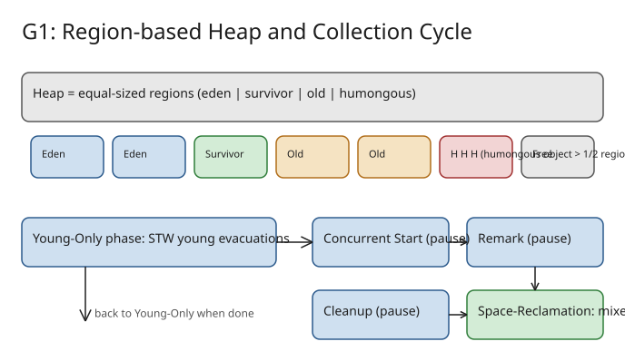

# The G1 Garbage Collector: Design, Collection Cycle, and How to Use It

Step-by-step walkthrough of G1 — the JVM's default garbage collector in **all environments since JDK 27** (JEP 523). Based on the official dev.java tutorial linked from the Inside Java release (Nov 2026). Related: [[explanation-jep-546-zgc-adaptive-heap-sizing]], [[explanation-zgc-decade-of-low-latency-gc]], [[explanation-jdk-27-stop-the-world-gc-changes]].



## 1. Why G1 exists — the design position

Garbage collector design balances three constraints: **throughput**, **latency (pause time)**, and **memory footprint**.

| Collector | Optimizes for |
|---|---|
| ParallelGC | Throughput (was JDK 8 default) |
| ZGC | Latency (&lt; 1 ms pauses) |
| **G1** | **Balance of latency and throughput** — good default for most workloads |

Timeline to learn:

- **JDK 6u14** — G1 introduced as experimental
- **JDK 7u4** — promoted to standard feature
- **JDK 9** — default in *server* environments (JEP 248), replacing ParallelGC; CMS deprecated
- **JDK 14** — CMS removed (G1 was originally built to replace CMS)
- **JDK 27** — default in *all* environments (JEP 523); 12+ JEPs have touched G1 since JDK 8

Originally G1 targeted big servers (many cores, tens of GB of heap); it has since been tuned down to perform well on a single CPU with &lt; 2 GB memory — which is what justifies the JDK 27 "default everywhere" change. Note: from JDK 9–26 the JVM auto-selected G1 only when it detected ≥ 2 CPU cores and > 1792 MB system memory; otherwise it fell back to SerialGC.

## 2. Understand the heap layout: regions, not contiguous generations

G1 is a **generational, incremental, parallel, mostly concurrent, stop-the-world, evacuating** collector. Its defining trick: the heap is divided into **equal-sized regions** whose roles are assigned dynamically:

- **Eden regions** — new objects land here.
- **Survivor regions** — objects that survive a young collection are *evacuated* (copied) here; on each later young collection they move to a new survivor region until heuristics promote them.
- **Old regions** — long-lived objects; collected less frequently.
- **Humongous regions** — one or more contiguous regions reserved for a single object **larger than half a region size**. Humongous objects bypass eden/survivor entirely and are treated like old-gen objects.

Key mental model: unreachable objects are never individually freed — when nothing in a region is reachable, the **whole region becomes reusable**. Region size/count come from internal heuristics driven by total heap size.

## 3. Follow the collection cycle: Young-Only and Space-Reclamation phases

The cycle alternates between two phases:

**Young-Only phase** — only young regions are collected. Every collection is a stop-the-world *pause* during which G1 evacuates live objects to new regions.

When old-generation occupancy crosses a threshold, the **concurrent marking** parts kick in (three special pauses bracket the work):

1. **Concurrent Start** (pause) — performs a normal young evacuation *and* kicks off concurrent marking of old regions. If G1 decides marking is unnecessary, a *Concurrent Mark Undo* pause aborts and Young-Only continues.
2. **Remark** (pause) — no evacuation; finalizes concurrent marking plus reference processing, class unloading, and empty-region reclamation. Concurrent work between Remark and Cleanup computes Space-Reclamation inputs.
3. **Cleanup** (pause) — no evacuation; decides whether Space-Reclamation is worth it. If yes, Young-Only ends with a single *Prepare Mixed* young collection.

**Space-Reclamation phase** — a series of **mixed collections** evacuating young *and* old regions. Old regions are picked by an efficiency algorithm weighted by garbage content: regions with the most garbage go first — hence **"Garbage-First"**. The phase ends when G1 judges further old-region evacuation not worth the effort, and the cycle returns to Young-Only.

## 4. Use it: the flags you actually need

```bash
# Explicitly enable G1 (never necessary on JDK 27+, which defaults to G1;
# required on JDK 8, where ParallelGC is the default)
java -XX:+UseG1GC -jar app.jar

# Max heap: set ~25% above expected live-set size
java -Xmx4g -jar app.jar

# Fix initial heap = max heap + pre-touch pages: avoids resizing and
# reduces latency in the app's early lifecycle
java -Xms4g -Xmx4g -XX:+AlwaysPreTouch -jar app.jar

# Soft pause-time goal (a target, not a guarantee)
java -XX:MaxGCPauseMillis=200 -jar app.jar
```

Configuration rules of thumb from the G1 team:

- **Less is more.** The heuristics are tuned to win out of the box; every custom setting is a *trade*, never a free "better".
  - Raising `-Xmx` trades memory footprint for latency/throughput.
  - Raising `-XX:MaxGCPauseMillis` trades latency for throughput (lowering does the reverse).
- Give the max heap headroom above the live set (~25% is general guidance; ideal depends on workload).
- Watch the upcoming **Automatic Heap Sizing** effort (openjdk JEP 8359211) — it aims to remove the last big manual knob, heap sizing.

## Verify your understanding

- Why do humongous objects skip the young generation? *(They are ≥ half a region, so copying them on every young collection would be pure evacuation overhead.)*
- Which pauses evacuate young regions and which do not? *(Young collections and Concurrent Start do; Remark and Cleanup do not.)*
- What happens between Remark and Cleanup besides concurrent marking bookkeeping? *(G1 concurrently calculates the inputs — per-region garbage value — used to select old regions in mixed collections.)*

## References

- [Tutorial: The G1 Garbage Collector — Inside Java](https://inside.java/2026/11/10/g1gc-tutorial/)
- [The G1 Garbage Collector — dev.java learn (full tutorial content)](https://dev.java/learn/jvm/tool/garbage-collection/g1gc-overview/)
- [JEP 523: Make G1 the Default Garbage Collector in All Environments](https://openjdk.org/jeps/523)
- [JEP 248: Make G1 the Default Garbage Collector](https://openjdk.org/jeps/248)
- [Garbage-First Garbage Collector — JDK 27 GC Tuning Guide](https://docs.oracle.com/en/java/javase/27/gctuning/garbage-first-g1-garbage-collector.html)
