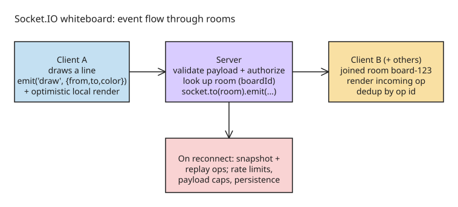

# Real-Time Collaboration with Socket.IO: Syncing Drawing Events Across Users

Two developers work on the same whiteboard from different locations. When one draws a shape, the other should see it almost immediately — no page refresh. That is a **real-time collaboration** problem: capture user actions, send them to a server, and deliver them to the right connected clients.

## Step 1: why polling is not enough

Repeatedly polling a server for new drawing actions adds unnecessary requests and latency. WebSockets provide a persistent, **bidirectional** channel; Socket.IO builds on that with **event-based communication, reconnection handling, and rooms**. Note Socket.IO is not identical to the raw WebSocket protocol — it may use different transports depending on connection and configuration.

## Step 2: architecture

Three parts:

- **Client** — captures drawing input, renders the canvas
- **Server** — receives events, decides which clients get them
- **Rooms** — group users collaborating on the same board

Event flow:

1. A user draws a line in the browser
2. The client emits a drawing event with the necessary data
3. The server validates the event and identifies the relevant room
4. The server broadcasts the event to the other users in that room
5. Those clients render the incoming drawing operation

This separates local interaction from communication, which makes the system easier to reason about.

## Step 3: connect a client

```bash
npm install socket.io socket.io-client
```

```js
import { io } from "socket.io-client";

const socket = io("http://localhost:3000");

socket.on("connect", () => {
  console.log("Connected:", socket.id);
});
```

In production: use the configured backend URL (not hardcoded localhost), set appropriate CORS, and use secure transport.

## Step 4: rooms isolate collaboration

Many boards can exist; users on one board must not receive events from another:

```js
io.on("connection", (socket) => {
  socket.on("join-board", (boardId) => {
    // Validate boardId and authorize access FIRST.
    socket.join(boardId);
  });
});
```

Never treat an arbitrary board ID as proof of permission — validate the input and check authorization before joining.

## Step 5: broadcast drawing events

Send a small structured **operation**, not the whole canvas image:

```js
// client
socket.emit("draw", {
  boardId: "board-123",
  from: { x: 10, y: 20 },
  to: { x: 30, y: 40 },
  color: "#222222",
  width: 3,
});
```

```js
// server
socket.on("draw", (payload) => {
  // Validate payload and authorize board access here.
  socket.to(payload.boardId).emit("draw", payload);
});
```

The server must verify the socket joined that board and that every coordinate/style value is valid before broadcasting. The originating client can **draw locally for responsiveness** while remote clients render the broadcast — *optimistic local rendering*.

## Step 6: real-world edge cases

- **Reconnection** — a disconnected user misses events; reconnecting the socket alone does not restore them. Define a recovery strategy: fetch a saved board **snapshot** and replay operations that happened after.
- **Ordering and duplicates** — rapid drawing generates many events; attach operation IDs or sequence numbers, and make receivers handle duplicates safely (idempotent).
- **Performance** — an event per raw mouse movement is too much traffic. Throttle, batch, simplify stroke points, limit payload sizes.
- **Security** — validate every event server-side; apply board-level authorization, rate limits, payload size limits. **A room name is not an access-control mechanism.**
- **Persistence** — live broadcasting does not save anything. New participants need persistent operations or a saved board snapshot.

## Step 7: test a collaborative whiteboard

1. Open the same board in two browser tabs; draw from one, verify the other receives it
2. Open a different board; confirm unrelated events are **not** delivered
3. Disconnect one client, reconnect, verify recovery behavior
4. Test malformed events, unauthorized board IDs, and unusually large payloads

Treating recovery, ordering, performance, access control, and persistence as part of the architecture (not afterthoughts) is what separates a demo from a production collaborative app.



## References

- [Real-Time Collaboration with Socket.IO: How to Sync Drawing Events Across Multiple Users (DEV.to)](https://dev.to/sachin_rajput_1361bca0230/real-time-collaboration-with-socketio-how-to-sync-drawing-events-across-multiple-users-470g)
